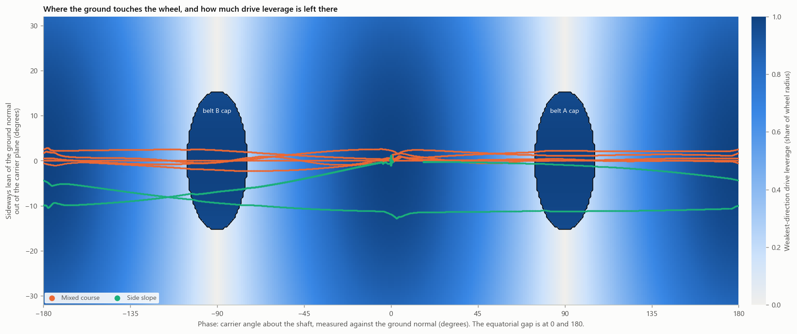
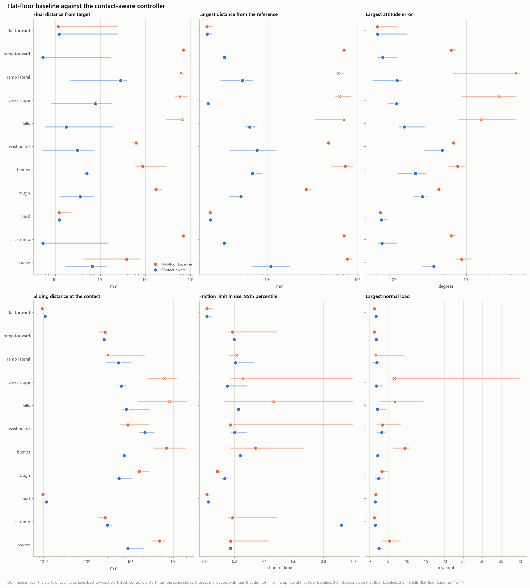
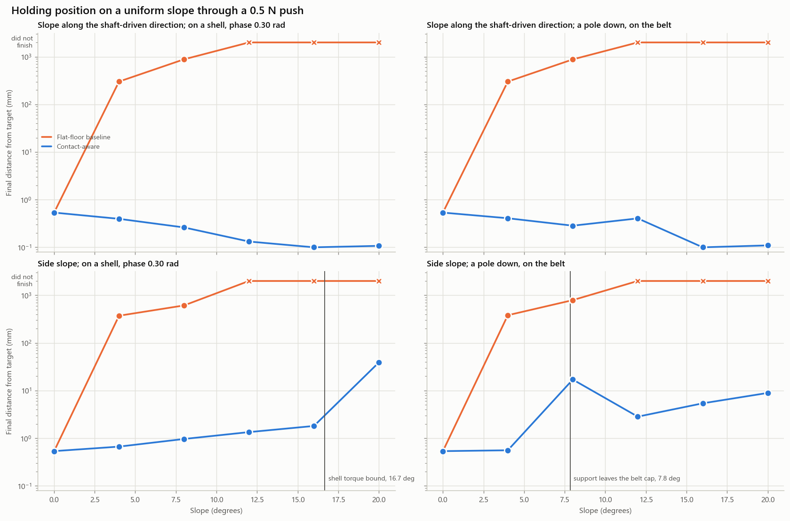
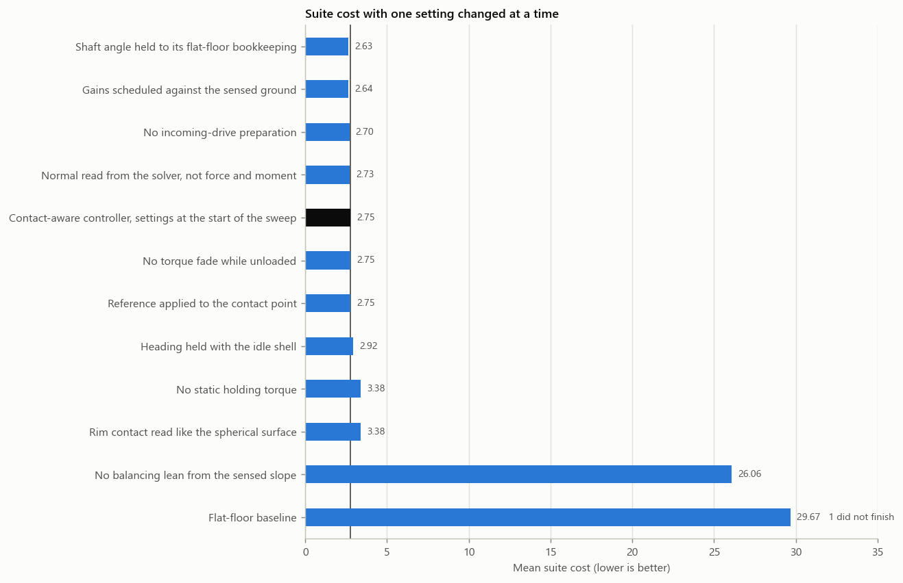
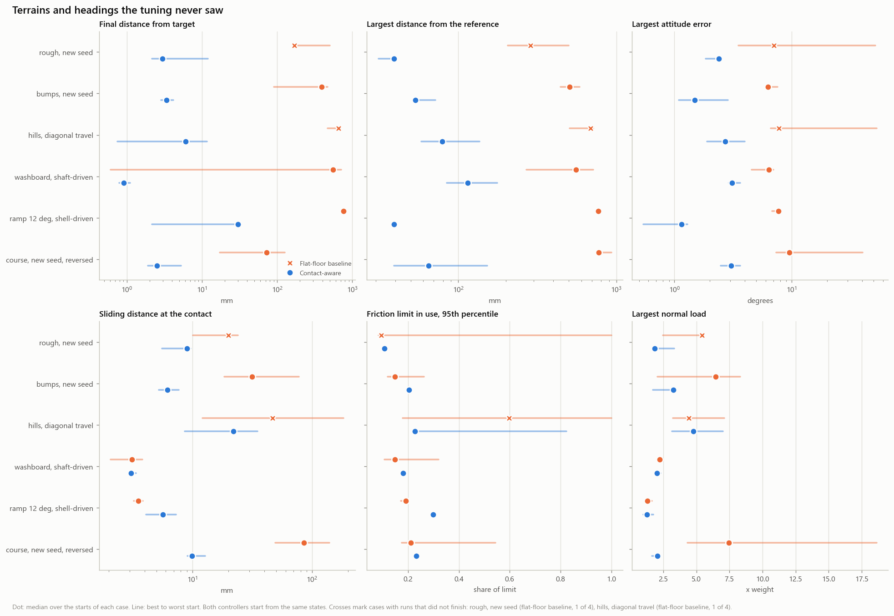

# Uneven ground: contact model, contact-force feedback and results

This adds smooth uneven terrain to the simulation, a controller mode that reads the ground reaction at the wheel, and the analysis that compares it with the existing flat-floor controller. Everything here is simulation of the same provisional model: assumed masses, friction and actuator bounds, ideal belt speed servos, and simulator ground truth for the state and the contact force.

**Headline.** Eleven terrain scenarios were each run from four starting positions on the wheel, 44 runs per controller. The contact-aware controller finished all 44; the flat-floor controller finished 38 and fell in 6. On the nine scenarios with uneven ground the contact-aware controller ended a median of 0.5 to 28 mm from its target, against 39 to 701 mm for the flat-floor controller. On level ground the two are indistinguishable. On six further cases the tuning never saw, the contact-aware controller finished 24 of 24 and the flat-floor controller 22 of 24.

**What makes the difference.** One thing dominates: leaning so the centre of mass is over the contact point the force measurement reports. Removing that lean alone raises the suite cost from 2.8 to 26, close to the flat-floor controller's 30, and a lean 10% too small or too large is measurably worse. Feeding the holding torque forward, handling the shell rims, and a fast filter on the sensed normal each help by a smaller, still measurable, amount. Everything else that was tried is within run-to-run scatter.

**Where it stops.** On a strip that needs more friction than the ground has, the wheel slides and falls. A side slope steeper than the loaded shell's torque bound (16.7 degrees) cannot be held. Worst-case tracking error varies by more than a factor of two with where surface handovers happen to fall, so medians over several starts are the figures to trust.

## Run it

From the repository directory, with the environment from the README. On Windows use `.venv\Scripts\python.exe`; on Linux `.venv/bin/python`.

```bash
python -m spherical_wheel offroad limits                    # static slope figures of the declared model
python -m spherical_wheel offroad run --scenario course     # one run: rollout, summary, figure, rendered still
python -m spherical_wheel offroad run --scenario course --controller momentum_observer   # the same without force sensing
python -m spherical_wheel offroad replay --scenario course  # MP4 of both controllers side by side
python -m spherical_wheel offroad suite                     # every scenario, both controllers, four starts each
python -m spherical_wheel offroad envelope                  # holding position on steeper and steeper slopes
python -m spherical_wheel offroad holdout                   # terrains and headings the tuning never saw
python -m spherical_wheel offroad tune                      # the tuning sweep
```

`run` and `replay` accept any scenario name from the suite table below, and `run` accepts `--controller flat_baseline` or `--controller momentum_observer`. Batch actions use worker processes (`--workers N`); results are identical for any worker count. Output goes to `results/offroad/`, and generated models to `generated/offroad/`, which is not tracked. On this 8-thread machine with six workers the suite takes about 12 minutes, the held-out set 8, the envelope 2 and the tuning sweep 25. A headless Linux machine needs `MUJOCO_GL=egl` for the rendered still and the replay; the runs themselves need no display.

The tests are in `tests/test_offroad_ground.py` (the ground model against closed-form mechanics), `tests/test_offroad_control.py` (sensing and the controller against the baseline) and `tests/test_momentum_observer.py` (the force-free sensing below).

## What a slope does to this wheel

**The lean is nearly as large as the slope.** A sphere on a grade touches the ground uphill of its centre, by the wheel radius times the sine of the slope. To stand still, the whole machine's centre of mass must be over that contact point. The upper body is 1.2 kg at 0.191 m above the wheel centre and the wheel radius is 0.12 m, so the body must lean 0.97 degrees from vertical per degree of slope. A machine with a small wheel under a tall body barely leans on a slope; this one leans almost as far as the ground does.

**Standing on a slope costs torque.** The weight (18.2 N) acting through the offset contact point loads the drive that rolls in that direction: 0.38 N m on the shaft for a 10 degree grade, or the same on the loaded shell for a side slope, scaled by the cosine of the carrier phase.

**On a side slope the support point leaves the great circle.** On level ground the support point stays on one great circle of the wheel as the carrier turns, so a single angle (the phase) says which surface is down. On a side slope the lean and the slope add, and the support point moves sideways off that circle by about twice the slope. The polar belt cap has a half-angle of 15.5 degrees, so with a pole down a side slope of more than 7.8 degrees carries the support point off the cap onto the shell beside it. Exactly on the pole line a shell there moves the contact the same way the shaft does and nothing drives the wheel sideways; a little off that line the shell regains a short lever.

Static figures from `offroad limits`:

| Figure | Slope | What sets it |
| --- | --- | --- |
| Friction | 35.0 deg | tan(slope) equals the nominal coefficient 0.7 |
| Shaft torque, slope along the shaft-driven direction | 43.2 deg | holding torque equals the 1.5 N m bound |
| Shell torque, side slope at the initial phase 0.30 rad | 16.7 deg | holding torque equals the 0.6 N m bound |
| Belt cap, side slope with a pole down | 7.8 deg | slope plus lean equals the cap half-angle |

The first three bound what any controller can hold at rest. The fourth is where the belt stops covering the pole; it is not a holding limit, and the envelope runs below hold position beyond it. All four inherit the assumed masses and bounds in `config/model.yaml`.



The map shows the leverage the loaded drives keep in their weakest direction at every support point. The horizontal axis is the phase; the vertical axis is how far the ground normal leans sideways out of the carrier's plane. Level ground is the horizontal line through zero. The pale vertical bands at plus and minus 90 degrees are the pole singularity, and the dark ovals are the belt caps that cover it only near the centre line. The dots are where the support point went in two saved runs.

## The ground model

`terrain.py` describes the ground as a height field built from closed-form features: planes, constant-grade ramps with blended ends, sums of sine waves, and Gaussian mounds or hollows, each optionally limited to a window. Height, gradient and Hessian are exact at any point, so no grid resolution enters the physics. A separate map gives the friction coefficient under the wheel.

`offroad.py` puts the existing plant on that ground. The flat-floor contact in `contact.py` already evaluates which shell or belt patch is down along the floor plane's own normal. The terrain plant moves that plane onto a mocap body and, before every physics step, poses it as the tangent plane of the terrain at the surface point nearest the wheel centre. MuJoCo then solves the same unilateral, finite-friction contact as on the flat floor, with the local normal, contact point, penetration and friction of the ground under the wheel. No force is added anywhere.

For a sphere on a smooth surface this reproduces the contact point, normal and penetration exactly at each step. It is wrong for anything that needs two simultaneous contacts: a step, a rut narrower than the wheel, a rock field. The condition is that every valley in the terrain is wider than the wheel, measured as a concave curvature radius above 0.12 m. `Terrain.audit` computes that radius and a test holds every preset to it with a 15% margin. The fork and platform collide with the same plane, which is enough to detect a fall and nothing more. The displayed height field is visual only.

Checks of the ground model against closed-form results, on a plain solid sphere using the plant's own ground routine:

| Check | Expected | Test tolerance |
| --- | --- | --- |
| Rolling down a 10 deg plane | acceleration (5/7) g sin(slope) | 1% |
| Normal and friction force while rolling | m g cos(slope) and (2/7) m g sin(slope) | 1% and 2% |
| Sliding where friction is too low to roll (mu 0.05) | acceleration g (sin - mu cos), force ratio mu | 1% |
| Rolling in a valley of 0.5 m radius | period 2 pi sqrt(7 (0.5 - R) / (5 g)) = 1.46 s | 1% |
| Level terrain against the flat plant | identical states | bit-identical over 600 physics steps |
| Displayed height field against the analytic ground | same height | 0.5 mm |

The valley period depends on the curvature, which enters only through the plane moving between steps, so that check covers the part of the method that is not exact by construction.

One artefact to know about: MuJoCo's soft friction lets a body resting on a slope creep at a fraction of a millimetre per second. The saved runs show about 2.5 mm of contact sliding over 15 s on an 8 degree grade for either controller. It is the contact model, not the wheel slipping.

## Reading the ground from the contact force

`contact_sensing.py` reads the solved wheel-ground contact each controller interval: the net force on the wheel, its moment about the wheel centre, the load on each shell and belt, the friction coefficient in effect, and how fast the loaded surface is sliding over the ground.

**The ground normal comes from force and moment alone.** A point contact on a sphere of radius R exerts the moment `M = -R n x F` about the centre, which fixes the normal `n` once `F` and `M` are known. A six-axis load cell at the wheel hub measures exactly that pair, so the slope under the wheel is observable without a map or a rangefinder. On the spherical surfaces the estimate matches the true ground normal to about 0.001 degree, and the tuning sweep found no benefit from replacing it with the solver's own normal. In simulation the pair comes from the solver. Sensor noise, bias, and the inertial loads a real hub cell would also read are not modelled.

**On the shell rims the same estimate means something else.** Crossing the 20 mm equatorial gap the wheel rides on one rim, then both, then the other, each up to 10 mm from where a sphere would touch. The force-and-moment normal then points from the rim contact to the wheel centre and swings by up to 4.8 degrees along the carrier axis within one crossing. The rims in this model are also 48-sided, so the contact wanders across the axis by a few millimetres as a shell turns. The carrier angle against the current estimate says when the support is in the gap, and there the estimate's filter is slowed (0.02 s to 0.2 s).

**Resting on both rims, the axial part is held.** Two rims are a stable two-point base, and how the load divides between them depends on where the body leans. Following the measured normal there is a slow positive feedback: the body leans toward one rim, that rim takes more load, the apparent slope grows, and the wheel ends up tipped onto one rim on level ground. An earlier run of the cross-slope scenario showed exactly that after stopping in the gap, so the part of the estimate along the carrier axis is held while both rims carry load and the wheel is at rest.

**Friction is learned only from sustained sliding.** The estimate starts at the nominal coefficient and drops to the measured force ratio when the loaded surface has slid for 30 ms. A single sliding sample during a surface handover is ignored, because the force at that instant is well inside the friction limit and says nothing about the limit. The estimate is reported in every run and does not limit any command; see below for why.

## Without a force sensor: `momentum_observer`

`terrain_aware` reads the force and moment from the contact solver, and the robot has no sensor that measures them. The `momentum_observer` mode is the same controller, with the same gains and settings, where that pair is estimated from the motion instead.

**What it estimates.** The drive motors push between the wheel, the carrier and the fork, so their torques cancel for the machine as a whole. Only gravity and the ground change its total momentum. Each 5 ms controller interval, `MomentumObserver` (in `contact_sensing.py`) computes the generalized momentum `M(q) v` from the state and the model and takes its change over the interval. It subtracts what the drive torques, gravity, Coriolis forces and joint damping account for, using the trapezoidal rule over the interval. The free joint's rows of what remains are the net external force on the machine and its moment about the wheel centre. They are rotated to the world frame and smoothed by a first-order filter at 100 rad/s (`observer_cutoff_rad_s`, a 10 ms time constant). This is the generalized-momentum disturbance observer of De Luca and Mattone (2003). Nothing is trained or fitted.

**Everything after it is unchanged.** The estimated pair goes through the same normal from force and moment, the same filter, lean and holding torque. At reset the observer starts from the static balance of the current state, so the starting slope is found without being told the terrain's normal. Standing still, the force alone is the weight and says nothing about the slope; the slope shows up in the moment, because the wheel touches the ground uphill of its centre.

**Checks** (`tests/test_momentum_observer.py`):

- The mass matrix, bias forces, damping and drive map it uses reproduce MuJoCo's own step to 1e-12 when evaluated with the integrator's rule.
- In the air, with random drive torques, it recovers a known push on the body to within 0.02 N and 0.005 N m.
- On hills, bumps and washboard it reproduces the contact impulse MuJoCo applied over each interval: median force error under 1e-4 N, worst under 5e-3 N.
- Standing on an 8 deg grade, a 6 deg side slope and a 10 + 5 deg slope, it finds the slope within 0.05 deg.
- Corrupting every solved-force field the controller could read leaves its commands bit-identical.
- It climbs the 8 deg ramp as well as `terrain_aware`.

The suite, envelope and held-out set below have not been run with it. In Gazebo on the Mars yard it finished 13 of 15 routes against 14 of 15 for `terrain_aware` from one start each (GAZEBO.md).

**What it does not remove.** It still needs the full state, including the base's linear velocity, which hardware would have to estimate. The per-surface loads used for gain blending and rim detection, the contact points of the rolling feedforward and the incoming-drive preview still come from the simulator. A push on the body reads as ground force while it lasts. Its slip speed is reported as zero, so the friction estimate stays at the nominal coefficient. It has not been tested with sensor noise, bias or delay, or with model parameters that differ from the plant's.

### Estimated-contact correction diagnostics

See the [iteration log](ITERATION_LOG.md) for the hypothesis/change/result/decision
sequence, including rejected candidates, and the
[presentation notes](docs/iterations/2026-11-25/README.md) for preserved evidence.

The subsequent [configuration/continuity study](docs/iterations/2026-11-25/configuration-study/README.md)
maps 17,739 kinematic configurations and eight requested travel directions,
then compares the existing controllers in 40 short Gazebo cases. It shows
direction-dependent feasibility and contact/feedback discontinuities; it does
not introduce a new weight law or establish improved closed-loop performance.

The separate `hardware` mode uses `StateMirror` and `SupportLocator` to estimate
contact locations and load shares as well as the net wrench. It reads no solved
contacts or terrain during control. Its current simulation inputs are still exact
body pose/velocity, joint angles/rates, and ideal applied drive inputs. The name
does not imply that a physical robot or a sensor-estimation pipeline has been tested.

`run_offroad(..., record_diagnostics=True)` in this mode adds estimated contact
points/load shares, drive-rate references, the LQR and feedforward command
contributions, transition corrections, clipping, and rolling-consistency signals.
The components sum to the requested command; clipping explains the applied command.
`reference_qvel` is the allocator's velocity reference; `feedback_reference_qvel`
also contains the vertical velocity added for tracking along the estimated slope.
The option does not change the controller's commands. Existing contact-force,
point, load and slip columns remain simulator truth used only by the evaluator.

Rolling consistency compares tangential body velocity with the velocity predicted
from the measured body rotation, joint rates, estimated contacts and the preceding
interval's applied belt speeds. It does not compare desired and actual speed.
The load-weighted RMS of individual contact residuals preserves opposing slip that
could cancel in a vector average. A mismatch over 0.02 m/s is labelled kinematic
inconsistency, not proof of slip or an incorrect radius. Invalid/unloaded estimates
are marked explicitly. Previous-interval saturation flags contextualize these
measurements; current-command saturation flags describe the upcoming interval.

Inside the Gazebo environment described in [GAZEBO.md](GAZEBO.md):

```bash
MUJOCO_GL=egl python scripts/run-contact-diagnostics.py --output results/contact_diagnostics/baseline
python -m spherical_wheel.contact_diagnostics results/contact_diagnostics/baseline/plain_figure8/phase_+0.90/rollout.npz --output results/contact_diagnostics/events
```

The study uses the existing figure-eight at phases +0.30, +0.90 and -1.00 rad,
plus triangle and out-and-back regressions. It blocks simulator contact APIs
during each controller call and writes annotated correction-event plots.

`OffroadParams(rolling_allocation='damped', rolling_damping_m_s=.01)` is an
opt-in allocation experiment, also selected by the script's `--variant damped`.
It adds a least-squares penalty on normalized drive rates to prevent nearly
singular contact Jacobians from requesting extreme opposing rates. The existing
scales (5 rad/s for joints, 0.3 m/s for belts) are preferences, not asserted motor
limits. The default remains `least_squares`: damping removes numerical spikes
but did not consistently improve trajectory tracking across the tested phases.

`OffroadParams(rolling_allocation='bounded')` is a second opt-in experiment.
It minimizes estimated-contact velocity error, normalized drive-speed demand,
and changes in those drive references using bounded least squares. Contacts
are weighted by their estimated load share. The normalization stays at
`(5, 5, 5, .3, .3)`; the effort and change coefficients both default to
0.001 m/s per normalized unit and can be set with `rolling_effort_m_s` and
`rolling_change_m_s`. Weak drive directions need larger rates to achieve the
same velocity, so the effort cost naturally permits more error there.

The declared simulation **reference** speed limits are `(20, 20, 20, .3, .3)`
in rad/s for the shaft/shells and m/s for the belts. Reference acceleration
limits are `(100, 100, 100, 3, 3)` per second, including starting, stopping
and contact changes. A brief unloaded interval holds the last references.
The 20 rad/s choice matches the existing incoming-shell preview ceiling;
the acceleration limits are experimental assumptions. These are configurable
through `rolling_speed_limits` and `rolling_acceleration_limits`, not identified
motor capabilities. Actual joint speeds can exceed the reference ceilings.
The balance LQR, holding torques, synchronization and final actuator bounds
remain in place; final torques and belt commands are not slew limited by this
allocator. Drive-speed cost is a proxy for command demand, not electrical
energy or torque effort. The timed path reference is unchanged in this trial.

```bash
MUJOCO_GL=egl python scripts/run-contact-diagnostics.py --variant bounded --output results/contact_allocation/bounded
python scripts/compare-contact-allocation.py --baseline results/contact_diagnostics/baseline --candidate results/contact_allocation/bounded --output results/contact_allocation/comparison
```

The optional diagnostics include allocated drive references, limits, active
bounds, cost coefficients, and the residual velocity the allocation cannot
match. Keep the default allocator until comparisons establish the desired
tracking-versus-demand tradeoff.

For a geometry-dependent cost, set `rolling_adaptive_effort=True` with the
bounded allocator, or add `--adaptive-effort` to the study command. Let `s`
be the smaller singular value of the normalized, load-averaged horizontal
contact Jacobian. The speed-cost coefficient is
`base + (weak - base) * threshold**2 / (s**2 + threshold**2)`.
Defaults are base 0.001, weak 0.005, and threshold 0.02 m/s per normalized
unit. These are tunable via `rolling_effort_m_s`, `rolling_weak_effort_m_s`,
and `rolling_authority_m_s`. This raises the penalty smoothly near aligned
drive directions or vanishing levers using estimated geometry alone. It
does not select weights by route name. Diagnostics record `s`, the blend,
and the coefficient actually used. The common-translation authority measure
does not certify that all constraints in a general multi-contact situation
can be satisfied.

The focused Gazebo comparison on 2026-11-25 ran a fresh baseline and three
bounded variants on the same five cases. All 20 runs completed; each setting
passed all existing acceptance gates on only one of its five cases. Moving
RMS errors in millimetres were:

| Case | Existing | Fixed cost .001 | Fixed cost .005 | Geometry-adaptive .001–.005 |
| --- | ---: | ---: | ---: | ---: |
| Figure-eight, +0.30 rad | 57.0 | 51.8 | 62.7 | 60.7 |
| Figure-eight, +0.90 rad | 50.5 | 67.6 | 46.2 | 55.5 |
| Figure-eight, -1.00 rad | 41.3 | 38.6 | 38.8 | 77.1 |
| Triangle, +0.30 rad | 24.4 | 23.8 | 35.2 | 23.4 |
| Out-and-back, +0.30 rad | 34.0 | 30.0 | 33.5 | 33.9 |

All bounded variants respected their reference speed and acceleration bounds.
The fixed .005 cost reduced the difficult +0.90 run's largest joint reference
from 1760.5 to 2.1 rad/s and peak position error from 190.9 to 85.3 mm, but
increased the triangle's peak error from 68.8 to 166.2 mm. Adaptive weighting
recovered triangle tracking but regressed the -1.00 figure-eight. Reference
bounds also did not prevent an unloaded shell from reaching 44.3 rad/s in the
first fixed-.001 trial. No variant consistently improved tracking and attitude,
so `least_squares` remains the default and the broader suite was not used to
qualify these candidates. These are single runs per setting; small Gazebo
numerical differences can change later handovers.

Raw logs, source hashes, input audits, comparison JSON/CSV/plots and videos are
in `results/weighted_allocation_20261125/`. Reproduce the stronger fixed-cost
trial with `--variant bounded --effort-weight .005`; the adaptive trial uses
`--variant bounded --adaptive-effort`. The controller's timed reference path
was identical across settings, so these results do not hide tracking error by
slowing the requested trajectory.

In the adaptive -1.00 regression, the onset at 28.975 s had only about
0.0000006 m/s allocation residual and no active allocation bounds. The estimated
support switched shell/belt 18 times over 28.900–29.385 s, alongside large
attitude/velocity feedback corrections and clipped belt commands. This is
evidence to inspect contact-transition/gain-blending continuity; it does not
establish that remaining allocation infeasibility or position error caused
the excursion. Event evidence is saved with the adaptive comparison.

`tests/test_multicontact_diagnostics.py` includes real Gazebo fixtures for two
loaded rims and two contacts in a V-groove. The latter supplies the exact net
wrench to isolate the locator's equivalent-support limitation. These fixtures
do not establish closed-loop traversal of general multi-contact terrain.

### Experimental feasible motion reference

`OffroadParams(rolling_allocation='feasible')` adds direction-dependent drive
costs and a feedback motion reference consistent with the bounded allocation.
It addresses common-shaft/hemisphere alignment at a single contact, which can
occur without a shell/belt handover. It retains the existing gain-scheduled
LQR and holding torques. **This is an implemented, tested prototype; trajectory
regressions prevent promotion.** The default remains `least_squares`.

For the normalized, estimated-load-averaged horizontal contact Jacobian
`A = J S = U diag(sigma) V.T`, each drive-space mode receives the smooth cost
`lambda_i = base + (weak-base)*threshold²/(sigma_i²+threshold²)`. The drive
nullspace receives `weak`. Defaults are base .001, weak .005, change .001,
threshold .02, with the same reference speed/acceleration bounds as `bounded`.
Unlike the scalar adaptive trial, this can relax a poorly driven direction
while retaining a useful direction. These are geometric speed costs, not
identified motor torque/current or energy costs.

After solving, the accepted horizontal body velocity is `-J @ drive_reference`.
This velocity enters feedback. A smooth geometric response
`P = U diag(sigma²/(sigma²+lambda²+change²)) U.T` also projects position error
and nominal acceleration. `P` describes unconstrained modal response; it is
not the derivative of the bounded solution. Acceleration is projected nominal
lean feedforward, not the exact derivative of accepted velocity. With several
estimated contacts, the accepted velocity matches their weighted mean; it
need not satisfy every contact. `allocation_reference_residual_rms_m_s` records
the remaining per-contact discrepancy. None of this certifies friction or
dynamic feasibility or agreement with measured motion.

The original timed path and destination stay in the evaluator. The candidate
uses projected position error capped by `rolling_reference_position_limit_m`
(default .05 m), plus a projected catch-up request with gain
`rolling_reference_catchup_gain_s_inv` (1/s) and speed cap
`rolling_reference_catchup_speed_m_s` (.06 m/s). Zero gain disables catch-up.
The nominal goal remains available when authority returns. There is no
autonomous reconfiguration or guarantee of reaching a permanently blocked goal.
During missing contact estimates, drive references hold but the accepted body
velocity is zero and its validity flag is false.

An optional `rolling_reference_balance_guard=True` scales travel setpoints by
`1/(1+((lean_error + horizon*lean_rate)/scale)⁴)`, with scale 3° and horizon
.1 s. It leaves gains and holding torques in place; it is not a stability
certificate. The trial with this guard improved some attitude peaks but
increased original-path moving RMS versus the fresh LS baseline in all five
tested cases.

```bash
MUJOCO_GL=egl python scripts/test-fixed-contact-allocation.py --output results/new_feasible/fixed_support
MUJOCO_GL=egl python scripts/run-contact-diagnostics.py --variant feasible --output results/new_feasible/initial
MUJOCO_GL=egl python scripts/run-contact-diagnostics.py --variant feasible --position-error-limit 1 --output results/new_feasible/wide_position
MUJOCO_GL=egl python scripts/run-contact-diagnostics.py --variant feasible --position-error-limit 1 --balance-guard --output results/new_feasible/balance
```

Use the Gazebo environment above for trajectory runs. The fixed-support fixture
is synthetic kinematics and does not execute physics or LQR. On 2026-11-25,
its 14 assertions passed. A fresh five-case baseline, three five-case candidate
families and three targeted ablations produced 23 completed Gazebo route
executions, but no consistently better candidate. The initial candidate reduced
moving RMS on four cases and regressed +0.90 to 161.6 mm versus 50.5 mm baseline.
A 1 m position cap helped that case but regressed +0.30 and out-and-back.
Reference bounds passed, while actual joint speeds still exceeded reference
caps. See [I-17–I-21 and the presentation evidence](docs/iterations/2026-11-25/fixed-contact-allocation/README.md)
for every setting, retained regression, test scope and videos. These results
verify reference handling under stated geometry, not an overall robot-level fix.

The later [targeted support-information probe](docs/iterations/2026-11-25/support-identity-probe/README.md)
revisits one shell/belt disagreement with saved-state command calculations and
four matched Gazebo runs. Last-1-ms support labels differ in timing from the
observer's filtered 5-ms wrench. Feedback-only true-share substitutions and a
complete valid true-contact-record substitution are confined to a declared
late window; none resolves the excursion. These are diagnostic input ablations
in [probe-support-identity.py](scripts/probe-support-identity.py), not new
controller modes or robot-measurable input sources. Core control and defaults
remain unchanged. The comparison retains original-path, attitude and endpoint
metrics, warm-prefix checks, source versions and failed trials.

### Experimental predictive balance control

The [MPC investigation](docs/iterations/2026-11-25/mpc-balance/README.md) implements
a private estimated-plane dynamics predictor and bounded finite-horizon control
in `predictive_model.py` / `predictive_control.py`. It plans three motor torques
and two ideal belt surface speeds. It does not read live simulator contacts or
terrain; the existing observer/locator supplies support estimates. Private
predicted contacts are part of its model, not measured ground truth.

Use the separate [experiment runner](scripts/run-mpc-comparison.py); no existing
`OffroadParams` mode/default is changed. The optional dependency is installed
with `python -m pip install -e '.[mpc]'` inside the Gazebo environment. The
initial affine and later trajectory-relinearized variants retain original
goals and explicit fallback/model/solver diagnostics. Accepted nonlinear plans
and solved QPs are counted separately. Input bounds are hard; state/tilt and
slew penalties do not establish hard safety or stability guarantees.

In the two 5.4 s warm-start tests, final trajectory MPC improves peak lean error
from 9.36° to 1.72° (initially weak Y) and 1.39° to .84° (strong X), with no LQR
fallback. Final original-goal errors remain 24.97 and 8.16 mm for a 16 mm request,
failing the declared 5 mm criterion. Typical planning costs 1.6–2.0 s per .02 s
simulated update, so this is an offline prototype. No broader Mars qualification
or default promotion is claimed. Earlier failed candidates and source stages
are preserved in I-27–I-30.

The [I-31 rest-goal audit](docs/iterations/2026-11-25/mpc-equilibrium/README.md)
adds tested optional input-reference and augmented-terminal costs, but does not
activate them in a new controller. None of five local fitted rest targets
passes the declared hold gates. Two separate fixed-input target pairs also
drift in Gazebo. A terminal value around a verified equilibrium was therefore
not derived or tested in closed loop; this failed prerequisite and its sources,
repeated diagnostics and video are retained for presentation.

The [I-32–I-33 feedback follow-up](docs/iterations/2026-11-25/feedback-recovery/README.md)
then tests recovery directly: unchanged native LQR/feedforward settles at
0.381 mm after the demonstrated drift, versus 31.215 mm for current MPC after
eight seconds. A bounded offline sequence has about 196 times lower cost than
the first selected MPC plan under the same objective, exposing a local-search
limitation at that anchor. This does not demonstrate a deployable seed fix.
Longer original LQR trajectories expose a separate late contact-transition
failure. Defaults and estimator remain unchanged; no particle filter is added.

The [I-34 MPC investigation](docs/iterations/2026-11-25/mpc-search/README.md)
then adds an optional predicted-native seed and configurable refinements. The
seed uses cloned present observer/controller history, not saved future inputs.
Initial modeled cost improves sharply, but live final error remains 28.982 mm
and fails settling. Sparse derivatives and short-horizon attitude/tracking
tradeoffs are measured separately. MPC already uses observer-derived current
contact and predicts geometry-based future contacts on a fixed local plane;
unknown terrain and general multi-surface uncertainty remain outside this model.
The [I-37 saved-video review](docs/iterations/2026-11-25/mpc-return-review/README.md)
qualifies the settling result: both original and seeded MPC are steadily
returning near the end. Failing the eight-second window does not establish
inability to return. The [I-38 unchanged extension](docs/iterations/2026-11-25/mpc-extended-return/README.md)
reaches 2.936 mm at 10.755 s, then retreats and ends 19.100 mm away at 16.4 s. There is
no full-second settled hold; added-interval support stays shell A in truth and
estimate without handovers or command saturation. This narrows the observed
problem to holding the recovery, without establishing its cause.

The [I-40 LQR forecast audit](docs/iterations/2026-11-25/lqr-contact-forecast/README.md)
then keeps native 5 ms LQR unchanged and evaluates 113 fine-feedback private
forecasts across eight fresh trajectories, including the Mars figure-eight.
Four of seven controlled cases settle; Mars fails its existing route gates.
At 200 ms, uniform motion-error p95 improves from 12.48 mm constant-velocity
to 5.47 mm dynamic, while dominant-patch accuracy is 92/96 versus 93/96 for
observer persistence. Twelve current-load fits miss tolerance and computation
takes 270 ms median, so predictions do not change actuation. The authoritative
report retains a corrected warning-aggregation stage and the failed forecast
example; no general multi-contact or real-time capability is established.

The [I-41 figure-eight event audit](docs/iterations/2026-11-25/figure8-event-audit/README.md)
locates the first sustained 20 mm local-path departure at 6.860 s amid changing
terrain, transient shell/belt disagreements and belt clipping. Private model
error persists with hindsight actual commands; the unused dynamic forecast
cannot cause the live drift. One same-reference flat run tracks better overall
but changes initial balancing as well as terrain, so local slope causality is
unresolved. The first Mars turn is delayed without geometric overshoot; later
turns and the flat comparison show genuine overshoot. No controller fix is
claimed; exact sources, negative evidence and an annotated video are retained.

The [I-42 four-arm diagnostic](docs/iterations/2026-11-25/handoff-factorial/README.md)
then replaces only feedback support shares, masks incoming-drive preparation,
or applies both during 4–10 s. All four first depart at 6.860 s with essentially
unchanged early errors. The mask improves later moving RMS to 41.68 mm and
passes existing route gates in one run, but fails the declared early-error
screen and worsens four of six turn overshoots. These results do not justify
a default change or rule out contact geometry/rolling feedforward, which the
feedback-share diagnostic leaves native. All sources and corrections remain
preserved; the hardware-facing candidates still need separate validation.
The secondary command audit instead finds large common attitude/rate feedback
on the correctly identified loaded belt before onset, with changing lean but
zero desired angular rate. An attainable tilt-reference/tilt-rate generator is
a proposed next test, not an implemented fix or reason to weaken balancing.

The [I-43 optional tilt generator](docs/iterations/2026-11-25/tilt-reference/README.md)
implements that test with bounded smooth tilt and consistent actual-body-frame
angular-rate references. Three matched +0.9 Mars runs reduce early local RMS
38.66→29.89 mm and belt demand 0.835→0.491 m/s, but full error against the unshaped
native lean target increases 8.71→13.58° and four turns regress. All complete
without falling with similar absolute platform tilt. The screen fails; no
conditional eight-case expansion or default change occurs. The feature remains
opt-in via OffroadParams.tilt_reference; disabled history replay is bit-exact.

The [I-35 horizon comparison](docs/iterations/2026-11-25/mpc-horizon/README.md)
uses full-stage Jacobians and five refinements at two saved states, with fixed
weights and 20 ms stages. Neither 0.8 nor 1.2 s produces a qualifying return
plan; no new Gazebo trial follows. Long forecasts expose substantial divergence
between the fine-feedback seed and its averaged held-input replay, along with
severe numerical conditioning. These private predictions do not establish that
longer lookahead cannot help or justify replacing the observer.

## What the controller does with it

`offroad_control.py` keeps the flat-floor gain library unchanged and corrects the places where assuming a level floor is wrong. They are listed by how much the tuning sweep found they matter.

1. **Where to lean.** The attitude reference leans so the centre of mass is over the sensed contact point. Without it, the position loop has to supply the lean as a standing error: the flat-floor gains need about 0.7 m of position error to produce the lean for an 8 degree grade. This one decides the outcome.
2. **What torque holds it there.** The static shaft and shell torques that carry the weight through the sensed contact point are fed forward. A test checks them against MuJoCo's own contact Jacobian.
3. **Shaft angle that agrees with position.** Rolling without slip ties position, pitch and shaft angle together. Distance travelled along undulating ground breaks an integrated shaft-angle reference, so the shaft error is taken from the position error instead.
4. **Whether it is on the ground at all.** A handover between surfaces can leave one controller interval with no contact. The gain, load shares and rolling reference of the last loaded interval are kept through it. Torques also fade if the filtered normal load stays below 30% of weight; no run in the tuning sweep reached that.

The reference height and the vertical speed of travelling along the ground are not treated as errors.

Things that were tried and removed, with the reasons:

- **Limiting torque to the friction cone made the wheel fall.** Scaling the torques so their implied tangential force stayed inside an estimated friction limit cut the shaft torque below what holds the wheel on a slope, and the body toppled. A balancing machine's holding torque is not optional. The friction estimate at the time also accepted a single sliding sample, which a rim handover produces while the force is well inside the limit.
- **Freezing the sensed normal in the equatorial gap** left it stale whenever the wheel lingered near the rims or the ground changed under it during a crossing. It is slowed instead, and held only in the one case described above.
- **Falling back to the ordinary-pose gain when unloaded**, as the flat controller does, applied shell gains for one interval while a belt was underneath. In a trace on steep rolling ground that saturated both shell torques at every dropout.

Options that exist and are off, because the sweep found no clear benefit:

- **Scheduling the gains against the sensed ground** instead of vertical (`schedule_on_ground_normal`).
- **Heading hold** (`heading_gain`). A shell that is off the ground is a reaction wheel about the tilted carrier axis, so its motor reaction has a vertical component. Rolling sideways spins the loaded shell about that same axis and turns the platform the other way; counter-spinning the idle shell cancels it. The option holds the starting heading this way. It works, and it does not lower the suite cost.
- **Contact-point reference** (`track_contact_point`). The position reference is applied to where the wheel touches the ground instead of to its centre.

## Results

All numbers below are in `results/offroad/`, written by the commands above. Tables give the median over the four starts with the worst start in brackets.

### Scenario suite

| Scenario | Ground | Travel | Steepest slope under the wheel |
| --- | --- | --- | --- |
| flat forward | level | 1.0 m, shaft-driven | 0 deg |
| ramp forward | 8 deg grade, then a plateau | 1.0 m, shaft-driven | 7.9 deg |
| ramp lateral | the same ramp turned 90 deg | 1.0 m, shell-driven | 7.9 deg |
| cross slope | 6 deg side slope between 0.4 and 1.5 m | 1.8 m, shaft-driven | 6.0 deg |
| hills | rolling ground, 0.55 to 1.3 m wavelengths | 1.8 m, shaft-driven | 9.0 deg |
| washboard | 3 mm ripples every 160 mm | 1.8 m, shell-driven | 6.7 deg |
| bumps | 8 to 14 mm mounds and potholes | 1.8 m, shaft-driven | 10.0 deg |
| rough | band-limited random ground, 8 mm RMS | 1.8 m, shell-driven | 5.1 deg |
| mud | level, friction 0.18 strip | 1.3 m, shaft-driven | 0 deg |
| slick ramp | 8 deg grade with a friction 0.15 strip on it | 1.0 m, shaft-driven | 7.9 deg |
| course | grade up, rough plateau with a friction 0.25 strip, washboard, a mound, grade down | 3.9 m, shaft-driven | 6.9 deg |

Shaft-driven travel rolls the carrier about the common shaft and crosses shell, belt and equatorial-gap supports several times. Shell-driven travel rolls on a shell and stays on it only as long as the heading does not drift. Reference speed is about 0.1 m/s throughout.

| Scenario | Controller | Finished | Final error, mm | Largest error, mm | Largest attitude error, deg | Friction use, 95th pct | Largest normal load, x weight |
| --- | --- | --- | --- | --- | --- | --- | --- |
| flat forward | flat baseline | 4/4 | 1.1 (24.1) | 21 (25) | 0.6 (1.1) | 0.01 (0.05) | 1.4 (1.8) |
| | contact-aware | 4/4 | 1.2 (24.1) | 21 (24) | 0.6 (1.6) | 0.01 (0.04) | 1.7 (1.9) |
| ramp forward | flat baseline | 4/4 | 700.8 (740.8) | 708 (741) | 6.2 (7.3) | 0.19 (0.48) | 1.3 (1.4) |
| | contact-aware | 4/4 | 0.5 (16.6) | 33 (33) | 0.7 (1.1) | 0.20 (0.20) | 1.8 (1.9) |
| ramp lateral | flat baseline | 1/4 | 613.6 (710.5) | 614 (714) | 47.5 (52.8) | 0.21 (0.22) | 1.8 (9.3) |
| | contact-aware | 4/4 | 28.0 (38.2) | 53 (68) | 1.1 (1.3) | 0.21 (0.33) | 2.0 (2.7) |
| cross slope | flat baseline | 2/4 | 586.8 (836.5) | 634 (836) | 27.7 (46.5) | 0.26 (1.00) | 6.6 (39.8) |
| | contact-aware | 4/4 | 7.7 (17.4) | 22 (22) | 1.1 (1.2) | 0.15 (0.28) | 1.8 (3.5) |
| hills | flat baseline | 3/4 | 661.9 (686.0) | 709 (710) | 16.0 (46.7) | 0.46 (1.00) | 6.8 (14.2) |
| | contact-aware | 4/4 | 1.7 (18.9) | 64 (75) | 1.4 (2.7) | 0.23 (0.24) | 2.1 (4.3) |
| washboard | flat baseline | 4/4 | 61.4 (65.8) | 479 (510) | 6.7 (7.2) | 0.17 (1.00) | 3.4 (8.3) |
| | contact-aware | 4/4 | 3.1 (7.3) | 76 (123) | 4.7 (4.9) | 0.20 (0.28) | 3.3 (4.2) |
| bumps | flat baseline | 4/4 | 87.5 (283.3) | 735 (894) | 7.6 (9.6) | 0.34 (0.67) | 9.4 (10.6) |
| | contact-aware | 4/4 | 5.0 (5.2) | 68 (87) | 2.0 (2.8) | 0.24 (0.25) | 2.2 (2.3) |
| rough | flat baseline | 4/4 | 172.3 (226.2) | 269 (303) | 4.2 (4.4) | 0.09 (0.11) | 3.3 (4.8) |
| | contact-aware | 4/4 | 3.5 (7.2) | 50 (52) | 2.5 (2.8) | 0.13 (0.15) | 2.5 (3.5) |
| mud | flat baseline | 4/4 | 1.2 (2.2) | 23 (23) | 0.7 (0.7) | 0.01 (0.01) | 1.7 (1.9) |
| | contact-aware | 4/4 | 1.2 (1.3) | 23 (23) | 0.7 (0.8) | 0.02 (0.03) | 1.5 (2.0) |
| slick ramp | flat baseline | 4/4 | 700.8 (740.8) | 708 (741) | 6.2 (7.3) | 0.19 (0.48) | 1.3 (1.4) |
| | contact-aware | 4/4 | 0.5 (15.0) | 33 (33) | 0.7 (1.1) | 0.92 (0.92) | 1.6 (1.9) |
| course | flat baseline | 4/4 | 38.7 (74.4) | 774 (875) | 8.7 (11.7) | 0.17 (0.43) | 5.4 (7.9) |
| | contact-aware | 4/4 | 6.6 (13.6) | 109 (177) | 3.6 (3.8) | 0.17 (0.19) | 2.6 (3.4) |



Reading the table:

- **Grades.** The flat-floor controller finishes the two ramp scenarios it does not fall on about 0.7 m short. It has no way to produce the 8 degree lean except as a position error. The contact-aware controller tracks through the grade within 33 mm and ends within a millimetre in most starts.
- **The slippery grade is climbed without sliding.** On the friction 0.15 strip the contact-aware controller uses 92% of the friction limit, which is what standing on an 8 degree grade with that coefficient costs (tan 8 deg / 0.15 = 0.94), and tracks as well as on the grippy ramp. The flat-floor controller's low figure there only means it never reached the strip.
- **Level ground is unchanged**, including the 24 mm standing error both controllers show from one start (see Limits).
- **Finishing is not the same as tracking for the baseline.** Its washboard, bumps, rough and course runs finish, but are up to 0.9 m from the reference on the way and bounce: normal loads reach 5 to 10 times weight in the worst start, against 2 to 4 for the contact-aware controller.
- **The sensed normal is accurate.** Over all 44 contact-aware runs its RMS error against the true ground normal is at most 1.5 degrees.

Each first-start run has its own figure, for example [the course with the contact-aware controller](results/offroad/suite/course/terrain_aware/plots.png) and [with the flat-floor controller](results/offroad/suite/course/flat_baseline/plots.png): path, tracking, lean against its reference, sensed against true slope, normal and tangential force, share of the friction limit, drive commands, and which surface carries the wheel.

A replay of both controllers on the course is in [results/offroad/replay/course.mp4](results/offroad/replay/course.mp4), and a still of the contact-aware run on the first grade in [results/offroad/runs/course_terrain_aware/view.png](results/offroad/runs/course_terrain_aware/view.png).

### Holding position on a slope

Each case starts balanced on a uniform slope, takes a 0.5 N push for 0.1 s, and is run for 6 s. Final distance from the target, contact-aware controller:

| Slope | 0 deg | 4 deg | 8 deg | 12 deg | 16 deg | 20 deg |
| --- | --- | --- | --- | --- | --- | --- |
| Along the shaft-driven direction, on a shell | 0.5 mm | 0.4 mm | 0.3 mm | 0.1 mm | 0.0 mm | 0.1 mm |
| Along the shaft-driven direction, pole down | 0.5 mm | 0.4 mm | 0.3 mm | 0.4 mm | 0.0 mm | 0.1 mm |
| Side slope, on a shell | 0.5 mm | 0.7 mm | 1.0 mm | 1.3 mm | 1.8 mm | 39.1 mm, still moving |
| Side slope, pole down | 0.5 mm | 0.6 mm | 17.1 mm | 2.8 mm | 5.4 mm, still moving | 8.9 mm, still moving |

The flat-floor controller holds level ground, ends 0.30 to 0.88 m from its target at 4 and 8 degrees in all four rows, and from 12 degrees drifts more than a metre away in all four.



- Along the shaft-driven direction nothing in this range is a limit; the shaft bound is at 43 degrees.
- A side slope on a shell is held to 16 degrees and not at 20. The static shell torque bound is at 16.7 degrees, so that is the actuator, not the controller.
- With a pole down, holding gets worse once the support point leaves the belt cap at 7.8 degrees, but it does not fail. A hard limit was expected there and the runs do not show one. The final position is 3 to 17 mm from the target, which is consistent with the wheel settling just off the pole line where the shell has a short lever; that was not checked directly. At 16 and 20 degrees it is still creeping at the end of the run.

### What each setting contributes

`offroad tune` varies one setting at a time from the shipped values and runs each candidate on seven uneven scenarios from two starts (14 runs, shortened to 1.1 m of travel). The change in mean cost is paired run by run against the shipped settings; the standard error is of that paired difference.

| Change from the shipped settings | Mean cost | Change | Paired standard error | Better in |
| --- | --- | --- | --- | --- |
| Shipped contact-aware settings | 2.75 | | | |
| No balancing lean (`lean_gain` 0) | 26.06 | +23.32 | 2.17 | 0 of 14 |
| Half the lean (`lean_gain` 0.5) | 13.81 | +11.06 | 1.54 | 0 of 14 |
| Lean 10% too small (`lean_gain` 0.9) | 3.97 | +1.23 | 0.38 | 3 of 14 |
| Lean 10% too large (`lean_gain` 1.1) | 4.48 | +1.74 | 0.29 | 0 of 14 |
| Slow filter on the sensed normal (0.25 s instead of 0.02 s) | 4.65 | +1.90 | 0.50 | 2 of 14 |
| Rims read like the spherical surface (`rim_aware` off) | 3.38 | +0.63 | 0.19 | 3 of 14 |
| No holding torque fed forward (`support_feedforward` 0) | 3.38 | +0.63 | 0.23 | 3 of 14 |
| Normal filter 0.1 s | 3.18 | +0.44 | 0.32 | 4 of 14 |
| Heading held with the idle shell | 2.92 | +0.18 | 0.28 | 7 of 14 |
| Rim filter 0.5 s instead of 0.2 s | 2.87 | +0.12 | 0.16 | 7 of 14 |
| Shaft error left free | 2.80 | +0.05 | 0.15 | 5 of 14 |
| Reference applied to the contact point | 2.75 | 0.00 | 0.19 | 7 of 14 |
| No torque fade while unloaded | 2.75 | 0.00 | 0.00 | 0 of 14 |
| Normal read from the solver instead of force and moment | 2.73 | -0.02 | 0.46 | 11 of 14 |
| No incoming-drive preparation | 2.70 | -0.05 | 0.11 | 7 of 14 |
| Gains scheduled against the sensed ground | 2.64 | -0.10 | 0.21 | 9 of 14 |
| Rim filter 0.1 s | 2.64 | -0.11 | 0.12 | 7 of 14 |
| Shaft angle held to its flat-floor bookkeeping | 2.63 | -0.12 | 0.14 | 9 of 14 |
| Flat-floor controller | 29.67 | | | one run not finished |



- The lean is the result. Its optimum is sharp and sits at exactly the value that puts the centre of mass over the contact point, which is a check on the physics as much as on the tuning.
- Three more settings are worth having: a fast normal filter, the rim handling, and the holding torque.
- Nothing below those rows is distinguishable from zero with 14 runs. That includes two things that were expected to matter, scheduling the gains against the sensed ground and the shaft-error choice, and it includes the existing incoming-drive preparation. The unloaded torque fade never engaged in any run, so its row is exactly zero.
- Reading the normal from the solver instead of from force and moment changes nothing, so the force-and-moment estimate is not what limits performance here.
- No candidate beat the shipped settings by the 5% margin the sweep requires, so nothing was changed. An earlier sweep, on an earlier version of the rim handling, moved the normal filter from 0.04 s to 0.02 s and turned off scheduling against the sensed ground; its files were overwritten by this one.

The cost is one point per term at its reference value: 30 mm RMS error, 100 mm largest error, 20 mm final error, 4 degrees attitude error, a normal load 2 weights above static, and 50 mm of sliding, plus 30 for a run that does not finish. [Per-setting sweeps with error bars](results/offroad/tuning/sweep.png) and every run are in `results/offroad/tuning/`.

### Cases the tuning never saw

| Case | Controller | Finished | Final error, mm | Largest error, mm | Largest attitude error, deg | Largest normal load, x weight |
| --- | --- | --- | --- | --- | --- | --- |
| rough, new random seed | flat baseline | 3/4 | 168.4 (500.3) | 286 (500) | 7.1 (51.7) | 5.4 (5.5) |
| | contact-aware | 4/4 | 3.0 (11.9) | 39 (40) | 2.4 (2.5) | 1.8 (3.3) |
| bumps, new random seed | flat baseline | 4/4 | 390.4 (466.1) | 505 (587) | 6.3 (7.6) | 6.5 (8.3) |
| | contact-aware | 4/4 | 3.4 (4.2) | 53 (72) | 1.5 (2.9) | 3.3 (3.3) |
| hills, travelling diagonally at 35 deg | flat baseline | 3/4 | 655.2 (673.9) | 685 (715) | 7.8 (53.0) | 4.4 (7.1) |
| | contact-aware | 4/4 | 6.0 (11.7) | 79 (137) | 2.7 (4.0) | 4.8 (7.0) |
| washboard, shaft-driven | flat baseline | 4/4 | 555.0 (716.2) | 555 (716) | 6.4 (7.0) | 2.2 (2.4) |
| | contact-aware | 4/4 | 0.9 (1.1) | 115 (177) | 3.1 (3.6) | 2.0 (2.3) |
| 12 deg ramp, shell-driven | flat baseline | 4/4 | 767.1 (767.8) | 770 (773) | 7.7 (8.0) | 1.3 (1.6) |
| | contact-aware | 4/4 | 30.1 (32.1) | 39 (40) | 1.1 (1.3) | 1.3 (1.7) |
| course, new seed, driven the other way | flat baseline | 4/4 | 72.0 (126.2) | 772 (931) | 9.6 (40.1) | 7.5 (18.6) |
| | contact-aware | 4/4 | 2.5 (5.2) | 65 (152) | 3.0 (3.7) | 2.1 (2.3) |



The pattern is the same as on the suite. Two things to note: travelling diagonally over the hills, the contact-aware controller's normal load reaches 7 times weight in one start, as bad as the baseline's; and on the shell-driven ramps it stops about 30 mm from the target in most starts (see Limits). This set also found a bug in the terrain code: a course turned by exactly 180 degrees was being treated as not turned, so its first run showed both controllers on level ground. It is fixed and has a test.

### Beyond the friction limit

`results/offroad/limit_cases/reproduce.py` runs the slick ramp with the strip's friction lowered to 0.12, below tan 8 deg = 0.14, so standing on it needs 117% of the friction available. The contact-aware controller reaches the strip, slides for 0.2 s and 112 mm, and falls at 7.3 s. The friction estimate drops to 0.13 as soon as it is sliding, against a true 0.12. The flat-floor controller never gets to the strip. [The figure](results/offroad/limit_cases/slick_ramp_beyond_friction/terrain_aware/plots.png) shows the tangential force riding the friction limit.

So the friction estimate works, and the controller does nothing useful with it. A machine that backed off the grade when it measured this would not fall; this one does not.

### Half the physics step

`results/offroad/numerical_step_check/reproduce.py` repeats three scenarios at 0.5 ms, with the gain library designed for that step.

| Scenario | Step | RMS error, mm | Largest error, mm | Final error, mm | Largest attitude error, deg | Largest normal load, x weight | Heading change, deg |
| --- | --- | --- | --- | --- | --- | --- | --- |
| ramp forward | 1 ms | 18.4 | 33.4 | 0.5 | 0.62 | 1.86 | 0 |
| | 0.5 ms | 18.5 | 33.4 | 0.5 | 0.63 | 1.65 | 0 |
| cross slope | 1 ms | 12.8 | 21.7 | 14.0 | 1.17 | 1.86 | 90 |
| | 0.5 ms | 12.0 | 29.6 | 6.1 | 2.39 | 1.86 | 57 |
| course | 1 ms | 28.5 | 146.0 | 2.1 | 3.80 | 2.25 | -25 |
| | 0.5 ms | 18.8 | 87.2 | 5.1 | 3.43 | 2.32 | -27 |

The ramp, where the wheel stays on smooth surfaces most of the time, reproduces to a tenth of a millimetre. The two scenarios with many gap and pole handovers do not: their largest error and final heading move by tens of millimetres and degrees. The step is not what the conclusions rest on, but single-run worst-case figures should be read with that in mind.

## Limits

- **Simulation of a provisional model.** Assumed masses, inertias, friction and torque bounds; ideal belt speed servos; no motor torque-speed curves. None of this is a hardware prediction.
- **Ground truth sensing.** The controller uses the simulator's state, the solver's contact force and moment, and the load on each shell and belt. `momentum_observer` replaces the force and moment with an estimate and keeps the rest. No estimator, sensor noise, bias or delay is modelled, and a real hub load cell would also read inertial loads that must be removed.
- **Smooth single-contact ground only.** No steps, edges, ruts narrower than the wheel, loose or deformable ground. Friction is Coulomb with one coefficient per place, with no torsional or rolling resistance at the contact.
- **Worst-case error is sensitive to small changes.** The largest error in a run depends on where surface handovers fall on the terrain. On the course the contact-aware controller's largest error was 67, 71, 146 and 177 mm from the four starts, and for the 146 mm start it became 87 mm at half the physics step. Medians over several starts are the figures to compare.
- **Heading is unregulated by default.** The platform turned by up to 142 degrees during contact-aware runs in the suite, with medians of 6 to 50 degrees on the seven scenarios where it turns at all. A heading hold through the idle shell exists and works, but did not lower the suite cost, so it is off. Heading drift is what turns shell-driven travel, which should stay on one shell, into travel that crosses the gap and the poles.
- **Surface handovers are rough in this contact model.** Where the support point passes between a smooth spherical patch and the faceted rim mesh, contact can be lost for a controller interval and the normal load then spikes. The spikes in the load plots are these events. They are a property of the collision geometry, are present on level ground too, and their size changes with the physics step.
- **Stopping in the equatorial gap leaves a standing error.** The two rims form a flat spot. A wheel that comes to rest there needs a small torque to roll out, the position gain is low, and there is no integral action, so it can stay 15 to 40 mm from its target. Both controllers show 24 mm on level ground from one start. The 24 to 38 mm final errors on the shell-driven ramps are probably the same effect; that was not checked.
- **The friction estimate is exercised only in the limit case.** No suite run slides for long enough to trigger it. It is unit-tested, and the limit case shows it reading 0.13 on a 0.12 strip, but no command depends on it. Using it to refuse or back off a grade it cannot hold is the obvious next step and is not done.
- **The cost used for tuning is a choice.** Its terms and scales are in `offroad_suite.py` and in every results file. A different weighting could prefer different settings.
- **Sampled runs.** Completing these scenarios is not a stability guarantee for other terrain, speeds or disturbances.
