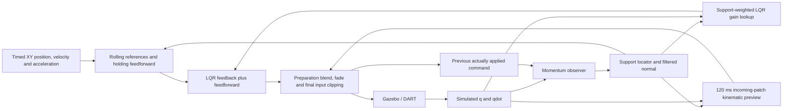

# Teammate handoff — control, evidence and current limits

Updated 2026-11-26. Start here, then read the
[dynamics/controller/observer study guide](iterations/2026-11-26/presentation-preparation/control-and-observer-study-guide.pdf).
The guide supplies the equations and presentation questions; this page explains
the latest experiments, what to run and what remains unresolved.

## Current system

The selected research controller is **gain-scheduled LQR with rolling and
holding feedforward**, a momentum observer, a geometry-based support locator,
and short incoming-drive preparation. The source calls this information boundary
`mode='hardware'`; the experiments run entirely in simulation. Body pose and
velocity are exact simulated state. Contact point, support identity/load and
normal used by this controller are inferred, with solver contacts reserved for
evaluation. The generic `terrain_aware` CLI mode uses solver information and
is a different measurement boundary.



The five commands are `[shaft torque, hemisphere A torque, hemisphere B torque,
belt A speed, belt B speed]`, in `[N m, N m, N m, m/s, m/s]`. The latest studies
use bounds `[1.5, 0.6, 0.6, 0.30, 0.30]`. Belts have prescribed surface-speed
actuation in the model. Joint references are not independent hard velocity
servos, and their limits do not bound actual acceleration.

The controller constructs an unclipped request of the form
`u_eq + u_rolling + u_holding - K e`, then applies preparation/fade and clipping.
`e` contains configuration/velocity errors; XY errors are heading-relative.
Heading is free in these selected trials. LQR effort penalties are soft costs;
they do not anticipate the effects of final hard clipping.

The momentum observer compares measured momentum change `M(q) v` with the
integral of known drive/model forces over the previous 5 ms, then filters the
external-force residual. It does not read contact force or acceleration.
Its first six generalized-force components give net force and moment about
the wheel center. The support locator combines that wrench with current shell/
belt geometry; an equivalent point can be accurate while patch identity is wrong.
General multi-contact decomposition is not uniquely determined by one net wrench.

Incoming preparation predicts geometric patch exposure over 120 ms using current
velocity and an observer-derived local plane. It prepares an unloaded patch
toward low ground-tangent material velocity. It does not forecast exact force
onset on unknown terrain. At 5% estimated load share, preparation fades out and
loaded LQR/feedforward takes over. This takeover is not guaranteed continuous.

No MPC, particle filter, depth-camera map, SLAM or live dynamic-contact forecast
actuates the selected research loop. Those modules/experiments are retained as
research history. There is limited kinematic prediction in the active preview.

## What the latest experiments show

**Latest: I-59 does not support the retained startup-gain explanation.**
An offline swap of the three startup shaft rows at identical states/errors in
all six I-58 traces changes the native torque request by at most 2.52744e-8 N m.
The equilibrium trim difference is only 5.0397e-13 N m. Both are negligible under
the fixed engineering resolutions. The ordinary startup design is retained in
source, but we should not use that fact to explain the visible trajectory
differences. No new physics or runtime/default change. The next proposed target
is the first divergence in current support, scheduled gains and evolving
state/reference history, rather than changing the retained startup row.
[Full I-59 audit and replay](iterations/2026-11-26/startup-anchor-audit/README.md).

**I-58 tests balance priority with smoothing kept soft.** The new
opt-in `BalancePriorityAllocator` retains total amplitude caps and exact
native modeled transverse response; yaw/momentum penalties are disabled.
Seven full 44 s runs complete. At -1 rad it passes the full screen, improving
RMS 51.08→33.43 mm and final error 42.65→6.29 mm. At +.30, final error worsens
20.82→52.62 mm and a turn regresses. At +.90, average tracking improves but
yaw/speed peaks and two turns regress. The final all-phase screen fails, and
none of the runs passes actual settling. Native LQR remains selected; P stays
experimental. The small modeled priority residual is not proof of stability.
[Full I-58 record](iterations/2026-11-26/balance-priority/README.md)
· [Lead video](handoff/media/i58-overview.mp4)
· [Slow event](handoff/media/i58-handoff-event.mp4)
· [Both additional starts](handoff/media/i58-other-starts.mp4).

**I-57 tests the model before that controller change.** All 30
fresh-prefix Gazebo diagnostics reproduce their starting histories exactly.
The dominant native-to-governed physical responses match the frozen contact
model closely at both selected states; five small 20 ms cross-coupling scores
fail, so model accuracy remains qualified. At the late state, the assumed slew
bound forces +0.898 N m shaft torque while native LQR requests -1.5; its
predicted large balance-response cost is confirmed. A separate held-command
analysis finds a poor yaw-cost baseline: proxy -0.006 versus actual +0.762 rad/s
after 20 ms. The missing term is mostly the native command's own future motion.
This narrows the next experiment to balance priority and the cost baseline,
separately. Native LQR, observer and feedforward remain selected; no controller
fix or full-trajectory root cause is established.
[I-57 record and reproducible data](iterations/2026-11-26/loaded-contact-validation/README.md)
· [Main response figure](iterations/2026-11-26/loaded-contact-validation/evidence/analysis/stage01/native_governed_response.pdf)
· [Yaw-baseline figure](iterations/2026-11-26/loaded-contact-validation/evidence/review/baseline_proxy_stage01/baseline_yaw_comparison.pdf).

**I-56 remains a rejected experimental command allocator.** It adds hard
total-command amplitude and slew boxes after native LQR, prioritizes a local
balance-response match, then penalizes travel changes, yaw and unloaded-shell
momentum. Three new 44 s runs complete, and native B exactly reproduces the
old B trace. The full candidate worsens peak tracking 116.26→136.16 mm, final
error 42.65→76.72 mm and absolute tilt 13.72→18.96°. Completion and bounded
commands do not establish improved balance. Conditional later phases do not
run; defaults remain unchanged. Read the
[full I-56 record](iterations/2026-11-26/constrained-handoff/README.md) for
the model assumptions, ablation, failed fixtures, comparison and reproduction.
The new `handoff_model.py`/`handoff_control.py` modules are opt-in experiment
components; the selected research loop above still uses native LQR.
[I-56 overview, 4×](handoff/media/i56-overview.mp4)
· [Handoff replay, 0.5×](handoff/media/i56-handoff-event.mp4)
· [Comparison plot](iterations/2026-11-26/constrained-handoff/evidence/analysis/plots_stage01/comparison.pdf).

I-52 compares four full-run variants at three initial common-shaft angles,
using the same 44 s Mars figure-eight and 0.30 m/s belt caps:

- **B:** original controller.
- **R:** exact I-51 joint-reference guard, 20 rad/s and 100 rad/s².
- **N:** use the estimated normal for the gain-lookup phase.
- **NR:** both factors.

Moving timed position RMS, in mm:

| Initial shaft phase | B | R | N | NR |
| --- | ---: | ---: | ---: | ---: |
| −1.00 rad | 51.080 | 76.789 | 39.195 | 49.688 |
| +0.30 rad | 56.963 | 48.415 | 53.936 | 53.466 |
| +0.90 rad | 50.486 | 44.213 | 43.284 | 44.972 |

At +0.90, NR finishes **9.527 mm from the goal and passes the existing settling
and route gates**, versus 190.191 mm and no settling for B. At −1.00, N alone
settles and passes those route gates. At +0.30, NR settles but fails the route
gates. Every candidate still fails the complete per-phase nonregression screen;
turning and transient lean/peak errors matter as well as final position.

N lowers RMS at all starts, but worsens peak error/lean at +0.30. R is not a
universal improvement: at −1.00 its peak error is 306.794 mm and peak relative
lean is 13.196°. Benefits are not additive, and a favorable endpoint must not
hide a violent excursion during the route. Defaults remain unchanged.

N changes **only the lookup angle in an existing flat-ground gain bank**.
It does not redesign the dynamics, rotate every error/input frame, or establish
terrain-wide stability. The ordinary local shaft-gain row remains anchored.
I-59 subsequently measures that anchor's actual command effect as negligible
for the three recorded starts; its retention alone is not an explanation of
the trajectory differences.
The lookup discards the carrier-frame normal's lateral component, although the
full normal is still used elsewhere for lean and holding feedforward.

[All-case overview, 4×](handoff/media/i52-overview.mp4)
· [Tracking plot](handoff/media/i52-tracking.pdf)
· [Turn plot](handoff/media/i52-turns.pdf)
· [Full I-52 record](iterations/2026-11-26/contact-scheduling-joint-tracking/README.md)
· [Tracked canonical report](iterations/2026-11-26/contact-scheduling-joint-tracking/evidence/analysis/stage01/report.json).

## The violent motion around 10 seconds of the video

The user's observation is real. In the −1.00-rad chapter, original playback
10.000 s is recorded time 32.000 s. The planned trajectory is still moving
until recorded 41 s; this is not the final settling interval. Original pose
frames are 200 ms apart, so fractional playback times below describe the
continuous clock mapping, not additional encoded original frames.

At recorded 32.305 s, R reaches **1.025 m/s planar speed**. Over the fixed
28–36 s window the maxima are approximately B 0.472, R 1.025, N 0.263 and
NR 0.660 m/s. N is calmer here, but still has short contact-transition pulses.

At 32.250 s, evaluated and inferred support switch from belt B to shell B.
The shell-B torque request changes from about −0.092 to **−7.719 N m**, then
clips to −0.600 N m. The exact LQR jump decomposition assigns approximately
−7.602 N m to the gain change and −0.011 N m to changing error. Lean error
was already about 13.17°. Preparation contributes zero at that sample, and
current rolling geometry is moderately conditioned, not the earlier +0.90
nearly singular allocation example.

The reference guard obeys its 100 rad/s² bound; actual joint acceleration is
not bounded by that rule. On the same frozen state, removing the current
guard modification would still leave the torque clipped: the guard actually
softens the negative request by about 0.098 N m. Its earlier effects changed
the trajectory history, so this does not clear the R policy of its regression.
It does rule out the simple claim that the instantaneous reference clamp alone
causes the whole acceleration burst. The proximate issue is a support/gain
handoff acting on large pre-existing errors and saturated commands.

[Slow four-way event replay](handoff/media/i53-acceleration-event.mp4)
· [Detailed event plot](handoff/media/i53-handoff-detail.pdf)
· [Event evidence and limits](iterations/2026-11-26/teammate-handoff/README.md).

This is an experimental comparison, not a solved controller. The next focused
question is how to preserve balance and command consistency through support
changes and direction reversals using the full estimated contact geometry.

The [I-54 acceleration/spin investigation](iterations/2026-11-26/acceleration-spin-cause/README.md)
adds an important qualification: the entering attitude error includes a rapidly
moving normal-derived target. Over 31.400–31.745 s, desired up moves 15.621°
while actual absolute tilt decreases. The platform already spins before the
largest command jump, reaches 6.635 rad/s vertical angular velocity, and makes
2.748 additional heading turns from 32.250 to 44 s. Saved-state momentum
accounting supports shell/platform exchange near a vertical shell axis.
Separate heading control is disabled, while native angular-rate feedback
remains active and later reverses torque. The complete causal chain remains
open; no new controller or trajectory campaign was introduced.

The subsequent [I-55 matched-prefix diagnostics](iterations/2026-11-26/causal-replay/README.md)
reproduce the original R trace exactly before two short interventions.
Removing only unloaded shell-A torque reduces the first 5 ms yaw-rate
increase by 55.2%, confirming its contribution; the later motion rebounds.
Holding the attitude target reduces yaw but worsens tracking of the fixed
untreated target (9.848→15.932°). Neither intervention is adopted. The
25 ms force/momentum check passes its declared tolerance, while the 55 ms
check fails. [Portable 1 ms data](iterations/2026-11-26/causal-replay/data/README.md)
and plots preserve both the causal findings and unresolved accounting.

## Run and inspect from a fresh clone

For the browser lab, follow the normal [README](../README.md) setup. For the
exact recent research variants, use the frozen recipe below. Generic demo
defaults need not have the same contact-information boundary.

1. Read [GAZEBO.md](../GAZEBO.md), create/activate its environment and build the
   bridge. Install this package in that environment. The optional MPC package
   is needed only for the parked MPC experiments.
2. Restore the exact frozen files and historical inputs required by preflight:

   ```bash
   python scripts/restore-research-workspace.py --check
   python scripts/restore-research-workspace.py
   ```

   This copies only missing files into ignored workspace paths. Differing
   existing files cause refusal before copying. The committed overlay is about
   65 MiB; it preserves old tested bytes instead of rewriting their path/hash
   assumptions.
3. Prepare a fresh campaign root without launching physics:

   ```bash
   python scripts/prepare-research-campaign.py --output results/teammate_i52
   ```

4. In the Gazebo environment, validate and run selected cases explicitly:

   ```bash
   python results/contact_scheduling_joint_tracking_20261126/run_factorial_case.py --output results/teammate_i52 --preflight
   MUJOCO_GL=egl OPENBLAS_NUM_THREADS=1 OMP_NUM_THREADS=1 python results/contact_scheduling_joint_tracking_20261126/run_factorial_case.py --output results/teammate_i52 --run --case-id p090_B --cap .3
   MUJOCO_GL=egl OPENBLAS_NUM_THREADS=1 OMP_NUM_THREADS=1 python results/contact_scheduling_joint_tracking_20261126/run_factorial_case.py --output results/teammate_i52 --run --case-id p090_NR --cap .3
   ```

   The twelve case IDs and conditions are in the prepared jobs. Each case
   writes its source/provenance, `summary.json`, `rollout.npz`, precision log
   and artifact manifest. Existing case directories are refused. Start with
   serial execution; the old study retained one native crash and its exact
   serial retry separately.

The recipe supports **fresh native execution**. The archived scientific reducer
also records original-case and retry provenance; it is retained byte-exact and
is not presented as a generic fresh-dataset analyzer. New summaries are directly
available per run. New full-study analysis must use an explicitly registered
resolver and correctly describe its new dataset, rather than silently claiming
the original crash/retry history. The original full raw study bundle remains
local, not in Git; compact reports, selected event data, tested sources and
selected movies are committed. [Portable workspace details](../research/README.md).

## Where to read the code

| Topic | Entry point |
| --- | --- |
| Mechanism, approximate masses and model generation | [model.py](../src/spherical_wheel/model.py), [model.yaml](../config/model.yaml) |
| Local LQR design, state/error conventions | [control.py](../src/spherical_wheel/control.py), [sim.py](../src/spherical_wheel/sim.py) |
| Gain bank and support/phase scheduling | [recovery_control.py](../src/spherical_wheel/recovery_control.py) |
| Live off-road command construction | [offroad_control.py](../src/spherical_wheel/offroad_control.py) |
| Momentum observer, support locator and normal filtering | [contact_sensing.py](../src/spherical_wheel/contact_sensing.py) |
| Native rolling references and belt feedforward | [experiments.py](../src/spherical_wheel/experiments.py) |
| Incoming geometric preview | [synchronization.py](../src/spherical_wheel/synchronization.py) |
| I-56 experimental measured-contact response and bounded command allocation | [handoff_model.py](../src/spherical_wheel/handoff_model.py), [handoff_control.py](../src/spherical_wheel/handoff_control.py) |
| I-58 experimental balance-priority allocation, retained after mixed results | [balance_priority_control.py](../src/spherical_wheel/balance_priority_control.py) |
| Measured-state mirror, lockstep Gazebo bridge | [gazebo/plant.py](../src/spherical_wheel/gazebo/plant.py), [bridge plugin](../gazebo/plugin/SphericalWheelBridge.cc) |
| Exact I-52 opt-in experiment sources | [frozen workspace](../research/frozen_workspace/README.md) |

## Read the iteration history efficiently

[ITERATION_LOG.md](../ITERATION_LOG.md) is the full research ledger, including
unsuccessful trials. The [dated presentation notes](iterations/2026-11-26/README.md)
are the shorter current index. Useful checkpoints:

- I-12–I-14: configuration/direction sensitivity; bounded references do not
  guarantee bounded feedback or good actual motion.
- I-31–I-38: MPC improved some behavior but did not establish reliable settling;
  the default remained LQR. Prediction and live outcome are separate.
- I-40–I-45: dynamic previews and four-camera memory were evaluated; useful
  prediction/map metrics did not establish driving improvement.
- I-46–I-50: observer timing/contact conventions, capacity sensitivity and
  exact handoff/reference failures. Compute delay is not demonstrated merely
  by filtered estimates in lockstep simulation.
- I-51–I-53: isolated reference/handoff changes, three-configuration factorial,
  and the violent-acceleration investigation above.
- I-54–I-56: saved momentum audit, matched-prefix causal diagnostics, then a
  bounded allocator that satisfies its numerical constraints but regresses
  physical balance/tracking. Defaults remain unchanged.
- I-57: matched-state model validation and separate baseline diagnostics;
  dominant local response is accurate, optional smoothing can prevent the
  native balance action, and a velocity-correction model needs a valid baseline.
- I-58: remove the optional hard rate box while keeping the soft costs; one
  lead succeeds but broader endpoint, turn and motion regressions prevent
  adoption. Native goal-hold and drive-reference behavior remain unresolved.
- I-59: fixed-state swaps find negligible retained startup shaft-gain/trim
  effects. This corrects an earlier practical hypothesis; mechanical and
  current-support/reference-history paths remain unresolved.

Historical `results/` links in archived iteration records may refer to ignored
full datasets. Use this page's tracked media/report links first; a plain clone
does not contain every old raw rollout. Old snapshots are historical source,
not automatically the current implementation.

Validation for the original I-53 publication: 579 existing tests passed and 6 skipped; the new
workspace tools have their own 21 passing tests. These are separate invocations,
not new robot trials. Default settings and older evidence were preserved.
I-56 separately adds 41 passing model/allocator tests and a three-run Gazebo
screen; this is not a repeat of the full repository suite. Its portable saved-
array replay reproduces the published metrics and gates without simulation.
I-57 adds 30 short held-input diagnostics after exact prefixes, eight pure replay
contracts and eight separate arithmetic checks. Its portable NumPy replay
reproduces all paired scores; output-group counts are not independent tests.
I-58 adds 31 new allocator tests; its 72 selected passes include the same 41
existing allocator/model tests. Sixteen separate harness contracts, eight metric
contracts and seven full trajectory runs have distinct scopes. Exact NumPy
replay and independent audits verify the final results; the full repo suite was
not rerun for this experiment.
I-59 uses saved arrays only; six traces contain 52,806 correlated states, not
additional robot trials or integration tests. Independent reconstruction and
standalone replay validate the negligible command-effect finding.

AI assistance: Codex helped implement experimental code, analyze logs and draft
figures/documentation. The team supplied design direction and observations.
Present the measured results and limitations with their recorded sources, and
distinguish AI-assisted work from calculations a presenter has independently
derived or checked. The study guide contains the deeper equations and questions.
