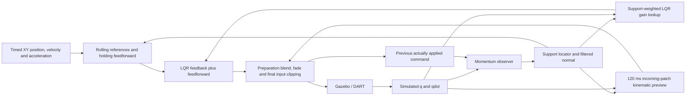

# Teammate handoff — control, evidence and current limits

Updated 2026-11-28. Start here, then read the
[dynamics/controller/observer study guide](iterations/2026-11-26/presentation-preparation/control-and-observer-study-guide.pdf).
The guide supplies the equations and presentation questions; this page explains
the latest experiments, what to run and what remains unresolved.
The [standalone ChatGPT context file](CHATGPT_CONTROL_CONTEXT.md) can be uploaded
without the repository; it explains the selected pipeline, equations, boundaries,
experiment history and common presentation questions through I-85 (revision 20).

## Current system

The selected research controller is **gain-scheduled LQR with rolling and
holding feedforward**, a momentum observer, a geometry-based support locator,
and short incoming-drive preparation. The source calls this information boundary
`mode='hardware'`; the experiments run entirely in simulation. Body pose and
velocity are exact simulated state. Contact point, support identity/load and
normal used by this controller are inferred, with solver contacts reserved for
evaluation. The generic `terrain_aware` CLI mode uses solver information and
is a different measurement boundary.



The five commands are `[shaft torque, hemisphere A torque, hemisphere B torque,
belt A speed, belt B speed]`, in `[N m, N m, N m, m/s, m/s]`. The reference
baseline uses bounds `[1.5, 0.6, 0.6, 0.30, 0.30]`. I-82's leading experimental
capacity variant raises both belt operating bounds to 0.60 m/s after the
original configuration and LQR gains are constructed. It passes the current
case's screen; defaults and gain design remain unchanged. Belts have prescribed
surface-speed actuation in the model. Joint references are not independent
hard velocity servos, and their limits do not bound actual acceleration.

The controller constructs an unclipped request of the form
`u_eq + u_rolling + u_holding - K e`, then applies preparation/fade and clipping.
`e` contains configuration/velocity errors; XY errors are heading-relative.
Heading is free in these selected trials. LQR effort penalties are soft costs;
they do not anticipate the effects of final hard clipping.

The momentum observer compares measured momentum change `M(q) v` with the
integral of known drive/model forces over the previous 5 ms, then filters the
external-force residual. It does not read contact force or acceleration.
Its first six generalized-force components give net force and moment about
the wheel center. The support locator combines that wrench with current shell/
belt geometry; an equivalent point can be accurate while patch identity is wrong.
General multi-contact decomposition is not uniquely determined by one net wrench.

Incoming preparation predicts geometric patch exposure over 120 ms using current
velocity and an observer-derived local plane. It prepares an unloaded patch
toward low ground-tangent material velocity. It does not forecast exact force
onset on unknown terrain. At 5% estimated load share, preparation fades out and
loaded LQR/feedforward takes over. This takeover is not guaranteed continuous.

No MPC, particle filter, depth-camera map, SLAM or live dynamic-contact forecast
actuates the selected research loop. Those modules/experiments are retained as
research history. There is limited kinematic prediction in the active preview.

## What the latest experiments show

**Latest: I-85's terrain-informed lean trial has small benefits but fails recovery; park this direction.**
[Completed trial, PDF, evidence and reproduction](iterations/2026-11-28/terrain-lean-trial/README.md)
· [99.5–133 s comparison video](../results/terrain_lean_trial_20261128/publication/video_stage01/native_vs_terrain_lean_99p5_133.mp4).
Two fresh 133 s Gazebo/DART runs compare native N against one bounded mapped-
terrain lean correction T, both with 0.60 m/s belt caps and unchanged original
LQR design/gains, momentum observer and current-normal feedforward. Fresh N
exactly reproduces all 79 I-82 B060 precision arrays. T uses a fixed 0.50 s
future-minus-current mapped-normal contrast, at most 2° additional lean and
0.15 rad/s additional angular reference, active only over 99.5–104 s.

The result is **STOP_CANDIDATE: 36/37 checks pass**. Primary two-second recovery
starts at **117.675 s for N and 118.325 s for T**, 0.650 s later; the candidate
needed entry by 116.675 s. Both remain acceptable through 133 s after their
entries. Moving timed RMS improves **23.362→21.809 mm**, peak timed error
**72.167→65.163 mm**, and focus spatial-velocity peak **33.177→23.498 mm/s**.
Focus path peak slightly worsens **37.526→38.799 mm** and final error
**0.877→0.986 mm**; clipping is zero, and full tilt/speed/spin peaks are unchanged.
Keep these partial benefits without calling the failed recovery objective solved.

Evaluation uses the original native attitude rule at each arm's own current
state, so changing T's target cannot manufacture balance success. An analysis-
only persistence correction, after N completed and before T outputs were read,
requires uninterrupted success from the first two-second entry through 133 s.
The 117 original frozen sources remain unchanged; both legacy and corrected
decisions are STOP. Independent reconstruction confirms the metrics and gates.

The user explicitly asked to stop terrain-assisted work if this attempt was
not good: **park it, with no tuning or retry**, and retain native LQR/observer/
feedforward with the promising 0.60 capacity setting. A separate old-baseline
diagnostic finds a short contact/normal transient near 105.53 s, followed by
the 105.59 s velocity-band failure while path distance stays below 8.24 mm and
own-up error below 1.26°. Commands are unsaturated, with no joint-reference or
preparation spike. Last-1-ms solver samples do not establish complete force
causality. The next question is baseline velocity recovery and its response
to the current normal-derived reference; no new map or estimator is selected.

**I-84 finds mapped terrain, but the preparation-only candidate has no action in this episode.**
[Completed terrain-preview audit and stopping decision](iterations/2026-11-28/terrain-recovery-preview/README.md).
This is a valid **STOP** for the selected candidate and episode, with no live
trial or new physics. The runtime/shadow audit uses 1,158 unique anchors:
267 uniform and 901 dense, with ten overlapping. Native reconstruction and
current-value guard errors are zero in the canonical audit; independent
saved-record verification passes.

Mapped future support is complete at all 261 focus anchors (100.5–101.8 s)
and all 901 dense anchors (99.5–104 s). Yet both native and mapped preparation
weights are zero throughout that dense interval, so shadow applied commands
are identical. The candidate changes **unloaded-drive preparation**, which was
inactive here. This is neither a visibility failure nor proof that cameras
have no value. No zero-action live trial was run. Elsewhere, 94 uniform anchors
have accepted nonzero mapped preparation and 50 meet the registered opportunity
threshold; those were not selected afterward to rescue the live comparison.

The causal replay captures 2,661 four-camera batches (10,644 frames), with 2,660
delivered and one pending at the end. Ideal depth, exact capture-time pose,
50 ms delivery latency and static terrain are assumptions. No MPC or new
contact estimator is introduced. Keep LQR/observer/feedforward and the promising
0.60 capacity variant. I-84 proposed using mapped terrain for **loaded** velocity
or lean references; the later I-85 lean trial above is separate and is rejected.

**I-83 separates fast first return from durable recovery.**
[Recovery report, plots and PDF](iterations/2026-11-28/recovery-assessment/README.md)
· [Annotated 100.5–133 s video](../results/recovery_assessment_20261128/publication/video_stage01/recovery_100p5_133_B030_B060.mp4).
This assesses the existing I-82 recordings, with no new physics or controller
change. All five criteria are already outside their bands at the common
100.5 s anchor: onset is left-censored, so elapsed times below are from that
anchor, not from an identified physical disturbance onset. The intended last
quarter of the eight is fixed to avoid credit for a different branch at the
crossing. Spatial nominal velocity is evaluated at projected path progress;
timed tracking remains a separate test.

| Path-motion recovery, elapsed from anchor | 0.30 m/s reference | 0.60 m/s variant |
| --- | ---: | ---: |
| First threshold entry | 9.460 s | 3.380 s |
| Entry sustained for 1 s | 16.455 s | 3.380 s |
| Primary entry sustained for 2 s | 16.455 s | 17.175 s |

Path-motion requires distance ≤20 mm, full spatial velocity residual ≤20 mm/s,
own-reference up error ≤2° and absolute tilt ≤15°. The raised-cap first good
interval lasts 1.705 s, ending at 105.585 s; velocity residual exceeds its band
at 105.590–106.000 s, so that return does not pass the primary two-second dwell.
Its eventual continuous good tail is 117.675–133 s. The reference's earlier
two-second recovery has two later qualifying exits, starting at 126.555 s,
and ends outside. Neither ever enters the stricter simultaneous criteria that
also constrain spin; those returns are right-censored. Faster first return and
better persistence do not mean every recovery-time metric improves.

Independent reconstruction confirms 60 signal arrays, 10 predicate arrays and
1,317 numerical ledger leaves plus all statuses/censoring/counts. These are
verification scopes, not additive tests or a full repository suite. I-82's
positive full-route capacity screen remains valid; I-83 asks a different question.
The objective is fast **and** durable recovery. The later I-84 audit stops the
selected preparation-only candidate before a live trial. Earlier camera-memory
tests were offline and never commanded LQR.

**I-82's 0.60 m/s capacity variant substantially improves the current figure-eight.**
[Completed report, plots, PDF and reproduction](iterations/2026-11-28/current-belt-capacity/README.md)
· [Full comparison video](../results/current_belt_capacity_20261128/publication/video_stage01/eight_m100_B030_B060.mp4)
· [98–104 s event video](../results/current_belt_capacity_20261128/publication/video_stage01/event_98_104_B030_B060.mp4).
Two fresh full 133 s Gazebo/DART runs compare 0.30 and 0.60 m/s operating caps
on both belts in the original I-76 native eight −1 rad case. LQR gains, original
configuration, observer, feedforward, native preparation and reference remain
fixed. Physical and measured-state-mirror bounds change together; preparation
uses that operating cap, so this is a capacity-interface comparison rather
than an isolated final-clipping change.

| Full-run comparison | 0.30 m/s reference | 0.60 m/s variant |
| --- | ---: | ---: |
| Moving timed XY RMS | 46.359 mm | 23.362 mm |
| Peak timed XY error | 336.408 mm | 72.167 mm |
| Final goal error | 32.880 mm | 0.877 mm |

Both runs complete. All **111 setup checks and 30 fixed performance checks
pass**, giving **PASS_CAPACITY_SCREEN** for this pair. A separate raw-array
audit reproduces 124 scalars and all 30 gate decisions; these are overlapping
verification scopes, not additive tests or a full repository test suite.
The fresh 0.30 run exactly reproduces all 79 original precision arrays across
26,601 rows. The first applied-command difference is at 80.880 s, so the later
100.9 s force comparison includes different prior histories; it does not
isolate a same-state correction to the original pulse.

The 0.60 variant returns close to the goal and nearly stops translating, but
retains about 6.095°/s world-vertical rotation in the final two seconds. It
therefore fails strict four-condition settling, whose rotation limit is
0.05 rad/s (2.865°/s). Position, speed and attitude settling pass; the 0.30
reference fails position and rotation. The registered screen preserves native
settling success when present; it does not require a new success when native
also fails. Keep 0.30 as the reference baseline and 0.60 as the leading
experimental capacity variant, with no automatic default promotion from one
case. Earlier [I-49](iterations/2026-11-26/belt-capacity-sweep/README.md) tested
a different 44 s figure-eight at +0.9 rad and yaw 45° and had mixed tradeoffs;
that evidence is retained, not replaced by I-82's positive result.

**I-81 captures downhill traction during correctly assigned belt contact.**
[New report, plots, PDF and exact evidence](iterations/2026-11-28/slope-response-trace/README.md).
One unchanged102s Gazebo/DART native eight−1 prefix matches all79 original
precision fields exactly. Physical1ms logging and full native preview snapshots
do not change the selected LQR/observer/feedforward/preparation/caps.

For the completed100.900s interval, actual beltA contact adds10.598N downhill
and gravity3.234N; whole-COM momentum confirms13.833N sampled total. The
preceding held belt speed is−.300m/s, clipped from−.889. Actual/inferred beltA
agree and preparation adds zero. Roll/pitch LQR contributes−.452m/s, with
velocity/position feedback making up most of the remainder. A similar pulse
occurs at101.000s. Other intervals brake. Command sign alone is not world-force
direction. This is not simply proof of inadequate static holding torque, and
the belt model does not identify a finite motor torque envelope.

Observer force matches interval physical force closely; misassignment/timing
differences remain elsewhere. Preview exposure is geometry, not force onset.
The next proposed causal test should isolate loaded-belt feedback while
retaining the current architecture and assess balance plus tracking/release.
It is not run in I-81. No motor/passive-work partition, complete departure cause
or accepted controller improvement follows from this unchanged trace.

**I-80 verifies supported downhill motion in the user's 101.5 s native frame.**
[Exact frames, terrain/contact plots and PDF](iterations/2026-11-28/slope-edge-review/README.md).
At the figure-eight−1 frame, mesh slope is8.644°, downward speed matches motion
along the terrain, positive shellA pressure remains, and yaw rotation is about
−200°/s. The robot is losing tracking during a supported descent; no sustained
airborne fall is demonstrated. Logs also show inferred beltA↔shellA routing
and saturated correction. That does not prove an observer bug, wrong action
or gravity-only cause. The larger nearby facet change occurs later. No new
physics or controller changes; retain native N and investigate timing/causality
with a separately instrumented short replay if proceeding.

**I-79 reviews the terrain-change hypothesis without new physics.**
[Review](iterations/2026-11-28/terrain-contact-hypothesis/README.md).
Sudden terrain can invalidate the native 120 ms frozen-plane/motion preview,
but preview candidates are not current load estimates. Existing eight evidence
also permits an accurately observed physical change followed by filtering and
a demanding lean target. Saved precision lacks full original preview targets;
wrong preview causing the departure is still unverified. A short unchanged
instrumented replay is proposed, not run. Baseline remains selected.

**I-78 retimes path progress, improves one start, and fails its comparison.**
[Report, PDF, videos and reproduction](iterations/2026-11-28/path-progress-governor/README.md).
Six fresh Gazebo/DART straight runs compare original N with an isolated online
virtual clock G at−1.0/+0.3/+0.9 rad. Original LQR/observer/lean/feedforward and
caps remain unchanged. G coherently slows desired position, velocity and
acceleration from current inferred authority and nominal full-command demand;
it performs no future physics or contact forecast.

Peak distance from the same path N→G is148.9→102.0,124.6→124.4,59.7→59.2 mm,
with0.985/0.600/0.005 s added travel time. All finish with the full ten-second
goal hold, none stalls, and all six meet position/speed goal convergence. Only
G−1 meets stricter four-condition settling. At−1, any clipping falls.680→.240 s,
but extreme rolling references remain. At+0.3, peak tilt9.397→9.970° and speed
.1819→.2284 m/s fail the fixed margins. The screen is80/82, with180/180 setup
checks passing. Two independent audits reproduce the scores and gate decisions.

Keep original N selected; no production/default changes. This tests a possible
remedy, not proof that nominal-clock advance caused every departure. Current
speed is not capped simply by slowing desired speed: +0.3 speed peaks with a
lower reference and no same-row saturation, after changed dynamics. Do not
claim a certified reference governor, a constrained LQR, or a general fix.
Exact source/metadata and failed setups are archived; large raw/video bundles
remain local with explicit inventories and hashes.

**Previous: I-77 returns to the original baseline and separates deviation causes.**
[Cause report, causal plots and raw evidence index](iterations/2026-11-27/baseline-deviation-cause/README.md).
The production controller remains unchanged. In one straight −1 rad episode,
two active drive directions nearly coincide; an unbounded rolling inverse
generates large opposing speed references. Exact same-prefix physical tests show
that limiting only feedback joint-rate references for 250 ms reduces subsequent
geometric peak error over 20.4–24 s from 148.9 to 22.0 mm. Removing only the
largest pulse does not help. This diagnostic is not a full-route controller
acceptance or a motor specification; earlier guard regressions remain recorded.

The figure-eight has another precursor: actual contact normals change rapidly,
and the accurately reconstructed wrench feeds a fast normal-derived lean target.
The baseline still requests zero body angular velocity. Aligned 1 ms contacts
verify the observer's filtered intrinsic direction within 0.02345° maximum in
96–97.5 s. This does not prove every contact estimate or reference is correct.
The cause report separates the earlier disturbance from the later near-path
crossing with residual velocity and contains the isolated attitude-reference
follow-up. Avoid explaining every departure as either wrong contact or saturation.
The half-second attitude-reference hold/release reduces later geometric peak
over 96.4–103 s from 316.7 to 62.2 mm, despite slightly worse immediate path
error. Its release changes shaft torque abruptly and later local attitude
targets differ with physical contact history. Keep this as causal evidence,
not a controller acceptance. All five shortened diagnostics finish; production
code and selected defaults stay unchanged.

**I-76 broadens the heading comparison; figure-eight path distance improves,
but the same heading overlay is not a general tracking improvement.**
Eighteen corrected Gazebo/DART runs compare N/T on straight, 90° arc and
figure-eight paths at three shaft starts. All complete, with 686 consistency
checks passing; the fixed control screen fails 42/207 checks. Eight remains
explicit rough stress outside the original moderate-terrain screen.

Heading RMS improves 8/9 pairs (20% benefit in 7/9); timed XY improves 3/9,
geometric path RMS4/9. The figure-eight improves geometric RMS in every start:
**39.87→15.54,27.91→22.22,32.73→17.21 mm**; timed RMS improves 2/3.
Straight improves 1/3; arc 0/3. These are matched within-route effects; route
shapes, durations, terrain and planned accumulated heading change differ.

Four-condition stopping totals are3 N /3 T, but T loses two native successes
and gains two different ones. Only straight+.9 T and eight+.9 T also satisfy
≤10° raw heading error throughout the final 2 s. Straight−1 T has a 19.89° tilt,
1.09 m/s speed and14.12 m/s² acceleration transient. All applied caps hold.
The formerly favorable −1 start is not uniformly best on new routes.
The selected event's large demand is dominated by attitude/body-velocity LQR
feedback; baseline straight−1 instead has large rolling-reference terms.
Do not assign the same cause to every spike or call a small direct helper
term proof that the intervention cannot have indirect effects.

The first unscored attempt exposed endpoint roundoff: quintic progress becomes
1.0000000000000009 just before 123 s, triggering a strict range guard. A minimal
[0,1] clamp passes adversarial tests; all 12 earlier complete recordings and
three saved failure prefixes reproduce exactly. Failed sources/data and explicit
aborts remain preserved. An accidental client closure later preserves six
completed corrected runs and resumes twelve with actual observed exit statuses
and file hashes documented. No source/gain/criterion tuning follows outcomes.

Keep original N selected; T stays experimental. The native zero LQR angular-rate
reference and translation-only rolling allocation are still present. This is
trajectory-heading reference work, not a new contact prediction or estimator.
[All nine videos, six-page PDF, setup/correction history and reproduction](iterations/2026-11-27/tangent-heading-routes/README.md).

**Previous: I-75 follows the desired path heading, with a clear tracking tradeoff.**
Six fresh matched N/T S runs complete 45 s. Both start at the initial path tangent,
yaw argument 149.242843°, so native numbers are a new baseline, not matched old
45° I-73/I-74 replays. T keeps the original LQR/observer/contact feedforward and
helper budgets, changes its target to planned geometric tangent, and tracks
its desired rate using exact Euler heading-rate feedback. Raw and command
targets coincide with no active reference shaping.

Heading RMS N→T is **78.26→9.43°, 96.52→22.87°, 94.45→23.61°**. Moving timed
XY RMS worsens in all phases: **19.66→33.82, 18.07→24.14, 20.08→27.01 mm**.
T final position errors are **81.93/56.99/26.11 mm**, heading errors
**5.41/17.68/7.46°**. No T passes original four-condition settling; only +0.3 N
does. All 212 setup checks pass, but 15/60 fixed control checks fail.

At +0.9 T, 15.515 s, large rolling shaft/shell-B references −74.1/+206.8 rad/s
create LQR velocity corrections around −17.74/+17.40 N m. Requested motors
−18.29/.79/17.55 clip to −1.5/.6/.6 N m, while the direct heading term is only
.127 N m. This identifies the algebraic demand source; no contact singularity
or whole-path physical cause is proved. Final helper availability differs by
configuration: −1.0 T is unavailable at the endpoint samples, while +0.3 T
remains eligible despite an offset. Eligibility loss cannot explain every residual.

Keep T experimental and original N selected. The overlay leaves native LQR
angular-rate references zero and rolling allocation translation-only; it does
not test a fully coordinated planar-pose controller or settle holonomy. Source/
input seals, setup corrections, all six results, full-hold videos and restore
instructions are retained. No post-result tuning or default change.
[Full I-75 record, PDF, videos and reproduction](iterations/2026-11-27/tangent-heading-control/README.md).

**Previous: I-74 bounded heading hold improves two stops, with important regressions.**
Six fresh matched N/H S-path runs all complete. H keeps the same LQR/observer/
contact feedforward and enables the existing starting-heading helper, gain .2,
rate damping .06, torque cap .15 N m and horizontal reaction budget .05 N m.
Native recordings reproduce all 46 shared I-73 numerical arrays per phase exactly;
all 95 setup checks pass. H fails 12/66 fixed checks and is not adopted.

Moving XY RMS N→H: −1.0 **47.31→24.38 mm**, +0.3 **22.85→24.00 mm**,
+0.9 **23.37→33.69 mm**. H−1.0/+0.3 pass the original final four-condition
settling test; only −1.0 also points within 10° of the target. Final H position
errors are .155/2.868/53.460 mm, heading errors 2.67/56.40/91.42°. Reduced spin
does not imply the correct final heading. At +0.9 hold entry/end, the existing
helper is disabled by its load and lever eligibility conditions.

A bounded posthoc ledger identifies a concrete regression at 16.670 s in −1.0H:
rolling joint references reach approximately −6555/−23638 rad/s, entering LQR
velocity errors and producing −1499/−1893 N m requests. Actual inputs remain
clipped to original caps; the heading term itself is only −.071 N m. This is
an algebraic source, not proof of contact-Jacobian singularity or the whole
physical cause. Keep H experimental and original N selected; preserve both the
improved stopping and the failed command/tracking/rotation guards.
[Full record, plots, two-page PDF, videos and reproduction](iterations/2026-11-27/heading-hold-control/README.md).

**Previous: I-73 tests N/A/C in fresh closed-loop motion; no consistent gain.**
Nine new 45 s Gazebo/DART S-shaped runs, three starting phases and a 10 s goal
hold, all complete without a declared physical failure. Change only the rolling
reference/feedforward records; the native observer, load/normal/gain routing,
support torque, preparation and limits stay in place. Candidate references also
enter LQR velocity feedback, so this is not merely an additive feedforward test.

Moving timed XY RMS for native N / velocity A / geometry-plus-velocity C:
−1.0 rad **47.31 / 44.39 / 45.38 mm**; +0.3 **22.85 / 27.05 / 27.53 mm**;
+0.9 **23.37 / 23.53 / 23.47 mm**. C improves one configuration, regresses
another and barely changes the third. Its late rotation increases at −1.0 and
+0.3; 12/36 fixed control checks fail despite all 101 setup checks passing.

None of the nine satisfies the final-2 s simultaneous position/speed/rotation/
reference-attitude criteria. This does not mean none returns: −1.0 ends within
5 mm, but retains motion; +0.3 native/A meet the other three criteria and fail
only rotation. Heading is free in this selected controller. Keep position return,
balance and rotation separate. Exposure is measured at the reference boundary,
not as a complete prepared/clipped-command counterfactual. Especially +0.9 has
only 0.10 s of direct reference intervention.

Retain the original selected pipeline and I-72's failed estimator screen. A/C
are experimental tools; neither is adopted. This is not a full native load/gain
estimator replacement or proof of general multi-contact performance. The map-only
site failures, explicit 8°→12° facet-screen revision before physics, source/gate
freeze, media encoding correction and unsuccessful control results are preserved.
[Full record, plots, two-page PDF, videos and reproduction](iterations/2026-11-27/contact-reference-control/README.md).

**Previous: I-72 geometry-first velocity selection improves point extremes but
does not pass its combined screen.**
Choose one original physical candidate per family nearest the native observer
equivalent point, then reuse the unchanged I-60 scores/confidence. Primary C
uses its accepted fused point/family or exactnative fallback. New optin module
has no live-control import. Same three saved starts; no new physics or tuning.

C has127family errors versus earlierguardedA124 (phase14/67/46vs14/64/46),
and accepts6848versus6902samples on unchanged domains. Full23423pointrows:
N/A/C RMS3.1361/2.7591/2.9100mm, p957.3885/5.7970/6.3428mm,
maximum26.9076/29.8429/25.5659mm. Cpassesallpointguards againstN andlowersA's
worstpoint, butworsensA'sRMS/p95. At35.205s thewrong shellB assignment remains;
onlyitsdistance decreases. Four of ten gate rows fail, includingtworedundant
coveragechecks. Keep configuredselectoroutoflivecontrol; all471pair rowsremain
inloaded evaluation. The HMMstaysstopped andoriginalpipelineaboveremainsselected.
[Full record, PDF, physical candidates and replay](iterations/2026-11-27/geometry-first-contact/README.md).

**Previous: I-71 stops this HMM version after the bounded diagnostic.**
Remove current two-family states while keeping the frozen interval-transfer
likelihoods and original dwell times. Three saved starts, unchanged costs and
selected points; no new physics or live controller changes. Restricted frame
has303dominant-support errors, no-edgehistory492 and primaryhistory425. The old
primary had564, so the restriction helps, but memory still worsens every phase.
Four of eight continuation checks fail; seven of sixteen adoption gates fail.

Keep all471true two-family pressure rows as deliberate failures of this
restricted model. Loadedset errors896 versus guardedA595. Current exactlymatched
pointRMS improves2.6105→2.3253mm, maximum worsens26.9076→29.4537mm; do not compare
that RMS directly to I-70's different matched subset. All71defined transitions
acquired, p9540ms. Independent recurrence/physicalpoint checks and isolated
NumPy replay agree. Stop this HMM version without a post-result parameter sweep;
the original live pipeline above remains selected.
[Full record, three-page PDF, fixed event and replay](iterations/2026-11-27/endpoint-pair-ablation/README.md).

**Previous: I-70 implements temporal contact reasoning, but this version fails adoption.**
The new opt-in estimator keeps rolling/slipping, singleton/two-family and unknown
explanations across time using raw momentum-observer load, measured motion and
known geometry. It has no truth input, future samples or live command connection.
Three saved Mars starts are processed without new physics or parameter tuning.

On 23,423 dominant-pressure rows it makes 564 errors versus native N's 412 and
earlier offline guarded A's 124. The 564 comprise 140 wrong singletons, 223
unknowns and 201 pair outputs. It recognizes 453/471 two-family pressure rows,
but gains only thirteen loaded-set decisions overall versus A. Matched point
RMS improves 2.5455→2.2295mm; maximum worsens 26.9076→29.4537mm. Six of sixteen
gates fail, including confident wrong count. Temporal smoothing is not enough
when the underlying evidence can favor the wrong contact.

Keep the live baseline above. The prototype and all regressions remain available
for learning; no closed-loop improvement is claimed. Sixty-nine selected
contracts pass; independent force/recurrence checks and full isolated replay
agree. [Full record, four-page PDF, event plots and reproduction](iterations/2026-11-27/temporal-contact-modes/README.md).
The user's earlier decision to stop solver investigation remains in force.

**Previous: I-69 identifies the source of the zero-normal shell forces.**
The installed Dantzig solver sets friction bounds using intermediate normal
impulses, then retains them while normals can change. A registered installed-
library probe reproduces zero final normal with nonzero tangent impulse and a
successful return. Default PGS fails that probe; a solver switch is not validated.

A private read-only hook confirms the actual35.203/35.205s shellB impulses
already contain the effect and reproduce the I-68 force records. All59precision
and36substep arrays remain byte-exact. All20captured calls succeed, noPGS;
12/140applied contacts exceed final-dependent component bounds, including good
control. This localizes the specific force anomaly, not all trajectory error.
Keep live LQR/observer/feedforward/preparation. The proposed solver follow-up
was subsequently parked at the user's request; it is not the current work item.
[Report, one-page PDF and cached replay](iterations/2026-11-27/contact-force-boundary/README.md).

**Previous: I-68 resolves much of the apparent observer-load error.**
One unchanged native −1rad Mars replay records every1ms solve; all59 old
precision fields match byte-for-byte. Joint-load discrepancy falls from0.1163Nm
(last1ms comparison) to0.0000866Nm (matched5ms forces). This validates interval
consistency in this simulation; it does not improve tracking.

At32.110s earlier shell contact explains the load. At35.205s admitted shell
records have tangential force but zero normal-pressure weight. They explain
the observer's shell torque, while dominant-positive-pressure labels miss that
force routing. Thus old family-error labels need careful interpretation.
A posthoc screen finds the pattern in290/8,000primaryintervals, including good
control. At I-68 its solver/reporting cause was unproved; I-69 above resolves the
specific force records. High later slip remains a separate limitation.
[Report, comparison PDF, fixed events and portable replay](iterations/2026-11-27/contact-interval-replay/README.md).
The14.13MB lossless input package reproduces the numerical analysis without
Gazebo. Full rollout/assets remain local. Live code and limits are unchanged.

**Previous: I-67 finds the targeted useful points already exist in the bank.**
All29 I-66 reference-point repairs can be reproduced by an originally usable
correct-family candidate. On41 lost useful frames, median selected distance
is6.26mm versus0.81mm for the nearest usable point. The admission mask is not
excluding a closer original projection on those focus/harmful rows.

This is truth-assisted capacity, not a new selector: conditional any-point
counts are27/41 focus,280/294 useful,5/6 harmful. Fourteen focus cases remain
unresolved. The original fused argmin is correct for its objective; the normal
prior dominates the selected-versus-nearest penalty in26/41 focus rows, velocity
in15/41 and allsix harmful rows. Minimum joint-load score can choose a distant
point, so it is not a validated replacement. Keep live settings unchanged.
[I-67 report, point clouds, capacity and clone replay](iterations/2026-11-27/contact-bank-audit/README.md).
At I-67 the proposed target was within-family point selection and its
velocity/normal assumptions. I-68 now adds the interval/force-label qualification
above; bank expansion and weight changes are still not automatically justified.

**I-66 separates candidate-point sensitivity from remaining load-model
disagreement.** With the same recorded pose and observer force, replace only
the correct-family physical candidate with its sampled contact centroid.
Joint-vector RMS on the 41 I-65 lost useful corrections falls 24.1%,
0.13926→0.10568 N m; 27 of those preferences are restored. Four other previously
correct useful preferences worsen. The registered criterion still fails because
the sole -1 rad focus case gets worse.

At 35.205 s, the correct belt point is misplaced by 26.04 mm relative to the
sampled centroid; correcting it fixes that relative decision. At 32.110 s,
correcting a 2.79 mm point displacement worsens the fit, while the full inferred
wrench helps. Point selection and interval-load representation are distinct
limitations. Structurally inactive joint rows also impose a point-independent
error floor; this does not prove contact lag or explain every remaining error.

The recorded centroid is from the last reported 1 ms step, whereas the raw
observer load spans 5 ms. These logs lack the intervening per-contact forces,
so no exact temporal cause is established. No new controller, physics run or
truth input to live estimation is introduced.
[I-66 report, comparison, events and portable replay](iterations/2026-11-27/contact-geometry-load-audit/README.md).
Next proposed: inspect whether the candidate bank contains a better point at
the same events before changing its search; later instrument substep loads if
needed to separate temporal transfer from model error.

**I-65 tests a different joint-error scoring calculation.**
Fit one shared bias/covariance model of the three joint-load residuals on two
whole recordings, then rank frozen contacts in the third. Fixed regularization
and ambiguity rules are declared before fitting. Training uses simulator family
labels; held-out scoring does not. All three runs were inspected previously.

Relative raw-interval ranking improves useful preferences 244→253/294 and
harmful preferences 1→2/6. It still fails: the offline shadow loses 41 useful
corrections to prevent two harmful changes, increasing A's 124 family errors
to 163. The +0.3 rad phase supplies 37 useful losses. Worst point discrepancy
stays 29.84 mm; matched-history control also fails. Keep the live system above.
This experiment changes no controller and demonstrates no tracking improvement.
[I-65 report, plots, event appendix and clone replay](iterations/2026-11-27/contact-covariance-ranking/README.md).
Next proposed diagnostic: distinguish candidate-point errors from an inadequate
interval/single-point load model at these same failures before adding estimation
complexity. A bad outcome does not establish which physical assumption failed.

**I-64 matches predicted and observed load histories.** Use raw interval
force once, frozen past contact estimates and the observer's same filter.
On 6,884 accepted correct-family frames, load-vector RMS falls 36.2%,
0.05828→0.03721 N m, with improvement at every start. All model-consistency
gates pass. This is a useful correction to how load hypotheses are compared.

Current-family discrimination still fails: useful correct preferences improve
212→243/294, but harmful correct preferences drop 2→1/6. The fixed matched
veto loses four useful corrections instead of 30, yet prevents none of six
harmful overrides; it has 128 errors versus offline A's 124. No load veto is
adopted. Keep the live LQR, observer, feedforward and preparation selected.
[Full I-64 record, comparison and eleven event windows](iterations/2026-11-27/contact-load-history/README.md).
This is saved-log diagnosis, not improved physical tracking or a new drive run.

**I-63 tests observable conditions for a dynamic tolerance.** The
new score uses only current/past observer changes and known shell–belt seam
geometry. It is high on all six harmful overrides as well as many useful
corrections. The worst bad point itself looks transition-risky. An exact bound
still forces 99 useful losses to reject it for the tested nonnegative affine
allowance; no adaptive schedule is fitted and no new driving episode runs.
These are available uncertainty clues, not contact-identity measurements.

All primary risk values are known, independent arithmetic agrees, and the
archived NumPy replay is exact across the two tested versions. Keep the native
LQR/observer/feedforward/preparation selected. The next proposed diagnostic is
to compare candidate load histories with matching observer filtering/timing.
[Full I-63 record and annotated event plots](iterations/2026-11-27/contact-condition-diagnostic/README.md).
This excludes the specified rule, not every dynamic threshold or the I-60 idea.

**I-62 completes the requested tolerance tuning.** A shared 3,721-pair
grid on the same three starts finds no qualified setting in any training fold
or the full-data fit. The best label-only witness improves 124→123 errors but
retains the 29.84 mm point peak. Preventing at least half of six harmful changes
costs at least 111 of 294 useful corrections on this grid. An independent bound
shows that removing the worst point necessarily loses at least 99 useful
corrections for any nonnegative shared affine tolerance on these fixed inputs.
This explains why changing just these numbers cannot meet the joint goals.

No new physics or live change follows. Keep the native controller selected;
I-60 remains a promising offline velocity signal. The next diagnostic should
address time/force-distribution assumptions before another hard load gate.
[Full I-62 record, tradeoff PDF and compact replay](iterations/2026-11-27/contact-load-tuning/README.md).
All episodes were previously examined; this is retrospective assessment.

**I-61 rejects the added joint-load veto.** With I-60 proposals frozen,
the fixed load check prevents one harmful override but loses 30 useful
corrections. Errors rise 124→153 versus I-60's accepted/fallback policy; five
of 13 registered gates fail. The worst guarded point discrepancy stays
29.84 mm. All lost useful corrections occur near transfers, where even the
logged-point load hypothesis fails compatibility with the filtered residual.
Stable compatibility exceeds 99%, which does not validate those transient
states. No conditional physical comparison follows in I-61; I-62 separately
tests the subsequently proposed tuning experiment.

The original LQR/observer/feedforward/preparation remains selected, and I-60's
positive offline family-ranking result remains intact. Investigate consistent
signal timing and transfer-force hypotheses before another hard veto.
[Full I-61 record, plots and portable replay](iterations/2026-11-27/contact-load-consistency/README.md).

**I-60 supports the measured-velocity idea in shadow evaluation.**
With the same saved states, wrong/unknown dominant-support labels decrease
412→109 (1.759%→0.465%) across all three native starts. All 12 registered
shadow gates pass. The accepted subset has 18 errors in 6,902 states, versus
306 native errors on those same states; it covers 86.60% of geometrically
ambiguous motion-eligible states, but only 29.47% of all primary eligible states.
The method still uses an observer-derived candidate domain. Velocity-only and
fused raw labels are identical; no extra label benefit from the moment cost is
shown. This is a useful contact-inference signal, not a new live controller.

Point RMS improves 3.134→2.672 mm, but maximum discrepancy grows
26.91→44.04 mm because some wrong-family choices remain. Even the accepted
subset has a worse maximum. The contact-count subset means one resolved record
above 0.05 N; it does not exclude weaker contacts in point averages. Keep native
LQR/observer/feedforward/preparation selected. Before any compensation, test
bounded geometry changes and slip-aware ambiguity handling. Zero new physics;
no commands, gains or defaults change.
[Full I-60 record, plots and portable replay](iterations/2026-11-27/velocity-contact-ranking/README.md)
· [Presentation notes](iterations/2026-11-27/README.md).

**I-59 does not support the retained startup-gain explanation.**
An offline swap of the three startup shaft rows at identical states/errors in
all six I-58 traces changes the native torque request by at most 2.52744e-8 N m.
The equilibrium trim difference is only 5.0397e-13 N m. Both are negligible under
the fixed engineering resolutions. The ordinary startup design is retained in
source, but we should not use that fact to explain the visible trajectory
differences. No new physics or runtime/default change. The next proposed target
is the first divergence in current support, scheduled gains and evolving
state/reference history, rather than changing the retained startup row.
[Full I-59 audit and replay](iterations/2026-11-26/startup-anchor-audit/README.md).

**I-58 tests balance priority with smoothing kept soft.** The new
opt-in `BalancePriorityAllocator` retains total amplitude caps and exact
native modeled transverse response; yaw/momentum penalties are disabled.
Seven full 44 s runs complete. At -1 rad it passes the full screen, improving
RMS 51.08→33.43 mm and final error 42.65→6.29 mm. At +.30, final error worsens
20.82→52.62 mm and a turn regresses. At +.90, average tracking improves but
yaw/speed peaks and two turns regress. The final all-phase screen fails, and
none of the runs passes actual settling. Native LQR remains selected; P stays
experimental. The small modeled priority residual is not proof of stability.
[Full I-58 record](iterations/2026-11-26/balance-priority/README.md)
· [Lead video](handoff/media/i58-overview.mp4)
· [Slow event](handoff/media/i58-handoff-event.mp4)
· [Both additional starts](handoff/media/i58-other-starts.mp4).

**I-57 tests the model before that controller change.** All 30
fresh-prefix Gazebo diagnostics reproduce their starting histories exactly.
The dominant native-to-governed physical responses match the frozen contact
model closely at both selected states; five small 20 ms cross-coupling scores
fail, so model accuracy remains qualified. At the late state, the assumed slew
bound forces +0.898 N m shaft torque while native LQR requests -1.5; its
predicted large balance-response cost is confirmed. A separate held-command
analysis finds a poor yaw-cost baseline: proxy -0.006 versus actual +0.762 rad/s
after 20 ms. The missing term is mostly the native command's own future motion.
This narrows the next experiment to balance priority and the cost baseline,
separately. Native LQR, observer and feedforward remain selected; no controller
fix or full-trajectory root cause is established.
[I-57 record and reproducible data](iterations/2026-11-26/loaded-contact-validation/README.md)
· [Main response figure](iterations/2026-11-26/loaded-contact-validation/evidence/analysis/stage01/native_governed_response.pdf)
· [Yaw-baseline figure](iterations/2026-11-26/loaded-contact-validation/evidence/review/baseline_proxy_stage01/baseline_yaw_comparison.pdf).

**I-56 remains a rejected experimental command allocator.** It adds hard
total-command amplitude and slew boxes after native LQR, prioritizes a local
balance-response match, then penalizes travel changes, yaw and unloaded-shell
momentum. Three new 44 s runs complete, and native B exactly reproduces the
old B trace. The full candidate worsens peak tracking 116.26→136.16 mm, final
error 42.65→76.72 mm and absolute tilt 13.72→18.96°. Completion and bounded
commands do not establish improved balance. Conditional later phases do not
run; defaults remain unchanged. Read the
[full I-56 record](iterations/2026-11-26/constrained-handoff/README.md) for
the model assumptions, ablation, failed fixtures, comparison and reproduction.
The new `handoff_model.py`/`handoff_control.py` modules are opt-in experiment
components; the selected research loop above still uses native LQR.
[I-56 overview, 4×](handoff/media/i56-overview.mp4)
· [Handoff replay, 0.5×](handoff/media/i56-handoff-event.mp4)
· [Comparison plot](iterations/2026-11-26/constrained-handoff/evidence/analysis/plots_stage01/comparison.pdf).

I-52 compares four full-run variants at three initial common-shaft angles,
using the same 44 s Mars figure-eight and 0.30 m/s belt caps:

- **B:** original controller.
- **R:** exact I-51 joint-reference guard, 20 rad/s and 100 rad/s².
- **N:** use the estimated normal for the gain-lookup phase.
- **NR:** both factors.

Moving timed position RMS, in mm:

| Initial shaft phase | B | R | N | NR |
| --- | ---: | ---: | ---: | ---: |
| −1.00 rad | 51.080 | 76.789 | 39.195 | 49.688 |
| +0.30 rad | 56.963 | 48.415 | 53.936 | 53.466 |
| +0.90 rad | 50.486 | 44.213 | 43.284 | 44.972 |

At +0.90, NR finishes **9.527 mm from the goal and passes the existing settling
and route gates**, versus 190.191 mm and no settling for B. At −1.00, N alone
settles and passes those route gates. At +0.30, NR settles but fails the route
gates. Every candidate still fails the complete per-phase nonregression screen;
turning and transient lean/peak errors matter as well as final position.

N lowers RMS at all starts, but worsens peak error/lean at +0.30. R is not a
universal improvement: at −1.00 its peak error is 306.794 mm and peak relative
lean is 13.196°. Benefits are not additive, and a favorable endpoint must not
hide a violent excursion during the route. Defaults remain unchanged.

N changes **only the lookup angle in an existing flat-ground gain bank**.
It does not redesign the dynamics, rotate every error/input frame, or establish
terrain-wide stability. The ordinary local shaft-gain row remains anchored.
I-59 subsequently measures that anchor's actual command effect as negligible
for the three recorded starts; its retention alone is not an explanation of
the trajectory differences.
The lookup discards the carrier-frame normal's lateral component, although the
full normal is still used elsewhere for lean and holding feedforward.

[All-case overview, 4×](handoff/media/i52-overview.mp4)
· [Tracking plot](handoff/media/i52-tracking.pdf)
· [Turn plot](handoff/media/i52-turns.pdf)
· [Full I-52 record](iterations/2026-11-26/contact-scheduling-joint-tracking/README.md)
· [Tracked canonical report](iterations/2026-11-26/contact-scheduling-joint-tracking/evidence/analysis/stage01/report.json).

## The violent motion around 10 seconds of the video

The user's observation is real. In the −1.00-rad chapter, original playback
10.000 s is recorded time 32.000 s. The planned trajectory is still moving
until recorded 41 s; this is not the final settling interval. Original pose
frames are 200 ms apart, so fractional playback times below describe the
continuous clock mapping, not additional encoded original frames.

At recorded 32.305 s, R reaches **1.025 m/s planar speed**. Over the fixed
28–36 s window the maxima are approximately B 0.472, R 1.025, N 0.263 and
NR 0.660 m/s. N is calmer here, but still has short contact-transition pulses.

At 32.250 s, evaluated and inferred support switch from belt B to shell B.
The shell-B torque request changes from about −0.092 to **−7.719 N m**, then
clips to −0.600 N m. The exact LQR jump decomposition assigns approximately
−7.602 N m to the gain change and −0.011 N m to changing error. Lean error
was already about 13.17°. Preparation contributes zero at that sample, and
current rolling geometry is moderately conditioned, not the earlier +0.90
nearly singular allocation example.

The reference guard obeys its 100 rad/s² bound; actual joint acceleration is
not bounded by that rule. On the same frozen state, removing the current
guard modification would still leave the torque clipped: the guard actually
softens the negative request by about 0.098 N m. Its earlier effects changed
the trajectory history, so this does not clear the R policy of its regression.
It does rule out the simple claim that the instantaneous reference clamp alone
causes the whole acceleration burst. The proximate issue is a support/gain
handoff acting on large pre-existing errors and saturated commands.

[Slow four-way event replay](handoff/media/i53-acceleration-event.mp4)
· [Detailed event plot](handoff/media/i53-handoff-detail.pdf)
· [Event evidence and limits](iterations/2026-11-26/teammate-handoff/README.md).

This is an experimental comparison, not a solved controller. The next focused
question is how to preserve balance and command consistency through support
changes and direction reversals using the full estimated contact geometry.

The [I-54 acceleration/spin investigation](iterations/2026-11-26/acceleration-spin-cause/README.md)
adds an important qualification: the entering attitude error includes a rapidly
moving normal-derived target. Over 31.400–31.745 s, desired up moves 15.621°
while actual absolute tilt decreases. The platform already spins before the
largest command jump, reaches 6.635 rad/s vertical angular velocity, and makes
2.748 additional heading turns from 32.250 to 44 s. Saved-state momentum
accounting supports shell/platform exchange near a vertical shell axis.
Separate heading control is disabled, while native angular-rate feedback
remains active and later reverses torque. The complete causal chain remains
open; no new controller or trajectory campaign was introduced.

The subsequent [I-55 matched-prefix diagnostics](iterations/2026-11-26/causal-replay/README.md)
reproduce the original R trace exactly before two short interventions.
Removing only unloaded shell-A torque reduces the first 5 ms yaw-rate
increase by 55.2%, confirming its contribution; the later motion rebounds.
Holding the attitude target reduces yaw but worsens tracking of the fixed
untreated target (9.848→15.932°). Neither intervention is adopted. The
25 ms force/momentum check passes its declared tolerance, while the 55 ms
check fails. [Portable 1 ms data](iterations/2026-11-26/causal-replay/data/README.md)
and plots preserve both the causal findings and unresolved accounting.

## Run and inspect from a fresh clone

For the browser lab, follow the normal [README](../README.md) setup. For the
exact recent research variants, use the frozen recipe below. Generic demo
defaults need not have the same contact-information boundary.

1. Read [GAZEBO.md](../GAZEBO.md), create/activate its environment and build the
   bridge. Install this package in that environment. The optional MPC package
   is needed only for the parked MPC experiments.
2. Restore the exact frozen files and historical inputs required by preflight:

   ```bash
   python scripts/restore-research-workspace.py --check
   python scripts/restore-research-workspace.py
   ```

   This copies only missing files into ignored workspace paths. Differing
   existing files cause refusal before copying. The committed overlay is about
   65 MiB; it preserves old tested bytes instead of rewriting their path/hash
   assumptions.
3. Prepare a fresh campaign root without launching physics:

   ```bash
   python scripts/prepare-research-campaign.py --output results/teammate_i52
   ```

4. In the Gazebo environment, validate and run selected cases explicitly:

   ```bash
   python results/contact_scheduling_joint_tracking_20261126/run_factorial_case.py --output results/teammate_i52 --preflight
   MUJOCO_GL=egl OPENBLAS_NUM_THREADS=1 OMP_NUM_THREADS=1 python results/contact_scheduling_joint_tracking_20261126/run_factorial_case.py --output results/teammate_i52 --run --case-id p090_B --cap .3
   MUJOCO_GL=egl OPENBLAS_NUM_THREADS=1 OMP_NUM_THREADS=1 python results/contact_scheduling_joint_tracking_20261126/run_factorial_case.py --output results/teammate_i52 --run --case-id p090_NR --cap .3
   ```

   The twelve case IDs and conditions are in the prepared jobs. Each case
   writes its source/provenance, `summary.json`, `rollout.npz`, precision log
   and artifact manifest. Existing case directories are refused. Start with
   serial execution; the old study retained one native crash and its exact
   serial retry separately.

The recipe supports **fresh native execution**. The archived scientific reducer
also records original-case and retry provenance; it is retained byte-exact and
is not presented as a generic fresh-dataset analyzer. New summaries are directly
available per run. New full-study analysis must use an explicitly registered
resolver and correctly describe its new dataset, rather than silently claiming
the original crash/retry history. The original full raw study bundle remains
local, not in Git; compact reports, selected event data, tested sources and
selected movies are committed. [Portable workspace details](../research/README.md).

## Where to read the code

| Topic | Entry point |
| --- | --- |
| Mechanism, approximate masses and model generation | [model.py](../src/spherical_wheel/model.py), [model.yaml](../config/model.yaml) |
| Local LQR design, state/error conventions | [control.py](../src/spherical_wheel/control.py), [sim.py](../src/spherical_wheel/sim.py) |
| Gain bank and support/phase scheduling | [recovery_control.py](../src/spherical_wheel/recovery_control.py) |
| Live off-road command construction | [offroad_control.py](../src/spherical_wheel/offroad_control.py) |
| Momentum observer, support locator and normal filtering | [contact_sensing.py](../src/spherical_wheel/contact_sensing.py) |
| Native rolling references and belt feedforward | [experiments.py](../src/spherical_wheel/experiments.py) |
| Incoming geometric preview | [synchronization.py](../src/spherical_wheel/synchronization.py) |
| I-56 experimental measured-contact response and bounded command allocation | [handoff_model.py](../src/spherical_wheel/handoff_model.py), [handoff_control.py](../src/spherical_wheel/handoff_control.py) |
| I-58 experimental balance-priority allocation, retained after mixed results | [balance_priority_control.py](../src/spherical_wheel/balance_priority_control.py) |
| I-60 offline measured-velocity contact-family ranking | [contact_hypotheses.py](../src/spherical_wheel/contact_hypotheses.py) |
| I-61 rejected offline joint-load acceptance check | [contact_load_consistency.py](../src/spherical_wheel/contact_load_consistency.py) |
| Measured-state mirror, lockstep Gazebo bridge | [gazebo/plant.py](../src/spherical_wheel/gazebo/plant.py), [bridge plugin](../gazebo/plugin/SphericalWheelBridge.cc) |
| Exact I-52 opt-in experiment sources | [frozen workspace](../research/frozen_workspace/README.md) |

## Read the iteration history efficiently

[ITERATION_LOG.md](../ITERATION_LOG.md) is the full research ledger, including
unsuccessful trials. The [dated presentation notes](iterations/2026-11-26/README.md)
are the shorter current index. Useful checkpoints:

- I-85: one actual terrain-informed lean pair improves some errors but its
  two-second recovery is 0.650 s later. Both persistence interpretations stop
  the candidate. Park terrain assistance as requested and investigate native
  velocity recovery through short contact/normal transitions.
- I-84: complete mapped future support in the selected episode, but zero native
  and mapped preparation weights mean no candidate command change. The valid
  stopping gate prevents an uninformative live trial; sensing generally remains
  distinct from this inactive control interface.
- I-83: saved-record recovery assessment finds a faster first/one-second return
  with 0.60, but its first two-second path-motion return is 0.720 s later. The
  raised-cap tail persists; native has late exits. Residual spin remains.
- I-82: both full 133 s runs complete; raising both operating belt caps to
  0.60 m/s passes the current eight −1 case's registered performance screen.
  It is the leading capacity variant, while 0.30 remains the reference baseline.
  Near-stationary translation and residual yaw are reported separately.
- I-12–I-14: configuration/direction sensitivity; bounded references do not
  guarantee bounded feedback or good actual motion.
- I-31–I-38: MPC improved some behavior but did not establish reliable settling;
  the default remained LQR. Prediction and live outcome are separate.
- I-40–I-45: dynamic previews and four-camera memory were evaluated; useful
  prediction/map metrics did not establish driving improvement.
- I-46–I-50: observer timing/contact conventions, capacity sensitivity and
  exact handoff/reference failures. Compute delay is not demonstrated merely
  by filtered estimates in lockstep simulation.
- I-51–I-53: isolated reference/handoff changes, three-configuration factorial,
  and the violent-acceleration investigation above.
- I-54–I-56: saved momentum audit, matched-prefix causal diagnostics, then a
  bounded allocator that satisfies its numerical constraints but regresses
  physical balance/tracking. Defaults remain unchanged.
- I-57: matched-state model validation and separate baseline diagnostics;
  dominant local response is accurate, optional smoothing can prevent the
  native balance action, and a velocity-correction model needs a valid baseline.
- I-58: remove the optional hard rate box while keeping the soft costs; one
  lead succeeds but broader endpoint, turn and motion regressions prevent
  adoption. Native goal-hold and drive-reference behavior remain unresolved.
- I-59: fixed-state swaps find negligible retained startup shaft-gain/trim
  effects. This corrects an earlier practical hypothesis; mechanical and
  current-support/reference-history paths remain unresolved.
- I-60: measured-velocity candidate ranking improves sampled support labels,
  but remaining wrong families enlarge point-error extremes. Keep the result
  as an offline estimator; no compensating command or driving improvement yet.
- I-61: the added load veto loses more useful corrections than harmful
  overrides removed. Five gates fail; keep it out of live control and examine
  current-point versus history-filtered load consistency at transfers.

Historical `results/` links in archived iteration records may refer to ignored
full datasets. Use this page's tracked media/report links first; a plain clone
does not contain every old raw rollout. Old snapshots are historical source,
not automatically the current implementation.

Validation for the original I-53 publication: 579 existing tests passed and 6 skipped; the new
workspace tools have their own 21 passing tests. These are separate invocations,
not new robot trials. Default settings and older evidence were preserved.
I-56 separately adds 41 passing model/allocator tests and a three-run Gazebo
screen; this is not a repeat of the full repository suite. Its portable saved-
array replay reproduces the published metrics and gates without simulation.
I-57 adds 30 short held-input diagnostics after exact prefixes, eight pure replay
contracts and eight separate arithmetic checks. Its portable NumPy replay
reproduces all paired scores; output-group counts are not independent tests.
I-58 adds 31 new allocator tests; its 72 selected passes include the same 41
existing allocator/model tests. Sixteen separate harness contracts, eight metric
contracts and seven full trajectory runs have distinct scopes. Exact NumPy
replay and independent audits verify the final results; the full repo suite was
not rerun for this experiment.
I-59 uses saved arrays only; six traces contain 52,806 correlated states, not
additional robot trials or integration tests. Independent reconstruction and
standalone replay validate the negligible command-effect finding.
I-60 adds 22 new contact-hypothesis tests; its 28 selected passes include six
existing kinematic tests. Seven separate evaluator contracts and independent
saved-array rank/evaluation/geometry/point checks have distinct scopes. Portable
NumPy replay reproduces every frame and gate; zero new physical trials.
I-61's 45 selected core passes contain 17 new plus the same 28 existing tests;
nine evaluator contracts and seven replay-adapter contracts are separate
invocations. Independent arithmetic confirms the candidate's five failed gates.
Cross-NumPy replay preserves arrays/metrics/gates; only five optional event
distance scalars vary below 3.56e-15 mm, explicitly reported. No full-suite or
driving-improvement claim follows.

AI assistance: Codex helped implement experimental code, analyze logs and draft
figures/documentation. The team supplied design direction and observations.
Present the measured results and limitations with their recorded sources, and
distinguish AI-assisted work from calculations a presenter has independently
derived or checked. The study guide contains the deeper equations and questions.
