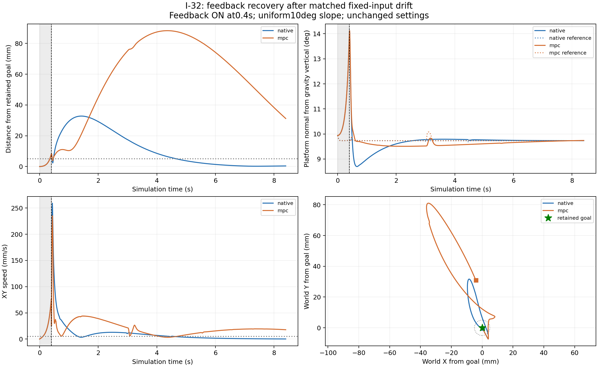
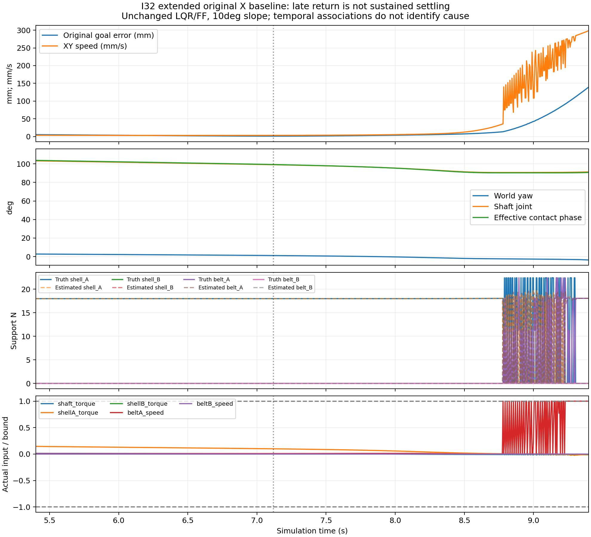
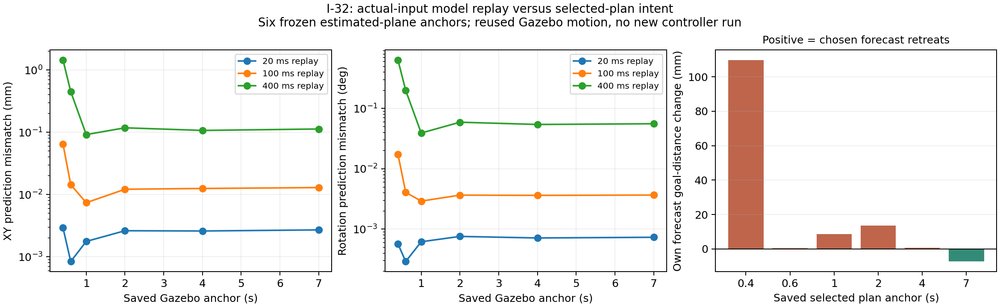

# I-32–I-33: feedback recovery and planning diagnosis

**Completed result:** unchanged native LQR/feedforward settles at 0.381 mm
error in the matched recovery fixture. The current trajectory MPC ends at
31.215 mm and fails the same final-second gate after eight seconds of feedback.
No controller parameters or estimator were changed. Keep native LQR as the
working comparison baseline; these results do not support promoting MPC.

The user asked whether the robot could return after the drift in I-31, whether
the scene was off-road, and why the platform was tilted. The earlier clip was
only 0.4 s of fixed torques with feedback disabled on a uniform 10° slope.
It did not answer the recovery question.

**Interpretation correction:** an unstable balancing system can drift under
fixed inputs and recover with feedback. I-31's stationary acceleration residuals
remain evidence that its fitted states were not verified trims; its open-loop
hold failures do not establish failure of LQR/MPC feedback or justify replacing
the controller. Tuning remains a possible explanation for other failures.

## Matched test, without tuning

The [protocol](evidence/protocol.json) uses the same nearby fitted pose/input
pair demonstrated in I-31. Gazebo/DART integrates a uniform 10° side-slope mesh
with a .04 m grid. This is not the Mars map or rough-terrain qualification.

For the first 0.4 s, apply the same fixed torques. The original XY goal stays
fixed from the beginning. Run the native hardware-mode observer/locator every
5 ms using measured simulation state and actual applied-input history. At
0.4 s, switch only the applied commands to existing native LQR/feedforward or
the existing I-30 trajectory MPC. No state, goal, observer or synchronizer reset
occurs at the switch. The ordinary design anchor is pi/2; nominal joints are
initialized once from the actual initial state. No gain, cost, horizon, input
bound, contact model or estimator is tuned.

Observe another eight seconds. A settled return requires the complete final
second within 5 mm of the goal, XY speed <=5 mm/s and reference lean error <=2°,
with physical completion and bounded inputs. First goal-radius entry is reported
separately from settling.

Both controllers use exact simulated state plus observer/locator contacts.
Live-contact reads are guarded inside control; truth contacts are logged only
for evaluation. MPC remains an offline research prototype.

## Matched feedback results

The existing gain-scheduled LQR with contact-aware feedforward **returns and
settles without tuning** in this fixture.

| Metric | Native LQR/feedforward | Current trajectory MPC |
|---|---:|---:|
| Error when feedback starts | 8.125 mm | 8.125 mm |
| Peak error during feedback | 32.788 mm | 88.278 mm |
| Final error | 0.381 mm | 31.215 mm |
| Final XY speed | 0.185 mm/s | 17.798 mm/s |
| Maximum goal error in final second | 0.381 mm | 49.518 mm |
| Maximum XY speed in final second | 0.518 mm/s | 19.423 mm/s |
| First complete one-second settling window starts | 4.67 s | None observed |
| Final absolute platform tilt | 9.732° | 9.739° |
| Final requested platform tilt | 9.731° | 9.731° |
| Final-second settling gate | Pass | Fail |

The first entry into the 5 mm radius is at 0.435 s, followed by substantial
overshoot; it is not immediate settling. All 1,681 guarded calls complete;
the final row is an observation rather than another actuated interval.

[Watch the native feedback recovery](../../../../results/feedback_recovery_20261125/videos/native_feedback_recovery.mp4).
The video reconstructs saved Gazebo states, shows the entire 8.4 s at 0.5x,
and labels the switch from fixed inputs to feedback. It shows absolute tilt,
reference tilt and goal error. The platform recovers its requested slope lean,
not a horizontal deck. Rendering performs no new physics.

Both controllers complete without falls and respect applied-input bounds.
The first 0.4 s of state/input/observer/native-shadow history and the state and
observer at the feedback switch match exactly. Both enter the 5 mm radius at
0.435 s; MPC then leaves it and never passes a complete settling window in
this observation period. Its failure is not a claim that it can never recover
or that tuning cannot improve it. There is no LQR fallback in this MPC case.
Its median update takes about 1.0 s for each .02 s simulated interval.

[Watch the matched LQR versus MPC recovery](../../../../results/feedback_recovery_20261125/videos/feedback_recovery_native_vs_mpc.mp4).
Both panels reconstruct saved Gazebo/DART dynamics; the right panel is not a
private-model simulation. The clip covers 8.4 simulated seconds at 0.5x, shows
the fixed-input/feedback switch, and labels absolute and requested platform
tilt separately. Current reference lean is about 9.73°, not a horizontal deck.



## Does the older trajectory just need longer?

After observing native recovery, a separate
[addendum](evidence/extended_baseline_protocol.json) was declared before two
additional Gazebo runs. Extend only the original I-30 LQR trajectory's recovery
time from four to eight seconds: same .8 s warmup, .6 s/16 mm path, phase pi/2,
terrain, controller and estimator. The new duration is 9.4 s. All first 1,081
samples through the old 5.4 s deadline are bit-identical across nine exact
state/input/observer/reference fields. These are separate trajectory fixtures
from the held-drift comparison above.

| Original trajectory | Error at old 5.4 s deadline | Error at 9.4 s | Final speed | Final-second gate |
|---|---:|---:|---:|---|
| Y | 98.826 mm | 5.804 mm | 1.721 mm/s | Fail |
| X | 5.300 mm | 139.607 mm | 298.623 mm/s | Fail |

More time helps Y materially but is not a uniform fix. X reaches about 1.01 mm
error at 7.12 s, then drifts away later. It is not a physical fall, but it does
not remain settled. A near-goal frame can conceal a later failure. These two
runs do not extend the original MPC trajectory cases; they do not provide a
matched longer-time MPC/LQR trajectory comparison.

### Late X event: a concrete diagnostic target

The [late-X audit](evidence/extended_original_baselines/late_x_audit/report.json)
finds that motion references, drive-speed references and rolling feedforward
are exactly zero during 5.4–9.4 s. This is a stationary-goal feedback event,
not a spike from inverting a moving velocity reference. Error crosses 10 mm at
8.660 s, the belt first reaches 99% of its bound at 8.780 s, and the first true
shell/belt contact switching occurs at 8.785 s. At 8.885 s, belt A is selected
by both truth and estimate; LQR requests about 0.853 m/s and the actuator clips
to 0.3 m/s. Later shell-supported intervals also receive synchronizer commands.

Before 8.5 s, estimated patch identity agrees with truth and the contact-point
gap stays below about 18.7 µm. During 8.5–9.4 s there are 21 identity-mismatch
samples, contact switching and substantial belt limit occupancy. This does not
exclude a transition-estimation contribution. Observer estimates and logged
instantaneous truth forces also have different timing/filtering, so their raw
difference is not pure estimation error.

These observations identify a reproducible configuration/support/gain/actuator
event. No ablation has yet separated those causes. They do not establish that
particle filtering, a gain change or a terminal-cost change is the fix.



## Private-model replay: prediction versus planning

A separately declared [replay audit](evidence/model_replay_protocol.json) uses
six saved MPC anchors and the actual subsequently applied commands. Each
estimated plane is reconstructed exactly and frozen; each .02 s command is
verified to match four consecutive .005 s samples. No new Gazebo runs occur.
The [report](evidence/model_replay/report.json) compares the private prediction
to the saved exact Gazebo state:

| Prediction horizon | Median XY mismatch | Maximum XY mismatch | Maximum rotation mismatch |
|---|---:|---:|---:|
| 20 ms | 0.00261 mm | 0.00292 mm | 0.000758° |
| 100 ms | 0.01272 mm | 0.06491 mm | 0.01743° |
| 400 ms | 0.11547 mm | 1.45397 mm | 0.63864° |

The selected MPC forecasts themselves sometimes increase goal distance: at
0.4 s, 8.125 to 117.973 mm over the predicted horizon; at 2 s, 44.903 to
58.604 mm; at 4 s, 87.407 to 88.098 mm. The 7 s forecast moves toward the goal.
The controller also ends moving toward the goal, but has not settled within
the declared observation period.

These sampled checks do not support attributing the failed MPC recovery solely
to unexpected plant drift. They do not validate the state/input Jacobians,
prove a sole cause, establish global nonlinear optimality or guarantee that
tuning will fix it. One SQP refinement and a finite seed set can miss useful
plans even when all individual QPs solve successfully. Cost priorities,
horizon and local planning choices remain candidates to examine.



## I-33: a lower-cost bounded candidate was missed

The first selected plan predicts large retreat, but that alone does not show
that the cost weights require retreat. A final
[declared frozen-anchor check](evidence/candidate_cost_protocol.json) recomputes
the saved 0.4 s plan with the same estimated plane, target states, weights,
bounds and nonlinear scorer. All predicted states and the selected cost
reproduce exactly. It then evaluates two bounded 20 ms command sequences
derived from the separate native run's saved future commands:

| Offline sequence | Total nonlinear cost | Predicted terminal goal error | Predicted absolute tilt |
|---|---:|---:|---:|
| Selected MPC plan | 24,525.748 | 117.973 mm | 54.317° |
| First native command from each 20 ms interval | 41,777.448 | 133.215 mm | 53.488° |
| Mean of four native 5 ms commands per interval | 125.012 | 21.723 mm | 10.282° |

The averaged sequence is about 196 times lower cost under the **unchanged**
objective and obeys the same physical input bounds. This demonstrates a missed
feasible candidate in the one-SQP search at that anchor. The first-sample
sequence fails, so arbitrary downsampling is not a reliable seed.

These saved future commands are an offline diagnostic, not deployable future
knowledge or a new controller. No Gazebo run or performance claim is attached
to either candidate. The result does not prove that a practical native-policy
rollout seed, more refinement, or any tuning change will fix recovery. It does
support investigating initialization/search quality before concluding that
new weights, a new equilibrium target or a new estimator are required.

Exact sources, commands, predicted states and component costs are in the
[candidate report](evidence/candidate_cost/report.json).

## Resulting decision

**Later follow-up:** [I-34](../mpc-search/README.md) completes the frozen-state
refinement, practical rollout-seed and closed-loop comparisons. Modeled initial
cost improves, but seeded MPC still fails settling at 28.982 mm final error.
LQR remains the benchmark; the late native X event remains a regression case.
The I-34 results are outside the frozen I-32/I-33 bundle.

Keep the existing LQR/feedforward controller as the working baseline. It
recovers this demonstrated drift without tuning. The current MPC prototype
does not earn promotion from this matched test. If MPC work continues, first
test a practical feasible initialization/refinement strategy against the
unchanged objective and native baseline; an offline candidate is not that fix.

For the original LQR trajectory, the reproducible late X
configuration/support-transition event also warrants a controlled ablation. The
longer-time results do not support accepting an early near-goal frame or
assuming more time fixes every case. No particle filter or broad gain/weight
search was implemented in this campaign.

## Evidence and limits

The [local campaign](../../../../results/feedback_recovery_20261125/) preserves
raw states, plans, source snapshots, failure/setup logs and the declared
protocols. Compact snapshots and the [evidence manifest](evidence/manifest.json)
are stored under `evidence/`. Four new Gazebo executions comprise two matched
recovery cases and two extended original-baseline cases. Six frozen-state
private-model replays and three offline candidate evaluations reuse those
traces; they are not new Gazebo runs. Earlier I-30/I-31 bundles remain unchanged.

Three focused recovery-metric tests pass. The prior 106-test selected suite is
earlier work, not rerun or added to this test count. This campaign changes the
experimental runner, not production controller behavior.

The [separate presentation bundle](../../../../results/feedback_recovery_20261125/presentation-pack.zip)
contains the iteration notes, compact evidence, both videos and the four new
runs' rollout/precision traces. Full MPC plan JSON and generated meshes remain
local with hashes and paths. The exact prior fitted input case is included;
older raw baselines are required for the prefix-reproduction analysis.

To repeat the native case in a **fresh** directory, use the Gazebo environment
from [GAZEBO.md](../../../../GAZEBO.md):

```bash
env -u PYTHONPATH -u LD_LIBRARY_PATH -u AMENT_PREFIX_PATH -u CMAKE_PREFIX_PATH -u COLCON_PREFIX_PATH \
  MAMBA_ROOT_PREFIX="$PWD/build/mamba" build/tools/bin/micromamba run -p "$PWD/build/gazebo-env" \
  env MUJOCO_GL=egl OPENBLAS_NUM_THREADS=1 OMP_NUM_THREADS=1 \
  python -u scripts/run-feedback-recovery.py --output results/new_feedback_recovery \
  --variant native --terrain slope --drift-s .4 --recovery-s 8
```

Repeat with `--variant mpc` for the matched candidate. The runner refuses to
overwrite a completed run. Its exact launch snapshots are distinct from later
current-source copies. These commands perform new experiments; they do not
increase the historical execution counts above.

```bash
PYTEST_DISABLE_PLUGIN_AUTOLOAD=1 OPENBLAS_NUM_THREADS=1 \
  .venv/bin/python -m pytest -q tests/test_feedback_recovery_metrics.py
```
