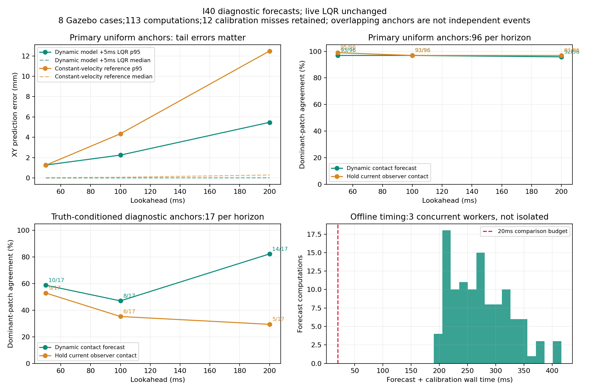

# I-40: audit predictive contacts under unchanged LQR feedback

2026-11-25. **Completed:** eight fresh Gazebo/DART trajectories and 113 private
forecasts, with unchanged live LQR. Motion prediction often improves on
constant velocity; contact prediction and runtime do not yet justify changing
commands. The forecast stays diagnostic.

[Trajectory video](../../../../results/lqr_contact_forecast_20261125/videos/native_lqr_trajectory_overview.mp4)
· [Forecast versus actual video](../../../../results/lqr_contact_forecast_20261125/videos/contact_forecast_vs_gazebo.mp4)
· [Authoritative report](evidence/analysis/final_report.json)
· [Evidence manifest](evidence/manifest.json)
· [Presentation bundle](../../../../results/lqr_contact_forecast_20261125/presentation-pack.zip).

**Report-stage correction:** use `final_report.json`. The preserved initial
`analysis/report.json` has invalid pooled warning FP/FN/precision/recall because
an aggregation function consumed its input generator too early. Per-anchor
records and motion/contact-endpoint metrics were correct. A separately sealed
arithmetic correction and final consolidation retain the original failure;
no physics, geometry evaluation or forecast was rerun to correct those counts.

## Trajectory results

All eight cases finish without falls and retain bounded applied inputs.
Four of seven controlled cases pass the original final-one-second settling
criterion; Mars fails its separate existing route gates. These are unchanged
controller measurements, not a before/after improvement comparison.

| Case | Duration | Moving RMS error | Final error | Quality result |
| --- | ---: | ---: | ---: | --- |
| Flat hold | 4.0 s | — | 0.0001 mm | Settling passes |
| Flat x | 5.8 s | 7.47 mm | 1.77 mm | Settling passes |
| Flat y transfer fixture | 4.0 s | 9.59 mm | 10.18 mm | Settling fails |
| Slope x, late regression | 9.4 s | 5.47 mm | 99.45 mm | Settling fails |
| Slope y | 9.4 s | 8.76 mm | 6.02 mm | Settling fails |
| Flat out-and-back | 7.8 s | 7.38 mm | 3.21 mm | Settling passes |
| Flat triangle | 9.8 s | 6.43 mm | 3.08 mm | Settling passes |
| Mars figure-eight, +.9 phase | 44.0 s | 50.49 mm | 190.19 mm | Existing route gates fail |

The flat y case stays belt-supported and produces **no stable shell/belt
transfer**. It is retained as an unmet coverage objective. The declared late-x
fallback has its first stable shell-to-belt family change at 9.260 s, with an
eligible forecast from 9.160 s. No other stable family change occurs within
±100 ms, but raw forces still chatter. It is a stress case, not a clean
instantaneous handover. No sustained multiple-patch load interval above the
declared 5%-weight threshold is demonstrated by this suite.

## Forecast results

All **113 forecasts** compute: 96 uniform primary anchors and 17 separately
labeled, truth-conditioned diagnostic anchors. All are unique case/anchor
pairs. Reconstructed command, requested command, observer, normal, nominal
joint and reference histories match the fresh live logs exactly. Source
controller states remain unchanged. The 339 horizon endpoints are nested
within these forecasts, not additional independent trials.

| Horizon | Uniform XY error, dynamic p95 | Constant-velocity p95 |
| --- | ---: | ---: |
| 50 ms | 1.27 mm | 1.26 mm |
| 100 ms | 2.25 mm | 4.35 mm |
| 200 ms | 5.47 mm | 12.48 mm |

Uniform 200 ms dominant-patch accuracy is **92/96** for dynamics versus
**93/96** for holding the observer's current label. Near the selected
transfers, the corresponding figures are **14/17 versus 5/17**, but these
overlapping event-conditioned anchors are not independent physical events or
representative population statistics. The maximum dynamic 200 ms XY error
on uniform anchors is **29.63 mm**. Quiet-case medians alone hide this tail.

The corrected 120 ms incoming-warning proxy has dynamic TP/FP/FN **3/0/3** on
uniform anchors versus **2/18/4** for native kinematic preparation. On
event-conditioned anchors it is **7/0/16** versus **14/1/9**. These are
correlated anchor/patch warning opportunities, not physical-event recall or
equivalent force forecasts. The native warning predicts preparation/exposure;
neither its lead time nor its meaning equals predicted load-transfer time.

Twelve of 113 current-load fits miss the declared tolerance, including 5/96
uniform and 7/17 event-conditioned anchors. All are bracketed; they are not
12 unbracketed fits. They remain included in reported accuracy. In the selected
late-x video, the model has a −1.966 N initial load residual, predicts loss of
wheel load around +100 ms and selects dominant shell A at +200 ms while actual
support is belt A. Similar body motion does not establish correct contact.

Another diagnostic example: slope-y anchor 4.260 s, +50 ms has only **0.465 mm**
equivalent-contact point error and **0.048 N** total-load error, yet predicts
dominant belt A with shell A also loaded; truth is shell A alone. Accurate
resultant point/force does not establish the correct load distribution.

Forecast plus calibration costs **270 ms median**, **364 ms p95**, **416 ms
maximum**; 0/113 meets a 20 ms budget. Three concurrent workers affect these
measurements, and they exclude history reconstruction, predictor construction
and serialization. This is an offline diagnostic, not a real-time benchmark.

## Protocol and measurement boundary

The question is how well an observer-initialized private model forecasts
contacts and motion when it includes the actual native 5 ms feedback policy.
The live controller remains hardware-mode gain-scheduled LQR, contact-aware
feedforward, least-squares rolling allocation and existing synchronization.
No iLQR optimizer, gain tuning or default change is included.

Eight fresh Gazebo/DART cases cover flat hold, flat x motion, a flat y transfer
fixture, the retained late slope-x regression and slope-y path, flat
out-and-back, a flat triangle and the existing full Mars figure-eight at +.9
starting phase. The controlled cases use flat or uniform 10° slope surfaces;
only the named Mars case uses the actual Mars yard. Completion, trajectory
quality, settling and forecast accuracy will be reported separately.

Each private forecast clones the current controller and observer history,
initializes its plane/friction from estimates, and simulates 200 ms of native
feedback at 5 ms intervals. Results at 50/100/200 ms come from that fine
trajectory, without averaging commands into slower holds. Its actual future
comparison uses the same native policy and reference program, not MPC inputs.

The protocol declares up to 12 uniform primary anchors per case, plus up to
eight evaluation-selected anchors before four stable shell/belt family
transfers. The latter use truth only to select diagnostic windows and remain
a separate stratum. Future truth is never passed into prediction or feedback.
Unique actual events are not counted repeatedly as independent transfers.

Baselines remain distinct: holding the current estimated patch/load shares;
constant-velocity state/geometry extrapolation; and the existing 120 ms
kinematic preparation warning. A kinematic method has no predicted contact
forces, so force/load accuracy will not be ranked against invented values.
Both raw and dwell-filtered contact changes will be reported, with censored
endpoints and forecast failures retained. A proposed isolated transfer must
meet its stated isolation condition rather than be assumed from the case name.

[Declared protocol](../../../../results/lqr_contact_forecast_20261125/protocol.json)
· [Clarifications](evidence/protocol_clarifications.json)
· [Exact cases](../../../../results/lqr_contact_forecast_20261125/campaign/jobs.json)
· [Iteration record](../../../../ITERATION_LOG.md#i-40--authorized-lqr-contact-forecast-and-trajectory-audit).

The fresh late-x fixture repeats the nominal path/control but is **not a
bitwise historical reproduction**: its generated mesh is ±1.0 m/51×51 vertices
versus the old ±.9 m/46×46, both .04 m spacing. Initial numerical differences
amplify later; final error is 99.45 mm versus the old 139.61 mm. This setup
distinction is recorded without claiming it as the sole cause. Every forecast
is compared to its own fresh actual trajectory.
[Repeatability record](evidence/campaign/old_slope_x_repeatability.json).

## Development, preservation and reproduction

The latest selected integration has **45 passing checks** in both environments:
14 forecast, 15 existing seed and 16 model checks. Counts overlap across
environments and source stages; they are not 90, 180 or the full repo suite.
A review correction fixed the before-command branch's stale anchor preview;
the campaign's provided-current-command branch was unaffected. An unexecuted
runner syntax error, analysis aggregation failure and preview metadata path
failure are preserved with their source stages. Later passes do not erase them.

The videos reconstruct saved states, add no physics and verify decoded final
frames/source hashes. The overview shows flat x and out-and-back at 1×, then
the actual Mars DEM route at 2×. The second clip labels actual Gazebo versus
the private estimated-plane forecast, with 50/100/200 ms markers, common force
scale, load-fit limitation and private −1 ms solver-force timing. Its stress
case was selected by the declared first-event rule, not prediction quality.

Compact evidence preserves exact launch/test/analysis/render stages and
corrected-versus-original reports. Full new NPZ traces, forecast JSON and clips
are in the separate presentation bundle. Generated workspaces/meshes are
inventoried rather than copied. Python snapshots end in `.py.txt`; restore the
original manifest paths for reproduction. Earlier packs retain their hashes.

The [campaign reproduction notes](evidence/campaign/README.md) describe the
Gazebo-environment commands. Run actual collection first, then the forecast
stage with the same numerical package versions; use fresh output locations.
The final analysis combines the initial saved-data reduction, corrected
warning aggregation and metadata consolidation. The authoritative report
records exact input/source hashes for each stage.
[Independent review](evidence/review/final_review.md)
· [Bundle verification](presentation_verification.json).

**Decision:** retain fast LQR and current observation as the live baseline.
Dynamic motion forecasting is useful in this ideal-state simulation study,
but current-load fit, timely contact warnings, outliers and computation cost
need improvement before forecast-driven preparation or gain changes. No such
controller change, iLQR or general multi-contact estimator is implemented here.
