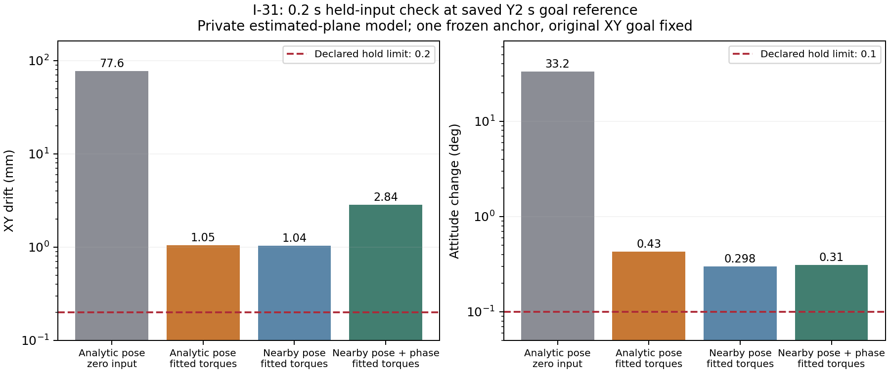
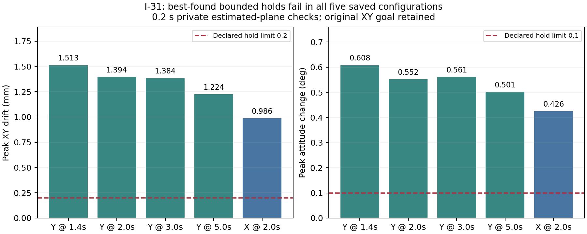

# I-31: checking the MPC rest-goal target

**Later qualification:** [I-32–I-33](../feedback-recovery/README.md) shows the
unchanged native feedback controller recovering the demonstrated drift, while
current MPC fails the same eight-second settling test. A lower-cost bounded
candidate is also missed by the local MPC search. Thus the fixed-input hold
failures below do not establish failure of feedback recovery. The frozen I-31
bundle retains the earlier record; these later findings change the next-step
priority without rewriting its numerical results.

This follow-up keeps the I-30 estimator, original XY destination and controller
defaults. It checks the proposed equilibrium target before a new MPC comparison.
The [I-27–I-30 record](../mpc-balance/README.md) and its presentation bundle remain
frozen.

## Question and decision rule

I-30 improved balance, but its selected Y predictions sometimes moved away from
the goal after the path stopped. The reference combined goal XY, current
height/configuration, analytic lean and zero rates without a hold check. Its
effort cost favored zero input rather than a verified holding input. These are
design concerns, not established causes of the observed retreat.

The [declared protocol](evidence/protocol.json) first requires a bounded-input
goal hold and usable local recovery model. The 0.2 s hold limits are 0.2 mm XY
drift, 0.1° attitude change, 2 mm/s body speed, 0.02 rad/s angular speed and
0.05 rad/s internal rates. Failure of a numerical search does not prove the
physical goal unreachable. A finite positive terminal matrix alone does not
establish feasible recovery.

## Implemented and verified separately

The optimizer now optionally tracks physical input references. It also accepts
an added terminal quadratic on state error and final normalized input error,
including their cross terms. This permits a command-change-aware terminal value
when a suitable local model is available. These APIs do not select a new goal
or activate a new controller mode.

The final selected integration suite passes **106 checks** in the Gazebo Python
environment: 61 solver, 16 predictor, 10 hardware-mode, two nonlinear-scoring
and 17 equilibrium checks. Earlier 61/89/17-test records overlap this suite and
are not additive. This is not the full repository suite. Six constant/LTV
default cases match the preserved pre-change solver bit for bit. A known flat
rest target passes the hold verifier; the verifier does not reject every case.

After final integration, the two nonlinear-scoring tests gained the same
optional-OSQP skip guard as the other solver tests. Both were rerun successfully;
runtime code and numerical behavior were unchanged. The exact pre-integration
source and later test-only guard are distinguished in the evidence.

The nonlinear acceptance score uses the same substantive centered-input and
terminal costs as the QP. As in I-30, its score omits the QP's numerical
regularizer of 1e-9 on absolute normalized inputs. Defaults retain the original
cost and behavior.

## First frozen-state hold checks

At the saved Y2 s state, all fits retain the original goal XY and the same
calibrated estimated plane. Holding input means a constant bounded physical
command, with no feedback during the check.

| Candidate at the same frozen anchor | XY drift after 0.2 s | Attitude change | Hold gate |
|---|---:|---:|---|
| Analytic rest reference, zero input | 77.601 mm | 33.195° | Fail |
| Analytic rest reference, fitted torques | 1.048 mm | 0.430° | Fail |
| Nearby height/tilt, fitted torques | 1.041 mm | 0.298° | Fail |
| Nearby height/tilt/shaft phase, fitted torques | 2.843 mm | 0.310° | Fail |
| Independent scaled nearby search | 0.995 mm | 0.505° | Fail |

These are multiple fits of one frozen anchor, not five distinct trajectory
tests. Successful least-squares termination is separate from a verified hold.
The original and later equivalent inline diagnostics are retained alongside
source-backed follow-up scripts; later helpers are not labeled original launch
sources.



The source-backed audit then evaluated all five declared frozen anchors. It
fits all five bounded physical inputs, then makes one local nearby
height/tilt/shaft-phase and input solve. The plane stays fixed for each anchor.
The best-found candidate is selected by hold-limit violation, not by numerical
solver success. The fixed analytic pose with fitted inputs was selected in all
five cases; no candidate passed.

| Frozen configuration | Peak XY drift in 0.2 s | Peak attitude change | Peak body speed |
|---|---:|---:|---:|
| Y at 1.4 s | 1.513 mm | 0.608° | 18.18 mm/s |
| Y at 2 s | 1.394 mm | 0.552° | 16.72 mm/s |
| Y at 3 s | 1.384 mm | 0.561° | 16.49 mm/s |
| Y at 5 s | 1.224 mm | 0.501° | 14.50 mm/s |
| X at 2 s | 0.986 mm | 0.426° | 11.99 mm/s |



All cases retain positive support and respect input bounds, yet fail the
position, attitude and rate limits. The search is local, uses raw mixed-unit
acceleration residuals, and limits pose changes to ±3 mm height, ±0.08 rad tilt
and ±0.35 rad shaft angle. It does not prove no equilibrium exists elsewhere.

At Y2 s, inverse dynamics with zero acceleration requires about 3.17 N of
unactuated force tangent to the slope. This makes low-speed contact behavior in the
private model a concrete concern; it does not establish that contact
regularization alone causes I-30's retreat. Inverse dynamics is a diagnostic,
not accepted forward-hold evidence.

**Decision:** the declared equilibrium prerequisite failed. No terminal value
was derived, local equilibrium recovery was not claimed, and no new
equilibrium-based closed-loop MPC candidate was launched. Optional objective
support remains tested preparation.

## Separate Gazebo hold diagnostic

Two saved pose/input pairs were initialized in a separate Gazebo/DART process
and held for 0.4 s with fixed torques. The private model starts at exactly the
returned Gazebo pose and velocity, including the bridge's documented 1 µs reset
microstep. This avoids claiming mathematically zero initial velocity or
resetting an ongoing trajectory. Each pair has the same initial state and
input across engines; the poses differ between the two pairs.

| Fixed pose/input pair | Engine | XY drift at 0.2 s | Attitude change | XY drift at 0.4 s |
|---|---|---:|---:|---:|
| Original analytic pose, fitted torques | Gazebo/DART | 1.069 mm | 0.437° | 4.938 mm |
| Same pair | Private MuJoCo | 1.046 mm | 0.430° | 8.054 mm |
| Independent nearby pose, fitted torques | Gazebo/DART | 0.986 mm | 0.501° | 8.125 mm |
| Same pair | Private MuJoCo | 0.996 mm | 0.506° | 8.120 mm |

All corrected traces retain positive support. **These two hold failures also
occur in Gazebo**, so they cannot be dismissed as a private-model-only artifact.
The original-pose prediction diverges materially by 0.4 s; this small diagnostic
does not validate the full MPC horizon or identify the sole cause of retreat.
These are open-loop fixed-input fixtures with no tracking controller or
observer, not new MPC performance or hardware tests.

Two completed Gazebo holds were repeated after fixing contact-label aggregation
(`shell_A_smooth` versus `shell_A`). The earlier kinematics and zero-load logging
error are preserved. Thus there are **four completed 0.4 s Gazebo holds of two
distinct pose/input pairs**, not four independent trajectory cases. Two earlier
startup assertion failures are separate from completed holds: overly strict
raw-pose and zero-velocity checks exposed the bridge's reset microstep. Source,
failures, correction and repeated traces are retained.

The short [diagnostic video](../../../../results/mpc_equilibrium_20261125/videos/nearby_goal_hold_gazebo_vs_private.mp4)
reconstructs saved Gazebo/private-model states. It shows fixed-input drift, not
closed-loop control performance. Exact media source and hashes are inventoried.

## Resulting next step

Keep the current controller as the comparison baseline. Establish a goal-holding
operating state with physically consistent contact forces and holding inputs,
allowing the orientation/internal configuration to settle where necessary, and
verify it in both engines. The bounded local search used here did not find one;
it did not exhaust configurations. Only then derive and test the local terminal
value. More weight tuning or particle filtering is not supported by these hold
tests as the immediate fix.

## Evidence and reproduction

Compact evidence is preserved under [evidence](evidence/). Large model
meshes and raw traces stay under
[the local campaign](../../../../results/mpc_equilibrium_20261125/).
The record distinguishes private-model audits, open-loop Gazebo fixtures,
unit tests and reused I-30 trajectory data. Old bundles are not overwritten.

The [evidence manifest](evidence/manifest.json) inventories compact snapshots;
the [separate presentation pack](../../../../results/mpc_equilibrium_20261125/presentation-pack.zip)
includes these notes, the iteration log, compact evidence, corrected short hold
traces and the diagnostic video. Full I-30 plan files and generated mesh payloads
remain in their recorded local campaigns.

Recheck the selected software suite in the configured Gazebo environment:

```bash
env -u PYTHONPATH -u LD_LIBRARY_PATH -u AMENT_PREFIX_PATH -u CMAKE_PREFIX_PATH -u COLCON_PREFIX_PATH \
  MAMBA_ROOT_PREFIX="$PWD/build/mamba" build/tools/bin/micromamba run -p "$PWD/build/gazebo-env" \
  env PYTEST_DISABLE_PLUGIN_AUTOLOAD=1 OPENBLAS_NUM_THREADS=1 OMP_NUM_THREADS=1 \
  python -m pytest -q tests/test_predictive_control.py tests/test_predictive_model.py \
  tests/test_hardware_mode.py tests/test_mpc_comparison_objective.py tests/test_predictive_equilibrium.py
```

The audit script deliberately refuses to overwrite its preserved source stage.
A current-source repeat must use a fresh output directory; this is a new
experiment, not an additional historical execution. It requires the local I-30
raw files referenced by the audit:

```bash
OPENBLAS_NUM_THREADS=1 .venv/bin/python - <<'PY'
import importlib.util
from pathlib import Path
spec = importlib.util.spec_from_file_location('audit', 'scripts/audit-mpc-equilibrium.py')
audit = importlib.util.module_from_spec(spec)
spec.loader.exec_module(audit)
audit.OUTPUT = Path('results/mpc_equilibrium_reaudit').resolve()
audit.main()
PY
```
