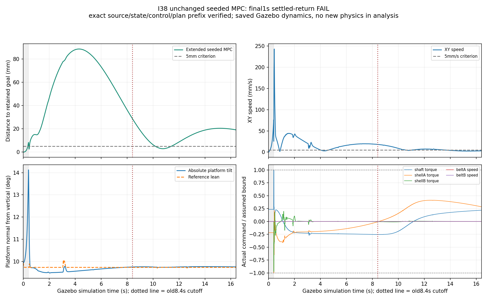

# I-38: extend the unchanged seeded MPC return

2026-11-25. User-authorized follow-up to the I-37 video review. **Completed:**
one Gazebo/DART execution, .4 s fixed-input drift followed by 16 s feedback
(16.4 s total). It returns within **2.94 mm**, then moves away again; no full
one-second settled window is observed. The entire old 8.4 s prefix matches.

[Watch the extended run](../../../../results/mpc_extended_return_20261125/videos/seeded_mpc_extended_return.mp4)
· [Analysis report](evidence/analysis/report.json)
· [Return events](evidence/analysis/return_events.json)
· [Prefix verification](evidence/analysis/prefix_verification.json)
· [Evidence manifest](evidence/manifest.json)
· [Presentation bundle](../../../../results/mpc_extended_return_20261125/presentation-pack.zip).

| Event | Simulation time | Goal distance |
| --- | ---: | ---: |
| Old video ends, moving inward | 8.400 s | 28.982 mm |
| Reenters the 5 mm goal region | 10.185 s | <=5 mm |
| Closest approach in the added interval | 10.755 s | 2.936 mm |
| Last sample in that goal-region visit | 11.400 s | <=5 mm |
| Largest subsequent retreat | 15.165 s | 20.492 mm |
| Extended recording ends, moving inward again | 16.400 s | 19.100 mm |

The user's observed return was real. Position stays within 5 mm from 10.185 to
11.400 s, but the speed/attitude/position conditions hold together for at most
**0.530 s**, short of the unchanged one-second criterion. Final XY speed is
**2.997 mm/s**, and final reference-relative lean error is **0.0262°**. The
final-second position maximum is **20.434 mm**. The final settling gate fails
on position; no complete one-second settled window occurs anywhere in the run.
At the endpoint it is moving inward again at **2.052 mm/s radial speed**.

The run completes without a fall, bounded inputs throughout, and zero actual
native fallback. During the added interval truth and estimate both identify
shell A in all 1,600 samples, with no dominant-patch transitions or disagreements,
no actuator saturation, no logged fork load, and minimum logged normal load
17.947 N. This renewed drift does not coincide with a patch handover or command
limit in that interval. Dominant-patch agreement does not establish every
contact-estimation quantity as correct or rule out all estimation effects.

The result establishes return followed by renewed retreat and another inward
trend. It does not establish a limit cycle, asymptotic failure/success, or a
specific damping, gain or objective cause. The more concrete next diagnostic
would inspect the commands and predicted/actual motion around the 10.2–11.4 s
near-goal passage. No such controller change or additional run is included here.

The question is whether the sustained inward return seen when I-34 ended
finishes and settles with more time. No controller tuning is included. The
same one-refinement, stride-5 Jacobian, .4 s prediction horizon and 20 ms input
hold remain in use, with the same 5 ms observer, practical predicted-native
seed, physical bounds, weights and retained goal. The setting is a uniform
10° side-slope mesh, not Mars. State measurements remain exact simulated
qpos/qvel; contact inputs come from the observer/locator, with live-contact
read guards. This is an offline prototype, not real-time or hardware evidence.

Preflight verified all 52 source hashes, the saved starting case, gain cache
and numerical package versions against the I-34 launch. The original runner
already accepts a longer duration, so no controller or runner source changed.
It saves a fresh exact source snapshot before execution. No state or observer
reset occurs at .4 s or the old 8.4 s endpoint.

Verification passes: all non-wall-time precision and rollout fields across
the first **1,681 samples** match bit for bit, and all **401 plan decisions**
match exactly after excluding wall-clock timing fields. Source/settings,
packages, terrain bytes, gain cache, initialization and feedback activation
also match. The old terminal command was computed but not actuated; the
extension newly applies it. Thus the added interval follows the same recorded
history, rather than a differently tuned controller or altered prefix.

The acceptance criterion remains the final complete second within 5 mm of
the original goal, XY speed <=5 mm/s and reference-relative lean error <=2°,
with completion and bounded actual inputs. Also report first full settled
window, overshoot, renewed drift, source/fallback counts and runtime. A brief
goal crossing alone does not count as settling. Earlier native/original-MPC
results are reused baselines, not additional executions in this iteration.

[Declared protocol](../../../../results/mpc_extended_return_20261125/protocol.json)
· [Launch command](../../../../results/mpc_extended_return_20261125/launch_command.txt)
· [Live log](../../../../results/mpc_extended_return_20261125/launch.log)
· [Prior return review](../mpc-return-review/README.md).

There are 3,281 guarded controller calls, 800 actuated accepted plans and
1,602 solved QPs; including the terminal observation there are 801 plans and
1,604 QPs. All 3,200 actuated feedback samples use SQP-refined source-3 inputs.
No seed-generation or trial failure is recorded. These are nested counts of
one simulation, not additional cases or unit tests. Median planning takes
**2.441 s per .02 s simulated command interval**, so this remains offline.

## Preservation and reproduction

The video reconstructs saved Gazebo/DART states in MuJoCo, with a fixed-world
goal inset, distance/speed/absolute-and-reference-tilt charts, and the old 8.4 s
cutoff. It is 1280×1000, 20 fps, 657 frames, 32.85 s at 0.5× playback. The decoded
last frame and input/source hashes are verified; rendering adds no physics.
[Video metadata](evidence/videos/video_metadata.json).

Compact evidence preserves exact launch sources, provenance, protocol, reports,
plots and exact analysis/render source stages. Primary analysis was sealed
before a separately staged saved-data reduction added the later retreat event;
neither stage reruns physics. A pre-execution review corrected exclusion of
the wall-clock `plane_update_s` field from plan comparison; simulation times
remain compared. Earlier source and trial records are retained.

Full new plans JSON and generated meshes stay local with path/hash inventory.
The shareable bundle includes the new video, new and I-34 baseline NPZ traces,
gain cache and compact evidence. Python snapshots use `.py.txt`; restore
original manifest paths before reproducing. No new unit-test suite ran:
earlier 124 checks are not an I-38 count. Source/prefix/metric/media/hash/archive
checks are recorded separately. Earlier presentation packs retain their hashes.

Use the launch command above with a fresh `--output` path and the same Gazebo
environment; no runner/controller source was changed for this extension.
[Presentation verification](presentation_verification.json).
