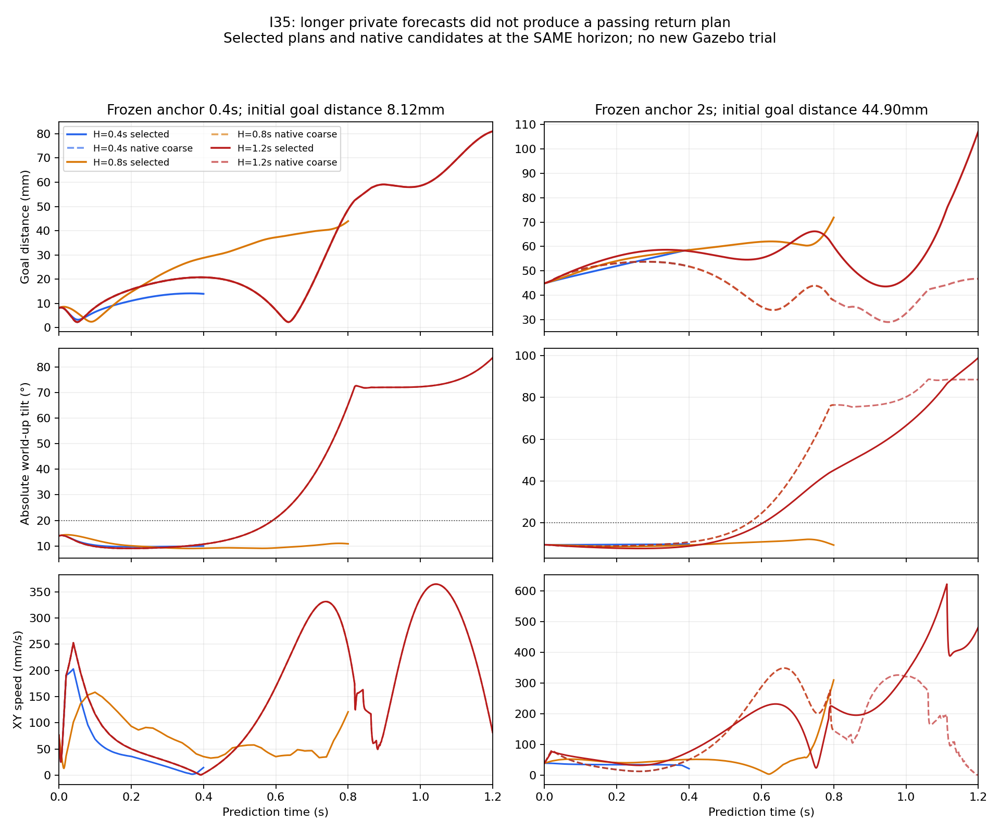

# I-35: longer horizons did not produce a convincing return plan

2026-11-25, completed frozen-state experiment. **Six private MuJoCo forecasts;
zero new Gazebo trials.** Neither longer horizon passed the declared selection
rules. This is a retained negative result, with no controller-default change.

[Iteration log](../../../../ITERATION_LOG.md#i-35--longer-horizon-frozen-comparison)
· [Protocol](evidence/protocol.json)
· [Report and explicit gates](evidence/frozen/report.json)
· [Evidence manifest](evidence/manifest.json)
· [Local presentation bundle](../../../../results/mpc_horizon_20261125/presentation-pack.zip)

## Question and controlled comparison

I-34 showed a short-window tradeoff: at the saved 2 s state, the selected plan
allowed more position retreat while avoiding the corrective lean of its native
policy candidate. We tested whether more lookahead would reveal enough later
return benefit to produce a better plan, before changing weights or estimators.

Use the same failed I-32 MPC states at 0.4 s and 2 s. Compare horizons
**0.4 / 0.8 / 1.2 s**, or 20 / 40 / 60 stages. Every case uses full-stage
Jacobians, a present-state predicted-native seed and the same five-refinement
budget. Weights, scales, input/change penalties, physical bounds, observer,
locator, friction and 20 ms command/stage period remain fixed. Terminal
multiplier 4 moves to each new horizon end as part of the horizon change.

The private model uses the observer-conditioned local plane; the source fixture
is the earlier 10° Gazebo slope, not a Mars map or unknown-terrain forecast.
The goal is the original fixed XY position; the balance reference intentionally
leans about 9.73°, rather than staying world-horizontal. Exact simulated state
is still an assumed measurement; there is no hardware evidence.

At 2 s, extend the old preceding 20-stage warm sequence by repeating its last
bounded input before the runtime's normal one-stage shift. Generate the native
candidate over each complete horizon. Shared current states, first 20 target
stages, first 80 fine native inputs and first 20 averaged inputs match bit for
bit across horizons. No saved future commands are used for the new seed.

## Observed outcome

| Saved state | Initial distance | Horizon | Final predicted distance | Peak world-up tilt at 1 ms | Outcome |
| --- | ---: | ---: | ---: | ---: | --- |
| 0.4 s | 8.12 mm | 0.4 s | 13.95 mm | 14.14° | Early comparison passes; not a return demonstration |
| 0.4 s | 8.12 mm | 0.8 s | 43.95 mm | 14.38° | Exceeds 40 mm excursion rule |
| 0.4 s | 8.12 mm | 1.2 s | 81.03 mm | 83.58° | Predicted tip and nonwheel contact |
| 2 s | 44.90 mm | 0.4 s | 58.60 mm | 9.90° | Fails return and closing-trend rules |
| 2 s | 44.90 mm | 0.8 s | 71.86 mm | 12.13° | Fails return and closing-trend rules |
| 2 s | 44.90 mm | 1.2 s | 107.23 mm | 98.98° | Predicted tip, support loss and retreat |



The 0.8 s plans retain wheel support. The later one finishes moving radially
away at 301.51 mm/s. Both 1.2 s forecasts lose wheel support and load nonwheel
geometries. Mechanical checks sample private physics at 1 ms; replay endpoints
match the saved 20 ms prediction states bit for bit. These are predicted
failures, not newly observed Gazebo falls.

The protocol allows early overshoot because the known recovering LQR also
overshoots. It requires a longer horizon to pass both anchors: bounded inputs,
adequate wheel load, no loaded nonwheel contact, tilt within 20°, acceptable
excursion, and a late plan that ends closer and trends toward the goal.
Neither longer horizon qualifies, so the conditional Gazebo trial was not run.
These are experiment selection rules, not a stability certificate.

## What the optimization evidence does and does not establish

All **42 QP calls solved** and passed the existing normalized KKT check; no
seed-generation failure or execution exception occurred. This is distinct from
passing the motion gates or converging the nonlinear problem. The early
1.2 s case retained the original native candidate with no nonlinear improvement.
Exact per-refinement costs and solver records are retained; intermediate
accepted motion trajectories were not captured. No duplicate solves were run
to add those missing trajectories.

Long-horizon Hessians become severely ill-conditioned: some maximum
eigenvalues reach 10^17–10^25, compared with about 10^6 at 0.4 s. Small relative
negative eigenvalues at those scales are not proof of physical nonconvexity.
No objective rescaling or positive-semidefinite repair was applied.
[Conditioning table](evidence/frozen/solver_conditioning.csv)
· [Within-horizon refinement plot](evidence/frozen/nonlinear_cost_progress.png).

The predicted-native initialization has a substantial limitation. It first
simulates feedback every 5 ms, then averages four commands into each held
20 ms input. Independently replaying those held inputs produces terminal XY
positions **77–103 mm** from the generating fine-feedback trajectory at the
longer horizons, versus **3.77–5.25 mm** at 0.4 s. The coarse trajectory is
correctly replayed and scored; fine states are not substituted into the MPC
cost. The gap shows that the initialization can lose the useful motion of the
policy that generated it. It does not by itself prove the cause of drift.

Raw objective sums at different horizons are not ranked. Selected/native cost
comparisons use the same horizon. Lower modeled cost alone does not demonstrate
goal recovery. Workers ran concurrently; per-plan times of **14–65 s** include
contention and remain far above the 20 ms simulated command interval.

## Decision and proposed next experiment

Do not promote longer horizons or change the estimator on this evidence.
This implementation and budget did not find an acceptable longer plan; that
does not establish that longer lookahead cannot help or recovery is impossible.

The next proposed diagnostic is a seed generated in a way that follows the
20 ms held-input dynamics: after constructing each stage's mean input, replay
that input and generate the next stage from the state it actually produces,
including consistent cloned observer/controller history. Compare it against
the current seed at the same saved states, cadence, horizon and weights before
another horizon or live experiment. This is **a proposal, not implemented or
validated here**. Numerical conditioning also remains unresolved.

## Evidence, source stages and reproduction

The [durable evidence](evidence/manifest.json) includes all six final plans,
1 ms contact/motion records, scalar tables, exact tested source snapshots and
the earlier unexecuted instrumentation stages. Generated history-workspace
geometry is inventoried rather than copied. Model mass properties are retained
separately. Baseline input files remain at the I-32 paths and hashes recorded in
each worker's provenance; this compact bundle does not replace that campaign.

Source stages remain distinct: declared pre-change source; exact 1 ms-audited
worker source; later proposed trace instrumentation that was **never run**;
and exact read-only merge/plot sources. The repository diagnostic script
matches the tested worker version. The underlying model/controller/runners
remain unchanged from I-34. Earlier presentation archives retain their hashes.

From the repository root, choose fresh output paths to reproduce numerical work:

```bash
OPENBLAS_NUM_THREADS=1 OMP_NUM_THREADS=1 .venv/bin/python -u scripts/diagnose-mpc-horizon.py --output results/new_horizon/anchor04 --anchors .4
OPENBLAS_NUM_THREADS=1 OMP_NUM_THREADS=1 .venv/bin/python -u scripts/diagnose-mpc-horizon.py --output results/new_horizon/anchor2 --anchors 2
```

[Frozen reproduction/stage notes](evidence/frozen/README.md)
· [Worker and prefix verification](evidence/frozen/verification.json)
· [Bundle verification](presentation_verification.json).
Archived Python files have `.py.txt` suffixes; restore original manifest paths
before execution. Collection verifies hashes and archive contents without new
physics or unit-test executions. Prior I-34's 124 selected checks are not new
I-35 tests and are not added to these six forecasts or 42 QP calls.

For presentation: “More lookahead did not yield a usable return plan in this
implementation. We retained the failure and found that command averaging can
substantially change the seed trajectory. The next test should separate that
initialization issue from the value of a longer horizon.”
