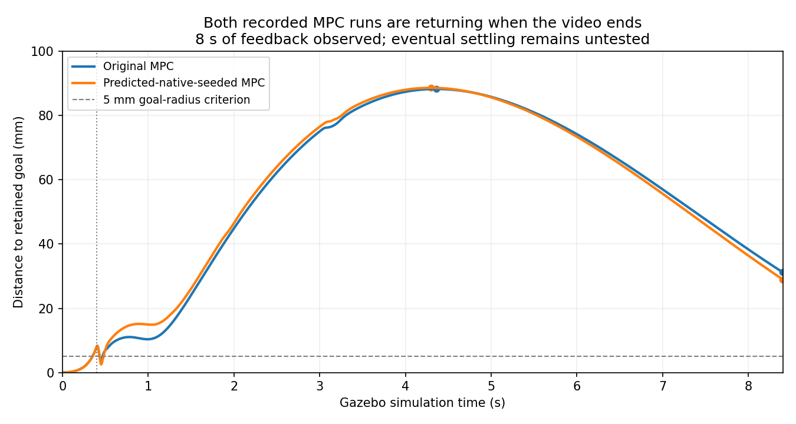

# I-37: the recorded MPC is returning when the video ends

2026-11-25. The user observed inward motion in the I-34 comparison video.
Saved-state review confirms it. **Both original and seeded MPC return steadily
toward the retained goal near the end; eventual settling was not observed.**
This is a saved-data audit, with no new physics, controller changes or tests.

Later follow-up: [I-38 runs the unchanged extension](../mpc-extended-return/README.md),
verifies the old prefix exactly, and observes a 2.936 mm near-goal return followed
by retreat. No full-second settled hold is observed by 16.4 s. The proposed test
below is retained as the I-37 stage of the iteration record.

[Original comparison video](../../../../results/mpc_search_20261125/videos/mpc_original_vs_predicted_native_seed.mp4)
· [Audit report](evidence/report.json)
· [Evidence manifest](evidence/manifest.json)
· [Iteration log](../../../../ITERATION_LOG.md#i-37--the-video-shows-sustained-return-correct-the-priority-inference).

| Recorded controller | Peak goal error | Final second: 7.4–8.4 s | Final inward speed |
| --- | ---: | ---: | ---: |
| Original MPC | 88.278 mm at 4.360 s | 49.518 → 31.215 mm | 17.174 mm/s |
| Predicted-native-seeded MPC | 88.643 mm at 4.295 s | 47.939 → 28.982 mm | 17.989 mm/s |

Distance decreases monotonically from each peak to the last recorded sample.
All 201 radial-velocity samples in the final second point toward the goal.
Radial velocity is the signed projection of measured world-XY velocity onto
the vector from goal to robot; negative means inward. It is different from
total XY speed. The audit verifies source-file hashes against the I-34 report.

There are eight seconds of feedback after the shared initial .4 s drift,
ending at simulation time 8.4 s. The video plays those states at half speed.
Both cases fail the existing final-one-second settled-return criterion: within
5 mm, XY speed <=5 mm/s and reference-relative attitude error <=2°. That failure
does not establish inability to return. Future overshoot, stopping short,
oscillation or settling remain untested.

## Corrected interpretation and proposed next test

I-36's recommendation to move away from this MPC prototype placed too much
weight on the eight-second settling deadline. Qualify that proposed priority:
**extend the unchanged seeded live run before rejecting it on recovery grounds.**
The separate native late-X failure remains valid evidence; it need not become
the immediate next task on the assumption that MPC cannot return.

A bounded next test would extend the I-34 seeded case from 8.4 to **16.4 s total**
(16 s feedback), with its exact original one-refinement, stride-5 Jacobian,
.4 s horizon, observer, weights, bounds and 20 ms held-input timing. Reuse
prior baselines explicitly. Reproduce and verify the saved prefix before
interpreting the added interval; retain the original one-second settling gate
and report any later overshoot or renewed drift. This extension is **proposed,
not launched** by the user's observation or this audit.

I-35's failed longer-horizon private forecasts remain recorded as such. They
are not continuations of this live trajectory and do not erase its measured
inward return. No prediction or deadline change is relabeled as a successful
settled recovery, and no existing pack is modified.

Reproduction: the archived [audit source](evidence/audit_saved_return.py.txt)
reads the exact precision files named and hashed in its report. Restore it to
the original manifest path and use fresh output destinations; its guards
prevent overwriting this stage. Compact evidence includes its exact source,
the reduced metrics and the plot. No new test-suite count is claimed.
