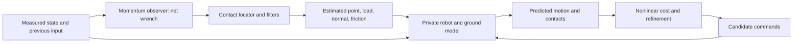
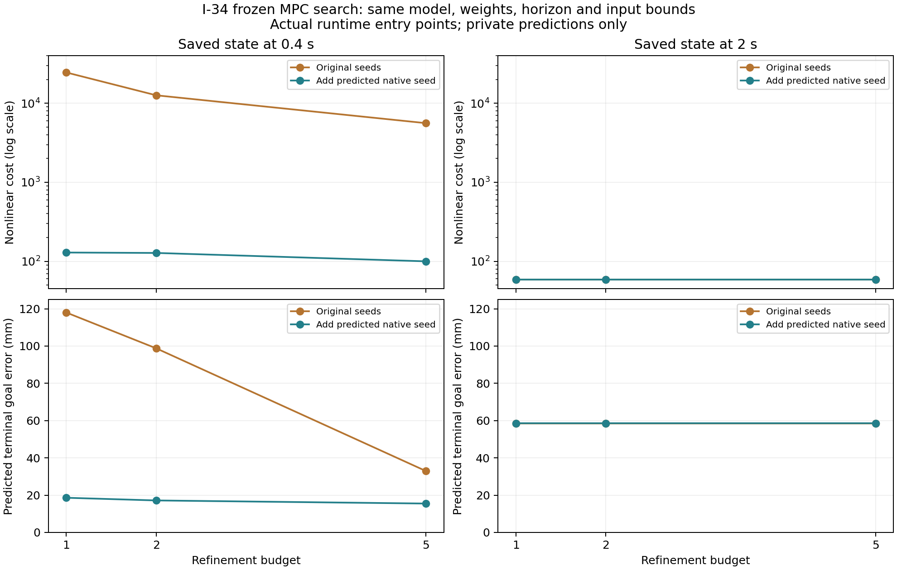
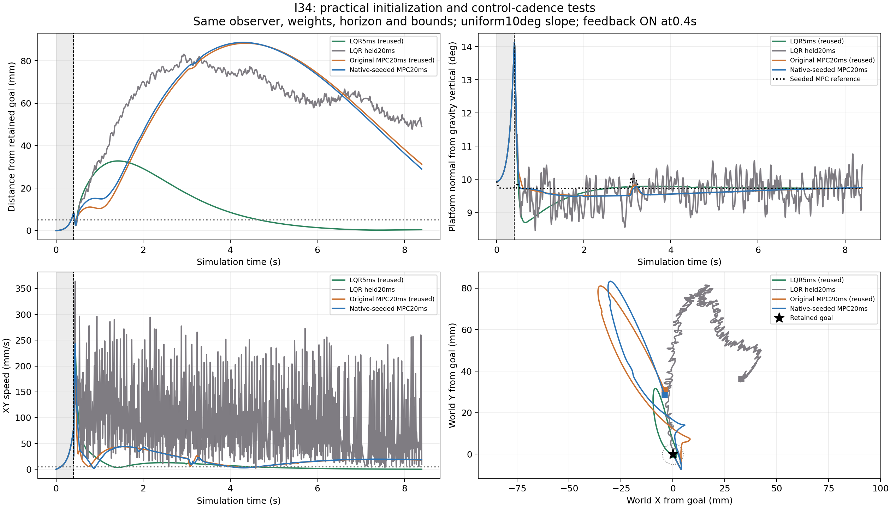

# I-34: MPC initialization, refinement and predicted contacts

**Completed result:** a practical, present-state rollout seed fixes a major
modeled initialization weakness, but does not fix closed-loop settling in this
case. Final error is 28.982 mm versus 31.215 mm for original MPC; both fail the
eight-second return gate. We also identify derivative approximation, timing
and short-horizon cost tradeoffs as separate issues. No estimator or physical
parameter was changed and the experimental seed is not promoted by default.

The user asked to investigate why MPC drifts and whether it uses contact
information from the observer. This iteration keeps model, costs, .4 s horizon,
input bounds and the estimator fixed while testing the search implementation.
The [protocol](evidence/protocol.json) was captured before the calculations and
new Gazebo cases. Earlier I-30/I-31/I-32–I-33 bundles remain unchanged.

## Contact inputs and prediction

**Yes: hardware-mode MPC uses observer-derived contact information.** The
momentum observer estimates a net contact wrench from measured simulation
state and actual prior input. The contact locator infers a point, patch and
loads; the contact estimator supplies filtered normal and friction. MPC receives
the equivalent point, total inferred load, normal and friction and builds an
estimated private plane. It does not read live Gazebo contact solutions.



Future contacts already change during private simulation: geometry and contact
dynamics can predict shell/belt/rim switching, multiple geometric contacts on
the estimated plane, slip, support loss and nonwheel contact. Current observed
patch labels are not imposed as fixed future contacts. Native feedforward is a
shadow command when direct MPC is active; MPC uses contact information through
its dynamics rather than simply adding that native feedforward.

The plane and friction remain fixed over each prediction horizon. This is not
prediction of unseen rocks/steps, arbitrary multiple terrain surfaces or a
probability distribution over contact modes. Those need additional terrain
information/representation and uncertainty treatment. Predicted contacts are
not new measurements from the robot.

### The old bad plan already predicted losing support

The [contact audit](evidence/contact_prediction/summary.json) reproduces saved
nonlinear states exactly. At the first 0.4 s anchor, the old selected plan
predicts shell-A unloading at +298 ms, brief recontact, then fork-arm contact at
+373 ms. Some events fall between sparse Jacobian nodes. At the 2 s anchor,
the selected plan remains supported by shell A throughout the horizon.

These are private forecasts, not actual Gazebo falls after continual
replanning. They do not establish prediction accuracy against a different
subsequent control sequence. Current finite/bounded candidate acceptance can
permit a forecast with nonwheel contact; no new hard contact rejection was
introduced here, so the search experiment retains its original objective.

## Practical initialization using present information

The new optional seed clones current native controller/mirror/observer/
synchronizer history and simulates native feedback in the private model at
5 ms. It averages each four commands into a feasible 20 ms stage. The coarse
sequence is independently replayed and scored; its trajectory is not assumed
equal to the fine feedback rollout. No recorded future commands or future
actual states are used. The real controller and estimator remain unchanged by
seed generation. Explicit original-method calls avoid recursion through the
experiment's command wrapper.

Native-policy candidates remain in the same bank as the original warm/shaft
seeds. One first refinement is evaluated per candidate; additional refinement
budgets continue from the best candidate. Existing defaults remain one
refinement with the new seed disabled. At the initial saved anchor, old/default
new runtime commands, complete input sequence and cost match bit for bit.

## Authoritative frozen-state comparisons

The actual current runtime entry point is evaluated at saved 0.4 s and 2 s
states with refinement budgets one/two/five. Source state is unchanged by every
call. The [matrix](evidence/frozen_search/runtime_entrypoints/report.json) gives:

| At 0.4 s | One refinement | Two | Five |
|---|---:|---:|---:|
| Original candidate bank | 24,525.748 | 12,610.934 | 5,599.801 |
| Add practical predicted-native candidate | 129.089 | 127.556 | 99.880 |

At 2 s all variants remain approximately 58.338715. Initialization makes the
dominant difference at the first anchor; more refinements from a poor starting
bank are not an equivalent substitute. These are modeled costs, not additional
Gazebo performance results or a proof of global nonlinear optimality.

The declared extra two-refinement live trial requires >=10% improvement at both
anchors. It is not triggered: improvement is only about 1.19% initially and
negligible at 2 s. The primary live test changes only the candidate initialization
while retaining one refinement, isolating that contribution. Five-refinement
tests remain offline in this campaign.



Initial exploratory per-seed chains, later global-best continuations and final
actual-runtime entry-point calculations are preserved separately. An initial
over-strict comparison against the old continuously warmed QP cache failed at
2 s: fresh-solver nonlinear cost differs by 4.96e-5, about 8.5e-7 relative.
The saved sequence's own cost/states reproduce exactly; the new fresh solve is
not relabeled bit-identical to the original cache history.

## Derivative approximation is another concrete limitation

The [directional audit](evidence/frozen_search/derivative_audit/report.json)
compares the same finite-difference epsilon with sparse five-node interpolation
and full evaluation at every stage. At the audited initial seeded plan, sparse
linearization predicts a directional cost derivative of about -57.20, versus
-18.26 from the nonlinear rollout. Full-stage derivatives predict -57.57456,
versus -57.57461 measured along their direction. The full model accepts a line
step reducing cost 129.089 to 120.636; the sparse version's tested steps all
worsen cost in that separate audit.

At 2 s the full-stage directional prediction also agrees closely, but the
available cost improvement is tiny. Each model produces its own direction;
these are sampled checks, not validation of every Jacobian or a sole-cause
proof. The limited line search may also miss smaller useful steps. No full-
Jacobian live controller, new weights or new contact estimator is adopted here.

## Closed-loop and cadence tests

Two new Gazebo runs use the same .4 s fixed-input drift and eight-second
feedback observation as I-32. One holds unchanged native commands for 20 ms
while its observer continues at 5 ms. The other uses the practical seed plus
one-refinement MPC, still at 20 ms. The original native 5 ms and original MPC
20 ms runs are explicitly reused, not counted as new executions.

The held-native test ends at 49.026 mm error and 9.213 mm/s and fails the
settling gate. It uses the unchanged 5 ms-designed gains, not a redesigned
50 Hz LQR. Thus cadence matters; it does not establish what a retuned slower
native controller could achieve.

| Case | Command period | Final goal error | Peak goal error after feedback | Final XY speed | Settled gate |
|---|---:|---:|---:|---:|---|
| Native LQR, reused I-32 | 5 ms | 0.381 mm | 32.788 mm | 0.185 mm/s | Pass |
| Unchanged native commands held longer, new | 20 ms | 49.026 mm | 83.109 mm | 9.213 mm/s | Fail |
| Original MPC, reused I-32 | 20 ms | 31.215 mm | 88.278 mm | 17.798 mm/s | Fail |
| Practical-seeded MPC, new | 20 ms | 28.982 mm | 88.643 mm | 18.224 mm/s | Fail |

All four fixed-input histories and feedback-switch state/observer match
exactly. Both new runs complete without physical falls and respect input
bounds. The new seed has no generation failures and MPC has no true native
fallback. Its selected nonlinear modeled cost is below its native-policy
candidate in all 401 plans, including the terminal observation; therefore a
lower local modeled cost does not establish better goal settling.

There are 400 actuated accepted plans and 802 solved QP calls (401/804 including
the terminal observation). All 1,600 actuated feedback samples use a refined
predictive sequence, source code 3. No accepted source-4-only candidate or
actual native fallback is credited as an optimized plan. Median update time
is about 2.02 s per .02 s simulated interval, roughly twice the old prototype's
time; this remains offline.

[Watch original versus seeded MPC](../../../../results/mpc_search_20261125/videos/mpc_original_vs_predicted_native_seed.mp4).
Both panels reconstruct saved Gazebo/DART dynamics at 0.5x. The original case
is explicitly reused. Observer-derived inputs, evaluation-only true/estimated
patch labels, feedback activation and absolute/reference tilt are distinct.
Both end near 9.74° actual tilt versus about 9.73° requested lean, not a
horizontal platform. Rendering adds no physics.



## Why drift remains: saved cost decomposition

A [read-only breakdown](evidence/cost_breakdown/report.json) reconstructs saved
costs exactly without calling a solver or integrating dynamics. At the 2 s
frozen state, the selected plan predicts 58.604 mm terminal goal distance; the
predicted-native candidate predicts less retreat, 51.803 mm, but is more
expensive under the current .4 s objective:

| Cost contribution at 2 s | Selected MPC | Predicted-native candidate |
|---|---:|---:|
| XY position | 52.265 | 49.476 |
| Tilt | 0.829 | 44.486 |
| Angular velocity | 0.284 | 8.124 |
| Linear velocity | 4.880 | 7.151 |
| Input effort | 0.046 | 0.049 |
| Total | 58.339 | 109.299 |

Within this short window, the modest position benefit is outweighed by the
cost of the corrective attitude motion. Neither candidate reaches the goal
within that horizon. This is evidence of a balance/tracking/time-horizon
tradeoff at a sampled state, not proof that a particular weight or longer
horizon will fix closed-loop behavior. Input effort is not the dominant
difference in this comparison.

**Decision:** better initialization alone is rejected as a settling fix.
Retain the improved seed and full-derivative findings as research evidence,
not a promoted controller. The next diagnostic should separate prediction
horizon/terminal return value and attitude-tracking priorities while controlling
derivative fidelity and command cadence. Do not infer missing contact input or
replace the observer based on this case. Accurate future-contact forecasts and
good optimization are different requirements.

## Verification and preservation

The selected integration suite passes **124 tests in 46.34 s** in the Gazebo
Python environment. The 15 seed tests also pass separately in both environments;
these counts overlap and are not additive. Tests cover clone isolation,
determinism, bounded stage means, observer update timing, wrapper recursion,
forbidden live-contact reads and failure isolation. Runtime smoke tests verify
default parity and an independently improved seeded plan without changing the
source controller.

Compact source, report, test and media snapshots are collected under `evidence/`.
Full raw plans, generated models and traces stay in the
[local campaign](../../../../results/mpc_search_20261125/). Failed exploratory
stages are retained with their exact sources. No production controller default
or estimator is replaced, and no particle filter is added.

The [evidence manifest](evidence/manifest.json) identifies source stages and
raw hashes. The [separate presentation bundle](../../../../results/mpc_search_20261125/presentation-pack.zip)
includes notes, compact evidence, the comparison clip and the four new/reused
cases' rollout/precision traces. Large plan JSON and generated mesh payloads
remain local with inventories. Reused baselines are not additional executions.

To repeat the seeded case in a fresh directory using the configured Gazebo
environment:

```bash
env -u PYTHONPATH -u LD_LIBRARY_PATH -u AMENT_PREFIX_PATH -u CMAKE_PREFIX_PATH -u COLCON_PREFIX_PATH \
  MAMBA_ROOT_PREFIX="$PWD/build/mamba" build/tools/bin/micromamba run -p "$PWD/build/gazebo-env" \
  env MUJOCO_GL=egl OPENBLAS_NUM_THREADS=1 OMP_NUM_THREADS=1 \
  python -u scripts/run-feedback-recovery.py --output results/new_mpc_search \
  --variant mpc --terrain slope --drift-s .4 --recovery-s 8 \
  --native-rollout-seed --refinement-steps 1
```

Use `--variant native --native-hold-s .02` without MPC flags for the cadence
control. Existing output directories are protected. These are new experiments;
their executions are not added to the historical counts in this record.
