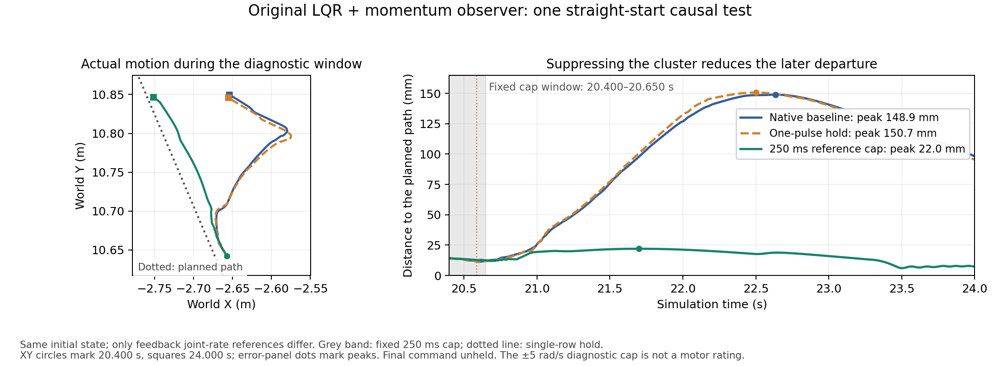
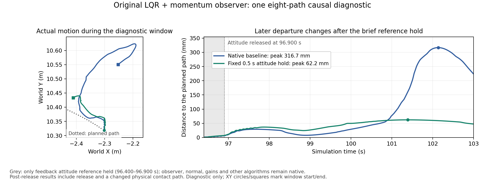

# I-77 — what causes the original baseline to deviate?

Started 2026-11-27; completed diagnostic analysis 2026-11-28. The selected baseline and production
controller code remain unchanged. This investigation returns to native N and
separates the disturbance, the control response, and later recovery.

Two different mechanisms appear. On the straight route, an ill-conditioned
rolling inverse generates a cluster of large speed references; a controlled
physical intervention confirms that this cluster contributes to the departure.
On the figure-eight, actual contact geometry changes rapidly, the observer
reconstructs the wrench accurately, and the normal-derived balance target moves
rapidly. A separate attitude-reference intervention changes its later departure.
Neither intervention is adopted as a controller change.

## Straight route: a causal allocation/reference result

Only shell B carries the measured pressure at the selected 20.585 s event.
The common-shaft and shell-B drives produce ground motions just **0.389°** apart.
Matching the desired sideways component then requires large opposing rates:
**26.06 and −91.90 rad/s**. The column-scaled active least-squares map has condition number
571.82. Its normalization scales are preferences; this baseline does not enforce
hard reference-speed bounds. Those rates enter LQR velocity feedback, producing
requests that are clipped at the final actuator box.

This is not established by a condition number alone. Reconstruction reproduces
all rolling references, inferred loads and contact points exactly in both saved
straight histories. At this event the inferred/instantaneous-pressure family
agrees, and equivalent points differ by 0.140 mm. Substituting the recorded
pressure point still gives condition 383.97 and rates 17.73/−61.68 rad/s.
Current point error magnifies the request but does not remove the weak geometry.

The reference growth begins while cross-track error is **closing**. Seven
rows request angular rates above 20 rad/s during 20.430–20.585 s. The largest
pulse is not the first large reference request. Estimated belt/shell switching follows around 20.605 s, and the
sustained 30 mm departure begins at 21.040 s.

Three fresh Gazebo diagnostics replay the original initialization and stop at
24 s. Only the indicated feedback joint-rate references change; raw allocation,
cache/nominal integration, observer, normal, support torque, gains, preparation,
fade and final bounds retain their original algorithms.

| Diagnostic | Geometric peak, 20.4–24 s | Geometric RMS, same window | Error at 24 s |
| --- | ---: | ---: | ---: |
| Original native N | 148.934 mm | 108.244 mm | 98.211 mm |
| Replace only the largest 5 ms pulse with preceding references | 150.665 mm | 109.095 mm | 95.334 mm |
| Limit feedback joint-rate references to ±5 rad/s during [20.400,20.650) s | **21.979 mm** | **16.858 mm** | **7.415 mm** |



The cluster treatment changes 43 rows, including moderate requests; it is not
only removal of seven spikes. At the pre-release 20.650 s endpoint its error is
slightly worse, 12.507 versus 11.995 mm. The large benefit develops later through
the changed physical/control history. The preceding reference at 20.645 s is
already inside the diagnostic cap, so release does not introduce a fresh direct
cap-switch step. At the original 22.635 s peak, cluster error is 18.773 mm.

This establishes a causal contribution from this feedback-reference window in
this case. Removing one maximum pulse is insufficient. The ±5 choice uses the
old normalization scale for a finite diagnostic; it is not a proposed motor
rating, a tested full-route controller, or an adopted baseline change.

[Protocol](evidence/component_audit/causal_branches_stage01/protocol.json) ·
[full reduction and release ledgers](evidence/component_audit/causal_reduction_stage02/report.json) ·
[independent verification](evidence/kinematics/README.md).

## Figure-eight: actual contact changes, fast balance targets, and residual motion

The late 102.135 s peak is **316.714 mm**. The robot comes within about 10 mm of
the path at 99.175 s, but velocity still differs from reference by **29.7 mm/s**.
It is passing near the path rather than settling. In the later 98.5–100.8 s
window the drive-rate tracking disagreement dominates the velocity error;
body rotation partly cancels it and material rolling inconsistency is small.
This accounting uses actual joint rates and the previously applied belt speed,
not desired rates. It does not exonerate an earlier disturbance.

Tracing farther back finds the last jointly small position/velocity/attitude
interval at 96.035–96.160 s. Yaw rate is still about −0.30 rad/s there; those
thresholds do not certify a completely settled state. Around 96.4 s the desired up direction changes at
84.3°/s while actual up changes only 0.46°/s. Velocity disagreement reaches
82 mm/s at 96.5 s. No command clips during 96.0–99.2 s and the rolling map stays
well conditioned (condition ≤5.97). The later saturation and surface transfer
cannot be assigned as the beginning of this sequence.

A new unchanged-native replay records every physical 1 ms contact sample over
96–97.5 s. All 79 precision fields reproduce the original 19,501-row prefix
exactly, with its explicitly shortened terminal held-command mask. It records
1,500 substeps / 300 completed holds / zero failed holds.

The aligned evidence distinguishes different quantities:

- Exported pressure-weighted solver normals change rapidly.
- Actual signed interval wrenches closely match the momentum observer:
  force RMS error 0.00174 N and moment RMS error 0.000395 N m in this window.
- Passing those physical interval wrenches through the same 100 rad/s filter
  gives an intrinsic direction within **0.02345° maximum / 0.00974° RMS** of the
  native observer. This diagnostic filter is initialized from the native
  filtered wrench at 96 s; it is not an independent initial-condition oracle.
- The controller's subsequently filtered normal can differ from the current
  pressure-normal aggregate by up to 6.08°. Equivalent radial contact direction,
  surface normal and nearest-centre DEM tangent are different observables.
  Current-vs-interval comparisons alone cannot establish observer error.

The rapid target motion is almost entirely normal-driven: desired-up rate peaks
at 152.16°/s, while the acceleration-only contribution stays below 0.0027°/s.
The lean cap is inactive. Baseline body-angular-rate reference nevertheless
remains zero. Thus accurate wrench observation still feeds a demanding,
rapidly changing reference into a local regulator.

[Aligned contact/command figure](evidence/contact_trace/analysis_stage01/aligned_contacts.png) ·
[physical contact report](evidence/contact_trace/analysis_stage01/report.json) ·
[reference-source attribution](evidence/timeline/reference_source_stage02/findings.md) ·
[earlier-event timeline](evidence/timeline/findings_stage01/findings.md).

### Isolated attitude-reference follow-up

The final diagnostic holds only the raw attitude quaternion passed into native
feedback at its 96.395 s value during [96.400,96.900) s. Current-yaw handling and
derived shaft-pitch coupling remain native. All other normal/contact-dependent
terms stay live. Primary endpoint 96.900 s precedes release; 97.500 s is secondary.
A prephysics amendment extends the diagnostic stop to 103 s to include the old
late peak. The initial 97.5 s proposal is preserved.

The branch reproduces all 79 fields before intervention and the first-active
state/observer/reference/gain inputs exactly. Independent verification reproduces
all 20,601 feedback errors and LQR terms; only the specified 100 control rows (0.5 s)
are held. The first applied change has shaft torque −0.274 N m relative to the
same-state native command, with the first physical difference one step later.

| State / fixed window | Native geometric error | Attitude-hold geometric error |
| --- | ---: | ---: |
| 96.900 s, before release acts | 5.924 mm | 6.898 mm |
| 97.500 s | 28.534 mm | 31.072 mm |
| Original peak time, 102.135 s | 316.714 mm | 59.372 mm |
| 103.000 s | 223.483 mm | 47.485 mm |
| Peak over 96.4–103 s | 316.714 mm | **62.191 mm** |
| RMS over 96.4–103 s | 142.194 mm | **44.979 mm** |



The early reference treatment followed by release therefore changes the later
departure. It gives no immediate path improvement. Release adds a 0.491 N m
shaft-command step; holding and release effects were not separately isolated.
This does not prove that zero angular-rate reference, a particular filter, or
all normal-dependent terms are individually responsible.

Three attitude comparisons remain separate. At 96.900 s the treated robot is
0.607° from the fixed held target and 2.942° from the saved original-native
target, versus native 0.420° from its target. However, it is also 0.416° from
its **current branch-local untreated target**: physical/contact histories have
already diverged. At 103 s the treated errors are 7.940° to the original-native
target but only 0.020° to its current branch-local target. The former alone does
not demonstrate a balance failure; the latter alone is not a robustness test.
Do not award success by selecting whichever target gives the smallest error.

[Full endpoint/release report](evidence/component_audit/eight_attitude_reduction_stage01/report.json) ·
[independent quaternion/error verification](evidence/kinematics/attitude_precision_verification_stage02/report.json).
This is a diagnostic with an event-specific hold, not a deployable rule or a
proposal to ignore terrain-induced balance changes. Native remains selected.

## What is active, and what this investigation does not claim

Native N explicitly selects `mode='hardware'`, `rolling_allocation='least_squares'`
and `track_contact_point=False`; heading gain is zero. It uses gain-scheduled
LQR, momentum observation, known-geometry support localization, intrinsic-normal
filtering, rolling/holding feedforward, a 120 ms kinematic incoming-drive preview,
unloaded fade and final clipping. The bounded/feasible allocator, path relaxation,
shaped tilt reference, heading overlay, MPC, particle filter and terrain cameras
are inactive. [Active-component audit](evidence/component_audit/COMPONENT_AUDIT.md).

The timed trajectory is a soft feedback reference, not a hard requirement to
occupy an exact position at each instant. What is inactive is the explicit
reference-relaxing allocator. The diagnosed straight burst comes from the
unbounded rolling inverse, not from that allocator choosing a path deviation.

A large requested command is not automatically the initiating disturbance.
A close point or correct family does not prove every contact quantity is right.
A near-path crossing is not recovery if velocity is still wrong. Algebraic LQR
term cancellation is not itself a gain bug. Lockstep simulation does not show
wall-clock computation delay; completed-interval averaging and filtering have
measurable temporal effects.

These results concern two selected baseline episodes. They do not establish a
general controller fix or complete attribution of every I-76 departure. Keep
native selected; use the demonstrated mechanisms to define the next bounded
reference/feedback experiment rather than replace the observer on speculation.
This single-window result does not reverse the earlier
[I-51 isolation/guard](../../2026-11-26/allocation-handoff-isolation/README.md),
[I-52 multi-start](../../2026-11-26/contact-scheduling-joint-tracking/README.md) or
[I-56 total-command candidate](../../2026-11-26/constrained-handoff/README.md)
regressions. A new solution would need to pass those broader conditions.

## Conditions, validation and reproduction

Gazebo Harmonic / DART, 1 ms physical steps and 5 ms held control; a contact-free
MuJoCo mirror supplies model/kinematic calculations only. Body/joint q and qvel
are exact simulation state; solver information is evaluation-only in native N.
Limits remain [1.5,0.6,0.6 N m,0.3,0.3 m/s]. No production control/physics source
changes are made.

The original straight −1.0 rad case starts at yaw 113°, origin [−2.4,10.0] m;
its nominal reference lasts 45 s, these probes 24 s. Eight −1.0 rad starts at yaw
158°, origin [−2.5953655642,10.4602524267] m; its nominal reference lasts 133 s.
The eight site is explicitly rough stress, outside I-76's moderate terrain
screen. Do not pool route metrics or call truncated diagnostics full-route passes.

Source revision at investigation start:
`3155d7af9dcfa6801a09e837f6566f1f15aa31b0`. I-76 protocol SHA256:
`53106cdb758d76436e04b747c9483c4081abcc7ec1f2a163ace90b58b82085c2`.
The same gain cache has SHA256
`45ab9990aa3961d1202533acf51d5d8a9294eefe5a4c7e6cfde6aa0b3ac462c1`.

Validation includes exact rolling reconstruction across 44,603 saved states
in three distinct recordings, independent all-field replay/intervention-prefix
checks, and three scoped hook contracts. Repeated contract stages are not added
and the full repository suite is not rerun. Preserve the interpreter-path setup
failure, velocity-report Path/string bookkeeping failure, reference-attribution
anchor failure, the independent verifier’s ≤5.56e−16 floating-operation mismatch,
and all source corrections. All five targeted physics runs finish with observed
exit code zero; that is diagnostic completion, not controller acceptance. See [iteration log](../../../../ITERATION_LOG.md).

Compact evidence is under `evidence/`; full arrays are ignored local results.
`source_and_metadata.tar.gz` retains frozen source and complete metadata/reports.
`raw_bundle_receipt.json` identifies the verified local lossless bundle and its
hash; generated workspace assets excluded from that bundle are documented.
Original I-76 inputs remain a separate prerequisite, identified in its
[restoration record](../tangent-heading-routes/README.md).

To reproduce the unchanged-native contact diagnostic in a fresh output directory, use
the Gazebo environment in [GAZEBO.md](../../../../GAZEBO.md):

```bash
env -u PYTHONPATH -u LD_LIBRARY_PATH -u LD_PRELOAD OPENBLAS_NUM_THREADS=1 OMP_NUM_THREADS=1 \
  build/tools/bin/micromamba run -p build/gazebo-env python \
  results/baseline_deviation_cause_20261127/contact_trace/run_trace.py \
  --run --output results/i77_reproduction/native97p5
.venv/bin/python results/baseline_deviation_cause_20261127/contact_trace/analyze_trace.py \
  --run results/i77_reproduction/native97p5 --output results/i77_reproduction/contact_analysis
```

Restore result-owned scripts at their archive paths before use; they deliberately
refuse to overwrite earlier evidence. The registered straight protocol lists
its three arms and exact intervention windows. [Evidence manifest](evidence/manifest.json)
and [archive verification](evidence/archive_verification.json) bind the publication.
