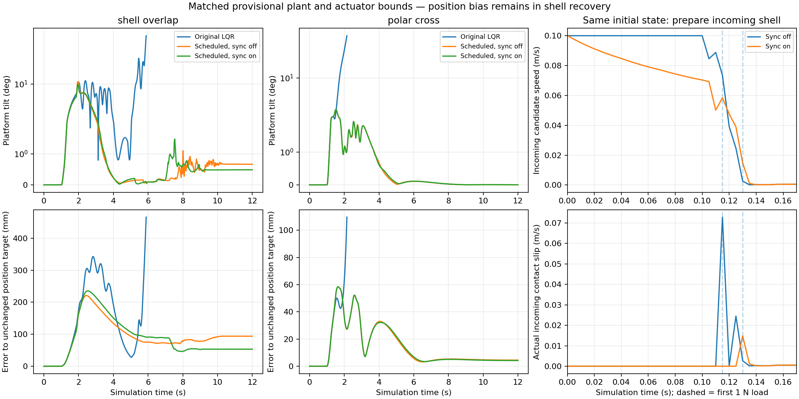

# Recovery and incoming-contact synchronization

These comparisons use the same MuJoCo model, masses, inertias, friction, actuator bounds, initial conditions and scheduled pushes. The position target stays at the original world origin. No extra generalized forces, upright constraints or world forces are introduced; the only world forces are the finite pushes recorded in the logs.

| Repeated disturbance | Original controller | Scheduled feedback, sync off | Scheduled feedback, sync on |
| --- | --- | --- | --- |
| Shell orientation: eight +Y 0.5 N pushes, 0.3 s duration, 0.15 s spacing | Falls at 5.89 s | Completes 12 s; final tilt 0.663°; position error 93.85 mm | Completes 12 s; final tilt 0.485°; position error 53.18 mm |
| Polar orientation: eight 1 N pushes cycling +X,+Y,−X,−Y, 0.2 s duration, 0.25 s spacing | Falls at 2.15 s | Completes 12 s; final tilt 0.000934°; position error 4.48 mm | Completes 12 s; final tilt 0.001028°; position error 4.17 mm |

Pushes begin at 1 s. The overlapping shell pushes sum to at most 1 N and supply 1.2 N s of lateral impulse. The polar sequence supplies zero net impulse when all eight pulses finish; the original controller falls before completing that sequence. Both scheduled versions end with low planar and angular velocities. The shell case has a measured position bias: its reference was not moved to conceal that error.

The controlled cap-exit experiment isolates preparation of an unloaded incoming shell. Both versions begin with carrier phase 1.74 rad, planar velocity [0.096, 0.100] m/s, shaft velocity 0.8 rad/s, and the outgoing belt moving at −0.100 m/s. They receive the same constant planar-velocity reference and no external push. Only synchronization is toggled.

| Incoming shell measurement | Sync off | Sync on |
| --- | --- | --- |
| Candidate material-point speed 20 ms before first 1 N load | 0.1000 m/s | 0.05018 m/s |
| Candidate material-point speed 5 ms before first 1 N load | 0.08880 m/s | 0.03899 m/s |
| Actual tangential slip at first 1 N load | 0.07285 m/s | 0.01478 m/s |
| Maximum synchronization blend before that load | 0 | 0.35 |

This demonstrates preparation before load transfer in this particular case. The two runs reach 1 N incoming load at different times (0.115 s and 0.130 s), because the preparatory motor torque has a real reaction on the carrier. These measurements use each run's first load event. Candidate speed is evaluated at the incoming patch's prospective support point; it does not imply contact while that patch is unloaded. Actual contact slip uses the contact point Jacobian and the belt surface velocity in world coordinates.



The six recovery logs and two controlled-probe logs are the eight NPZ files here. They share the portable `model/model.xml`. `summary.json` records outcomes, actual transfer loads/slip, commands, physical bounds, source hashes and gain-library provenance. Each recovery NPZ records post-step states and interval inputs; contact measurements align with `time_s[1:]`. The probe's named `incoming_observations` array records measurements before each interval. `configuration.yaml` preserves all physical assumptions.

The historical runtime is preserved in `baseline/lab_runtime.py.txt` from commit `bb05156` (full commit in `baseline/commit.txt`), SHA-256 `4ddd480e63aa3f7ef866640bef034f7c019c6821b5321d55e9e84313d51be89c`. Its shared physical dependencies are checked against `baseline/plant_sha256.json` before reproduction. The historical source therefore remains available after the default controller changes.

From the repository root:

```bash
OPENBLAS_NUM_THREADS=1 OMP_NUM_THREADS=1 .venv/bin/python results/recovery_control/reproduce.py
OPENBLAS_NUM_THREADS=1 OMP_NUM_THREADS=1 PYTEST_DISABLE_PLUGIN_AUTOLOAD=1 \
  .venv/bin/python -m pytest -q tests/test_recovery.py
```

To regenerate only the plot, append `--plot-only` to the first command. Use `--output PATH` to save a new comparison elsewhere.

These are sampled design-study results with provisional physical parameters and ideal belt speed servos. They do not establish global stability or real motor capability. The paired exploratory measurements in `additional_probe_summaries.json` show that synchronization did not improve every faster initial-velocity probe; scheduling, heading handling and transition geometry also affect recovery. The controller remains local LQR feedback with a broader scheduling and preparation layer.

## Full repeated-push suite

The [81-case aggregate](stress_comparison.json) reports 20 original falls versus 2 revised falls, with no new survival regressions. Strict end settlement is 46/81 original versus 45/81 revised; survival, settling and position accuracy are separate measurements. Both remaining falls occur with 4 N combined same-direction force. The configuration and force patterns are fully recorded in the aggregate.

To regenerate all raw cases and the aggregate, run from the project directory:

```bash
OPENBLAS_NUM_THREADS=1 OMP_NUM_THREADS=1 .venv/bin/python results/recovery_control/stress_benchmark.py --controller-mode local_lqr --output /tmp/asw-original
OPENBLAS_NUM_THREADS=1 OMP_NUM_THREADS=1 .venv/bin/python results/recovery_control/stress_benchmark.py --controller-mode transition_aware --output /tmp/asw-revised
.venv/bin/python results/recovery_control/summarize_stress.py --original /tmp/asw-original --revised /tmp/asw-revised --output /tmp/asw-stress-comparison.json
```

The original aggregate used the frozen baseline package. The reproduction script's `local_lqr` branch preserves its command path; physical dependencies are unchanged. Full raw outputs are kept outside this repository to avoid duplicating 81 models and logs. The selected eight portable logs above are included here.

The [half-step check](numerical_step_check.json) repeats two difficult cases with a 0.5 ms physics step and freshly designed local gains. Both stay upright; the shell trial's final position bias changes appreciably, from about 53 mm to 105 mm. This check supports balance survival in those two runs, not accurate position convergence. Regenerate it with `numerical_step_check.py`.
