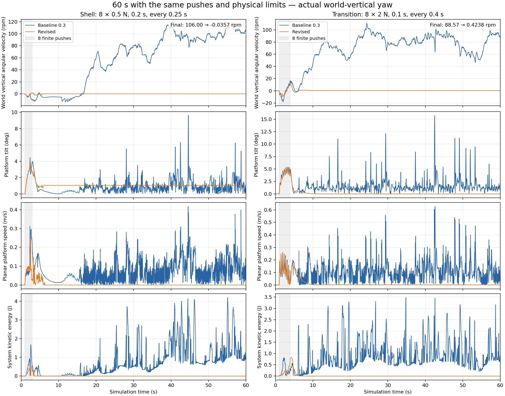

# Delayed yaw-spin correction, version 0.3.1

The default transition-aware controller now excludes the two shell material-angle
position errors. It retains carrier shaft phase, all measured velocities, local
gain scheduling, incoming-drive synchronization and the existing actuator bounds.
The platform stays a free body; no heading constraint, external braking torque,
state reset or physical-parameter change was introduced.

[Mechanical explanation](../../YAW_BEHAVIOR.md) ·
[81-case comparison](stress/README.md) ·
[60 s matched traces and provenance](longtail/summary.json) ·
[browser checks](browser/summary.json)

## What changed in the delayed-spin cases

The baseline is commit `3bfd7998ed72146521894f445c2907129ed9802c` (version 0.3.0).
Both source snapshots, the physical configuration, portable models and actual
state/input/force traces are preserved under `longtail/`.

| Exact sequence, eight pushes starting at 1 s | Baseline yaw at 60 s | Revised yaw at 60 s |
| --- | ---: | ---: |
| Shell: 0.5 N +Y, 0.20 s pulses every 0.25 s | 106.00 rpm | −0.0357 rpm |
| Transition: 2 N +Y, 0.10 s pulses every 0.40 s | 88.57 rpm | 0.4238 rpm |

The baseline keeps adding motor power after the external pulses end. In the mild
shell case its final kinetic energy is 0.942 J and tail mean joint motor power
is 2.481 W. The revision ends at about 1.05e−7 J and 1.89e−5 W, respectively.
The synchronizer is dissipating power on average in the baseline tail; it is not
the sole source of the spin. Removing shell position feedback eliminates the
observed feedback pump while preserving real motor reaction torques.



Seven matched 60 s pairs give three strictly settled baseline outcomes and five
revised outcomes. Settlement uses tilt below 0.5°, planar speed below 0.03 m/s,
and total base angular speed below 0.08 rad/s. This criterion does not require
zero position error or restoration of the initial heading.

The mild shell case still has 1.061° tilt and 105.54 mm position bias, so it does
not meet that strict criterion. The polar cross-push case retains about
−0.326 rpm, compared with −0.222 rpm previously. The 4 N combined polar overlap
train falls at 2.060 s with both controllers. The additional [strongest shell and transition overlap tails](longtail/strong_tail/summary.json) show a remaining limitation: both revised runs retain roughly 10 rpm at 60 s. Their rates and kinetic energy are steady over the final ten seconds, unlike the accelerating feedback pump above. The baseline shell run also retains about 10 rpm; the baseline transition run falls. Thus this correction does not remove all steady spinning after large pushes.

## Broad comparison and explicit regressions

The 81-case suite uses identical physical models, initial states, requested
trajectories and applied-force histories until either member of a pair falls.
Both controllers survive 79/81 cases. Among the 78 common survivors, median
final absolute vertical spin decreases from 0.03769 to 0.01089 rad/s; the 90th
percentile decreases from 0.59523 to 0.16253 rad/s. Demonstrated yaw settling
within 10 s increases from 50 to 63 cases.

The equal survival count includes one new failure: polar 2 N same-Y pulses of
0.20 s every 0.25 s fall at 2.980 s with the revision. Conversely, the 4 N
combined transition overlap train now survives its 10 s run; it still reaches
33.72° peak tilt. These paired outcomes and remaining yaw/position errors are
retained in [the full comparison](stress/comparison.json).

One formerly quiet shell overlap case also settles more slowly. With preparation
on, its yaw is −0.233 rad/s at 12 s and remains about −0.220 rad/s at 40 s,
then falls below the strict threshold by about 49 s. The final second at 60 s
meets the unchanged strict tilt and speed thresholds. The regression test now
checks that longer sustained tail; it no longer claims the previous 12 s
settling deadline. [Transient measurements](transient_checks.json) retain both
sync-on and sync-off results, including their XY errors.

## Incoming-drive preparation after the correction

The earlier 0.3.0 handoff improvements remain historical evidence, not current
quantitative guarantees. The [repeated controlled cap-exit check](transfer_check.json)
still activates the incoming shell while its normal load is zero and reduces
its candidate point speed before contact. At the default 1 ms physics step,
speed 5 ms before first 1 N load changes from 0.08879 to 0.07013 m/s; actual
slip at that event changes from 0.07282 to 0.06791 m/s. With a 0.5 ms physics
step and redesigned gains, the corresponding values are 0.08702 to 0.05698 m/s
and 0.08183 to 0.05268 m/s. The direction of improvement persists in these two
checks; its magnitude and contact timing depend on stepping.

Preparation targets contact-point speed. It does not ensure smaller endpoint
position error in every closed-loop run. For example, the polar cross-push case
has 5.390 mm error with preparation and 5.120 mm without it at 12 s.

## Verification and reproduction

The regressions check shell material-angle invariance, the actual complete-step
feedback Jacobian at seven representative support poses, world vertical spin
measurement and heading unwrapping, physical reaction torque and rim force
couples, bounded actuator inputs, free-base topology and applied-force logging.
The sampled Jacobians have no resolved growing local mode; this is not a proof
for all scheduled gains or a nonlinear region of attraction.

Browser checks cover real state/CSV fields, controller switches, overlapping
pushes, and desktop/mobile layout. Synthetic API responses used solely to check
the spin display and recovering status are labeled separately from physics
evidence. Screenshots are under `browser/`.

Run from the repository root:

```bash
OPENBLAS_NUM_THREADS=1 OMP_NUM_THREADS=1 PYTEST_DISABLE_PLUGIN_AUTOLOAD=1 \
  .venv/bin/python -m pytest -q
.venv/bin/python results/yaw_control/mechanics/reproduce.py
.venv/bin/python results/yaw_control/longtail/reproduce.py --workers 3
.venv/bin/python results/yaw_control/transfer_check.py
.venv/bin/python results/yaw_control/transient_probe.py
```

The [verification record](verification.json) covers all 56 tests in two passing batches (51 general tests and 5 longer recovery tests). The stress subdirectory documents its paired baseline/candidate invocation.
All comparisons concern the current provisional flat-floor model with assumed
mass/friction and ideal belt speed servos. They do not establish hardware yaw
authority, absolute-heading control or recovery from arbitrary disturbances.
